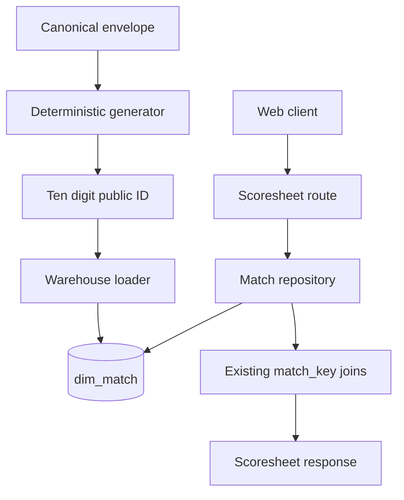

# Deterministic public match identity

## In short

The application needs a short, stable identifier for match URLs. The identifier must be safe to expose publicly, but it
must not replace the UUIDs used for identity or the numeric key used internally by the warehouse.

This plan adds a persisted `publicMatchId`:

- It is exactly ten decimal digits: `1_000_000_000` through `9_999_999_999`.
- It is calculated from the stable `canonicalMatchId`.
- The calculation is deterministic, so the same match always gets the same value.
- It is stored in the warehouse and protected by a unique constraint.
- The API uses it in URLs and translates it to the internal `matchKey` for database joins.

## The four identifiers

These identifiers have different jobs and must not be combined:

| Identifier         | Purpose                                                                            | Public? |
|--------------------|------------------------------------------------------------------------------------|---------|
| `sourceRecordId`   | Stable UUID for one record from one provider.                                      | No      |
| `canonicalMatchId` | Stable UUID for the reconciled match. Merged provider records share this identity. | No      |
| `publicMatchId`    | Ten-digit identifier used by API URLs and match responses.                         | Yes     |
| `matchKey`         | Numeric warehouse key used for joins between fact tables.                          | No      |

The existing `sourceRecordId`, `canonicalMatchId`, source lineage, and warehouse foreign keys stay unchanged. This is an
additional public identity, not a replacement for an existing one.

## Rules the implementation must satisfy

1. A canonical match always produces the same public ID, regardless of machine, directory, import order, or database
   insertion order.
2. Importing the same canonical envelope again reuses the existing public ID and does not create a second match.
3. The database rejects a public-ID collision. It must not probe for another value or silently choose a different match.
4. The scoresheet URL accepts a ten-digit `publicMatchId`, then resolves the private `matchKey` before using the
   existing fact-table joins.
5. Match list, search, and scoresheet contracts expose `publicMatchId`; they do not expose `matchKey` as the URL
   identifier.
6. Legacy rows without a canonical identity remain without a public ID. They must be replayed from canonical envelopes
   before they can be reached through the public route.

## Scope

### Included

- A validated `PublicMatchId` type and deterministic generator.
- Warehouse persistence, idempotency, legacy backfill, and collision handling.
- PostgreSQL, MariaDB/MySQL, and SQLite migrations.
- Generated jOOQ model updates.
- API contracts, routes, repository queries, and web-client links.
- Tests, an ADR, and updates to the project documentation.

### Not included

- Collision probing or automatic allocation of a replacement ID.
- Changes to `sourceRecordId` or `canonicalMatchId` semantics.
- Changes to warehouse foreign-key types.
- Cross-provider reconciliation.

# Technical design

## Where the change belongs

The existing identity and persistence code already gives us the right extension points:

- `bbb-cli-shared/.../identity/MatchIdentity.kt` owns `ProviderId`, `SourceRecordId`, `CanonicalMatchId`, the fixed
  namespaces, and the UUIDv5 implementation.
- `bbb-update-database` owns canonical-match persistence and idempotent loading through `Entities.kt`, `Database`, and
  the output adapters.
- `bbb-shared/.../types/values/MatchKey.kt` owns validation for the private positive `Long` warehouse key.
- `bbb-shared/.../contracts/ApiContracts.kt`, `ScoresheetParser.kt`, `MatchesRoute.kt`, `MatchRepository.kt`, and
  `JooqMatchRepository.kt` currently use `matchKey` at the API boundary.
- `bbb-web/ClientApp/src/app/feature/matches` uses the current key in links and scoresheet requests.

The new public ID should be added beside these existing concepts, not used as a replacement for them.

## Decisions

### Derive from the canonical match

Use `canonicalMatchId` as the input. Do not use a provider key, source digest, filename, or warehouse key. If two
provider records are later merged, they will therefore keep one public URL.

### Reject collisions

The ten-digit space is finite, so a mathematical guarantee of no collisions is impossible. When two canonical matches
produce the same value, the database must reject the second write with an actionable error.

Do not probe for a free value and do not allocate IDs sequentially. Both approaches would make the result depend on
database state or import order, which would break reproducibility.

### Use a dedicated value type

Create `PublicMatchId` as an immutable `@JvmInline` value class in `bbb-shared`. It validates the ten-digit range at the
boundary using Arrow. Keep the generator in the deterministic identity module, and add the smallest required
`bbb-cli-shared` dependency rather than defining duplicate types in the API.

### Make the URL change explicit

Replace `/api/matches/{matchKey}/scoresheet` with `/api/matches/{publicMatchId}/scoresheet`. Do not keep a second public
route: the compact ID is the new canonical URL contract.

## How the number is generated

Use a fixed UUIDv5 namespace that is recorded in code and in ADR 0004. The canonical UUID string is the UUIDv5 name. The
resulting UUID is then converted into the ten-digit range:

```kotlin
fun publicMatchId(canonicalMatchId: CanonicalMatchId): PublicMatchId {
    val publicUuid = uuidV5(PUBLIC_MATCH_NAMESPACE, canonicalMatchId.value.toString())
    val unsignedValue = firstEightBytesAsUnsignedLong(publicUuid)
    return PublicMatchId.from(MIN_PUBLIC_ID + (unsignedValue % PUBLIC_ID_RANGE).toInt())
}
```

These details are part of the persisted contract and must not change:

- the public namespace UUID;
- UTF-8 name encoding;
- byte extraction order;
- unsigned arithmetic;
- ten-digit range constants; and
- the golden test vectors.

The intermediate public UUID is internal. It is never placed in a URL or returned by the API.

## Runtime flow



## Warehouse work

1. Add immutable migration `4__public_match_id.sql` to the MySQL/MariaDB, PostgreSQL, and SQLite migration directories.
2. Add nullable `public_match_id` to `dim_match`. Nullable is required so existing schemas can be upgraded safely. Add a
   unique index or constraint using the dialect’s appropriate integer type.
3. Require new canonical loads to write a non-null ten-digit ID.
4. Extend `MatchRecord`, `WarehouseMatch` or its identity representation, `Database`, `OutputAdapter`, and the JDBC,
   SQL-script, and CSV adapters to calculate, store, read, and verify the public ID beside `canonical_match_id`.
5. When a replay finds a legacy row with a canonical identity but no public ID, calculate and backfill the deterministic
   value.
6. Leave rows without a canonical identity as `NULL`. Replay the canonical envelope to make them addressable; never
   infer an identity from `file_name`.
7. Update committed jOOQ `DimMatch` and `DimMatchRecord` models, plus forced-type configuration, so API queries can
   select `public_match_id` while internal joins continue using `id` and `match_key`.

## API and web work

1. Add `PublicMatchId`, its validation error, and its factories beside `MatchKey` in `bbb-shared`.
2. Use Arrow `Either` in `ScoresheetParser.kt` to validate the route value and return `400 Bad Request` for values
   outside the ten-digit contract.
3. Replace `matchKey` with `publicMatchId` in `MatchSummary`, `MatchSearchResult`, and `MatchScoresheetContext`,
   including feature models and mappers.
4. Change `MatchRepository.scoresheet` and `MatchService.scoresheet` to accept `PublicMatchId`.
5. In `JooqMatchRepository`, look up `dim_match.public_match_id`, obtain the private `matchKey`, and then reuse the
   existing innings and delivery joins.
6. Update `MatchesRoute.kt`, API serialization tests, and the Angular match feature so generated links use
   `/api/matches/{publicMatchId}/scoresheet`. Preserve the existing external-template convention.

## Risks and safeguards

| Risk                                          | Safeguard                                                                                          |
|-----------------------------------------------|----------------------------------------------------------------------------------------------------|
| Two matches produce the same ten-digit value. | Unique database constraint, explicit collision error, golden vectors, and a forced-collision test. |
| Legacy rows are given an invented identity.   | Nullable migration; only canonical-envelope replay may backfill an ID.                             |
| One layer still exposes `matchKey`.           | Update Kotlin contracts, jOOQ accessors, Angular models, routes, and tests as one vertical slice.  |
| The public namespace changes accidentally.    | Make it immutable, document it in ADR 0004, and never reuse it for another identifier.             |

# Validation plan

## Test the value and generator first

- In `bbb-shared`, test valid ten-digit values, both bounds, malformed input, and serialization for `PublicMatchId`.
- In `bbb-cli-shared`, add golden vectors for repeatability, the exact decimal range, independence from the source
  directory, and distinct canonical inputs.
- Include unsigned-conversion cases around high-bit values so the result cannot depend on signed JVM arithmetic.

## Test warehouse loading

- Test the first insert and a repeated canonical import.
- Test backfilling a legacy row that already has `canonical_match_id`.
- Test that a row without canonical identity remains without a public ID.
- Test duplicate public-ID rejection and verify that no alternative value is probed.
- Cover JDBC, SQL-script, and CSV generated statements.
- Extend `SqliteMatchIdentityMigrationTest` and add representative PostgreSQL/MariaDB migration coverage for nullable
  legacy rows, uniqueness, and foreign-key integrity. Use Testcontainers where configured.

## Test the API and web client

- A valid public ID returns the expected scoresheet.
- A malformed ID returns `400`.
- An unknown ID returns `404`.
- A legacy row without a public ID is not addressable.
- Internal delivery joins still use `match_key` after the public ID has been resolved.
- Angular models map the response correctly, links use the public ID, and no link uses the internal `matchKey`.

## Run the checks

Run focused module checks first, then:

```text
./gradlew clean check --no-daemon
```

Also run the configured Detekt/Ktlint, Kover, Pitest, and cyclomatic-complexity checks. Report unavailable tools and
pre-existing failures separately; do not suppress them.

# Decision record and documentation

## ADR 0004: Deterministic public match identifiers

Create an ADR that explains:

- the difference between source UUID, canonical UUID, public URL ID, and warehouse `matchKey`;
- the fixed public UUIDv5 namespace, canonical UUID string as the name, byte-to-range mapping, and ten-digit bounds;
- why deterministic hash-and-reject is used instead of collision probing or sequential allocation;
- why the URL is based on the canonical match and why replacing the `matchKey` route is intentional; and
- the legacy migration rule: backfill rows with canonical identity, replay rows without it, and never infer identity
  from filenames.

Update `docs/architecture/applications.md`, `README-DEV.md`, `README.md`, and `docs/project_memory.md` with the
generation rules, new route, collision behavior, and any remaining full-check MariaDB limitation.

# Delivery status

The implementation has been completed in the following sequence.

## ✓ Step 1: Define the public ID type and algorithm

`bbb-shared` and `bbb-cli-shared` provide one validated ten-digit type and one reproducible canonical-ID-to-public-ID
function.

- Added `PublicMatchId` with Arrow parsing, serialization, bounds, and structured validation errors.
- Added an immutable public namespace and deterministic UUIDv5-derived decimal mapping in `MatchIdentity.kt`.
- Added golden vectors, high-bit/unsigned tests, range tests, and the collision policy before persistence work.
- Added the minimal module dependency without duplicating the type in the API or updater.

## ✓ Step 2: Persist public IDs during warehouse loading

Canonical imports store and reuse the deterministic public ID while preserving internal warehouse joins and safe legacy
behavior.

- Added migration 4 for MySQL/MariaDB, PostgreSQL, and SQLite with nullable legacy-safe columns and unique constraints.
- Extended `Database`, `Entities.kt`, `OutputAdapter`, `MatchRecord`, and JDBC/SQL-script/CSV adapters to insert,
  backfill, and verify `public_match_id`.
- Made repeated canonical imports idempotent and made collisions fail clearly instead of probing.
- Added migration and adapter coverage for populated schemas, replay backfill, null legacy identity, uniqueness, and
  foreign keys.

## ✓ Step 3: Replace API match URLs

The API resolves scoresheets from ten-digit public IDs and no longer exposes `matchKey` as the URL contract.

- Updated `ApiContracts.kt`, `ScoresheetParser.kt`, match models, `MatchRepository`, `MatchService`, and
  `MatchesRoute.kt`.
- Updated `JooqMatchRepository.kt` and generated `DimMatch`/`DimMatchRecord` accessors to select public IDs and resolve
  private join keys.
- Updated recent, search, and scoresheet mappers and API tests for success, invalid input, not-found, and
  missing-legacy-ID cases.
- Updated `bbb-web/ClientApp/src/app/feature/matches` models, links, and presenters to use the new route.

## ✓ Step 4: Document and validate the URL contract

The repository documents the stable public-ID boundary and reports validation status accurately.

- Created ADR 0004 and updated the architecture guide, developer README, main README, and project memory.
- Added human checks for repeat imports, moved source files, stable URLs, correction digests, and forced collisions.
- Ran module checks and the full `clean check`, retaining any known live MariaDB integration limitations in the report.
- Ran configured static analysis, coverage, mutation, and complexity checks, recording unavailable or pre-existing
  limitations.

## ✓ Step 5: Widen the identifier to ten digits

The deterministic public-ID contract was widened consistently so current collisions are resolved without changing
canonical identity or warehouse joins.

- Updated the `PublicMatchId` range, boundary messages, serialization tests, and golden vectors.
- Updated API, updater, generated jOOQ, web-client, migration, and documentation references.
- Added regression coverage for ten-digit validation, deterministic reuse, and unique-constraint collision behavior.
- Ran focused checks and the full validation commands, reporting the known MariaDB limitation separately.

# Structural review follow-up

These follow-up improvements keep the implementation smaller and its ownership clearer.

## ✓ Step 1: Unify warehouse write policy

Extract shared pure row values and collision/idempotency policy so JDBC, SQL, and CSV adapters focus on sink encoding
and IO.

## ✓ Step 2: Align generated jOOQ with the identity-era schema

Represent `match_key`, `canonical_match_id`, and source references accurately in committed generated models and queries.

## ✓ Step 3: Split match reads and remove the empty service hop

Extract focused match read/query responsibilities and route the repository directly where no service policy exists.

## ✓ Step 4: Consolidate identity ownership

Keep identity types and deterministic generation beside the shared public ID while leaving envelope DTOs in
`bbb-cli-shared`.

## ✓ Step 5: Normalize optional contracts and make bowling inference explicit

Use nullable display fields consistently, name the opposing-team rule, and colocate the Angular match-search codec.

## ✓ Step 6: Verify and update project memory

Run focused and broader checks for changed modules, clean touched imports, and record the outcomes in project memory.