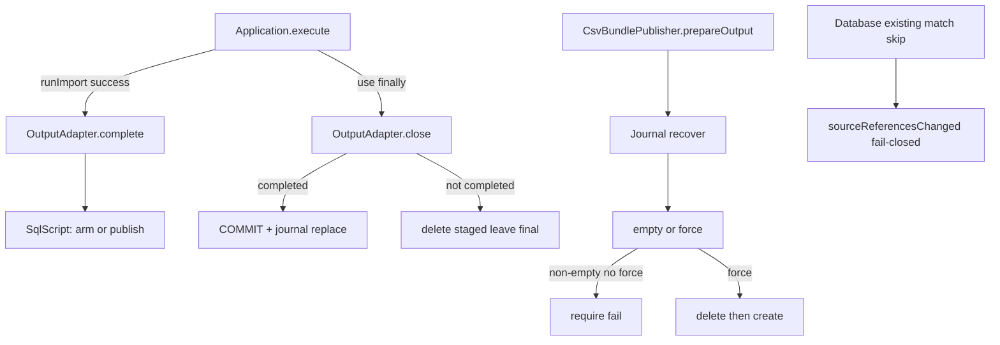

# Requirements

### Overview & Goals

Resolve every **open P1 and P2** in `docs/FIXME.md` for `bbb-update-database`, in the locked remediation order, with regression locks so happy-path tests can no longer mask partial SQL publish or CSV recovery corruption.

**Out of scope:** residual P3 items, locked-closed historical P1s, full CSV identity hydration / fake resume, single canonical schema generator (parity gate only).

### Scope

**In scope**

1. **P1-1** — SQL script adapter publishes only after explicit success (`complete()`); failure abandons staged output and leaves the previous final file untouched.
2. **P1-2** — CSV journal recovery always applies the same empty-or-`--force` gate (no `if (recovered)` bypass).
3. **P2-1** — Provenance change detection fail-closed when an existing match has no source-reference rows.
4. **P2-2** — Semantic parity gate between Flyway migrations and `RelationalSchemaSql` (alias non-drop policy + uniqueness + final contracts); fix migration drift that the gate catches.
5. **P2-3** — SQL script emits rejected unless a match transaction is active.
6. Update `docs/FIXME.md` (and brief project memory) so open items match reality after the fixes.

**Out of scope**

- P3 tidy-ups (`Database.writeMatch` size, CLI factory verbosity, `getNameParts`, hardcoded Postgres schema name, concurrent JDBC id allocation, `SessionBackedOutputAdapter` facade).
- Implementing CSV resume-by-hydration.
- Generating Flyway from one schema model.

### User Stories

- As an operator running SQL_FILE rebuilds, I want a failed import to leave the previous script file alone so I never apply a half-built rebuild that ends in `COMMIT`.
- As an operator recovering a crashed CSV publish, I want open to refuse a non-empty recovered dir without `--force` so the next write cannot append/collide with a cold identity brain.
- As an importer of corrections, I want missing provenance on an existing match to force a rebuild rather than a silent skip.
- As a maintainer, I want schema parity tests to fail when migrations and generated bootstrap diverge on alias survival or uniqueness intent.

### Functional Requirements

1. `OutputAdapter.complete()` is a default no-op; SQL script adapters mark durable publish eligibility; `close()` abandons staged work unless `complete()` ran.
2. `Application` calls `complete()` only after `runImport` succeeds for every output target (harmless no-op for JDBC/CSV).
3. Failed import / exception inside `use {}`: staged `.tmp` deleted; final output path unchanged or absent; process still non-zero.
4. CSV `prepareOutput`: recover journals first, then always empty-or-`--force` (wipe only with force).
5. `sourceReferencesChanged`: empty/missing existing refs ⇒ changed (`true`).
6. Migrations do not `DROP team_name_aliases`; alias create path is re-apply safe (`IF NOT EXISTS` where dialect allows); uniqueness contract matches generated intent; tests lock this.
7. SQL script `emitRow` / write path requires active match transaction.

### Non-Functional Requirements

- Kotlin-first, small functions, tests with JUnit + Strikt; TDD where practical.
- `./gradlew :bbb-update-database:check` (or project `check`) green after each stage.
- No suppressions; do not reopen locked-closed P1s.

# Technical Design

### Current Implementation

| Area | Files | Today |
|---|---|---|
| SQL script lifecycle | `adapter/SqlScriptOutputAdapter.kt` (`ScriptContext.close`) | Always appends `COMMIT;`, journal-publishes staged → final on every `close()` |
| App wiring | `parse/Application.kt` | `createScriptOutputAdapter(...).use { runImport(...) }` — failure still runs `close()` |
| CSV open | `adapter/csv/CsvBundlePublisher.kt` `prepareOutput` | `recovered` skips empty/`--force` guard |
| Provenance | `JdbcIdentityStore.sourceReferencesChanged`, `IdentityCore.sourceReferencesChanged` | Empty/missing refs ⇒ not changed |
| Schema | `migrations/*`, `RelationalSchemaSql.kt` | Migrations `DROP team_name_aliases`; generated filters aliases out of DROP + `CREATE IF NOT EXISTS`; end-state SQLite contract test exists but does not lock non-drop policy on migration text |
| Script emits | `ScriptContext.emitRow` / `write` | No active-tx check; non-tx rows sticky in staged file |

Shared write path remains: JDBC / SQL script / CSV → `SessionBackedOutputAdapter` → `RelationalMatchSession` → sink. Do not undo that.

### Key Decisions

1. **`complete()` on `OutputAdapter`** (default no-op) — SQL script overrides to arm publish; `close()` publishes only if completed, otherwise abandon (rollback active tx if needed, delete staged, leave final untouched).
2. **CSV recovery = recover then same gate** — no hydration; reject non-empty without `--force`; with force wipe then clean rewrite.
3. **Provenance fail-closed** — missing/empty existing refs means changed.
4. **Schema: semantic parity gate + fix migrations** — not a single generator; align migration alias policy with generated bootstrap and lock with tests beyond end-state column smoke.
5. **Script emit reject-at-emit** when no active match transaction (same discipline as commit requirements).

### Proposed Changes

#### P1-1 — Success-only SQL script publish

- Add to `OutputAdapter`:
  ```kotlin
  fun complete() {}
  ```
- `ScriptContext`:
  - `var completed = false`
  - `fun complete()` — flush prerequisites only if needed; set `completed = true` (or perform publish here and make `close` idempotent abandon/no-op after publish — prefer **arm in `complete()`, publish in `close` when armed**, or **publish inside `complete()` and `close()` only abandons if not completed**). Recommended shape:
    - `complete()`: require not closed; rollback active tx if any? **No** — import should have committed per match; if active tx at complete, rollback then fail or treat as incomplete. Prefer: `check(!transaction.isActive)` then set flag / publish.
    - `close()`: if already closed return; if `completed` then finalize (`COMMIT;`, journal replace); else abandon (rollback active, close writer, `deleteIfExists(staged)`, do **not** touch final path).
- `Application` script (and uniformly all) branches:
  ```kotlin
  adapter.use {
      runImport(it, input, people)
      it.complete()
  }
  ```
- Update every happy-path `SqlScriptOutputAdapterTest` / parity test that expects a final file to call `complete()` before `close` / end of `use`.

#### P1-2 — CSV recovery gate

In `CsvBundlePublisher.prepareOutput`:

```kotlin
recoverPublication(output)
// always:
if (exists && isDirectory) {
  val isEmpty = ...
  require(isEmpty || force) { "... pass --force ..." }
  if (!isEmpty) deleteDirectory(output)
}
Files.createDirectories(output)
```

Remove `recovered` special case entirely.

Flip constructor recovery test: without force → open fails and recovered content preserved; with force → wipe then usable empty/clean dir.

#### P2-1 — Provenance fail-closed

- JDBC: `return existing.isEmpty() || existing != fingerprints`
- IdentityCore: missing map entry ⇒ `true`; present ⇒ inequality check (empty set also ⇒ changed if we treat empty as missing: `existing.isEmpty() || existing != fingerprints`)
- Fix `JdbcIdentityStoreTest` expectation that empty refs + empty incoming is currently `false`.
- Add regression: empty refs + non-empty incoming ⇒ `true` (JDBC + memory).

#### P2-2 — Semantic parity gate

- **Fix** `migrations/{mysql,postgres,sqlite}/1__initial_tables.sql`: remove `DROP TABLE IF EXISTS team_name_aliases` (keep legacy warehouse drops).
- Make `team_name_aliases` create re-apply safe (`CREATE TABLE IF NOT EXISTS` + index `IF NOT EXISTS` where supported; SQLite/Postgres/MySQL as already used elsewhere).
- Keep uniqueness via migration `2__...` and/or align with generated inline `UNIQUE` — parity asserts **final** unique contract on `(source_system, source_team_name, stats_team_id)`.
- Extend `RelationalSchemaSqlTest`:
  - migration sources must not contain `DROP TABLE IF EXISTS team_name_aliases`
  - generated already asserts no alias drop (keep)
  - apply migrations twice (SQLite) and assert alias row survives (mirrors generated re-apply test)
  - keep/strengthen existing end-state column/index/FK equality vs generated

#### P2-3 — Transaction-gate script emits

In `ScriptContext.emitRow` / `write`:

```kotlin
check(transaction.isActive) { "No match transaction is active" }
```

Schema bootstrap in `init` stays outside emit (header + DDL + `transactionStart` only).

Production path already uses `Database.withMatchTransaction`. Update unit tests that wrote outside `beginMatch`/`commit` to open a match tx (or expect rejection).

### Architecture Diagram



### File Structure

**Modified (primary)**

- `bbb-update-database/src/main/kotlin/.../adapter/OutputAdapter.kt` — `complete()`
- `bbb-update-database/src/main/kotlin/.../adapter/SqlScriptOutputAdapter.kt` — complete/abandon/publish; emit tx gate
- `bbb-update-database/src/main/kotlin/.../parse/Application.kt` — `complete()` after successful `runImport`
- `bbb-update-database/src/main/kotlin/.../adapter/csv/CsvBundlePublisher.kt` — unified force gate
- `bbb-update-database/src/main/kotlin/.../adapter/JdbcIdentityStore.kt` — fail-closed provenance
- `bbb-update-database/src/main/kotlin/.../adapter/IdentityCore.kt` — fail-closed provenance
- `bbb-update-database/migrations/{mysql,postgres,sqlite}/1__initial_tables.sql` — stop dropping aliases; IF NOT EXISTS for aliases

**Tests**

- `SqlScriptOutputAdapterTest.kt` — happy `complete()`; **failed import does not publish**; emit without tx rejected; update existing close expectations
- `CsvOutputAdapterTest.kt` / `ApplicationTest.kt` — recovery without force fails; with force wipes
- `JdbcIdentityStoreTest.kt` + IdentityCore tests — empty refs fail-closed
- `RelationalSchemaSqlTest.kt` — migration non-drop + re-apply alias survival + existing end-state parity

**Docs**

- `docs/FIXME.md` — mark P1/P2 closed with proof pointers
- `docs/project_memory.md` — short ship note after completion

### Risks

| Risk | Mitigation |
|---|---|
| Many script tests assume `close()` publishes | Systematic `complete()` before close; one shared test helper if useful |
| P2-3 breaks tests that upsert outside tx | Wrap in `beginMatch`/`commit` or assert rejection |
| Editing Flyway `1__` after deploys | Acceptable for this rebuild-oriented tree; parity is for greenfield/test + future installs |
| `complete()` then exception before `close` | Prefer publish inside `complete()` so success path is durable even if later close is skipped; `close()` becomes abandon-if-not-completed only. **Choose publish-in-`complete()`** so Application success is enough. |

**Refined lifecycle (publish-in-complete):**

- `complete()`: not closed; no active tx (or rollback+fail); write trailing `COMMIT;` if not already; close writer; journal-publish staged → final; mark completed/closed as needed.
- `close()`: if already published/closed, return; else abandon staged only.

### Testing

#### Validation Approach

TDD per issue: failing regression first, then minimal fix, then `check`.

#### Key Scenarios

1. Write N matches, throw on N+1 inside `use {}` without `complete()` → final path unchanged/absent; staged gone.
2. Full successful script import → `complete()` → final file has schema reset + data + `COMMIT`.
3. Recovered non-empty CSV dir, `force=false` → open fails; contents preserved.
4. Same with `force=true` → wiped; subsequent publish clean.
5. Existing match, zero `match_source_reference` rows, non-empty incoming sources → `sourceReferencesChanged == true`.
6. Emit/upsert on script adapter without `beginMatch` → fails.
7. Migration SQL has no alias DROP; double-apply migrations preserves alias; SQLite generated↔migrated contracts still equal.

#### Edge Cases

- Double `complete()` / `complete` after `close`
- Active match tx at `complete()` time
- `close()` after failed `complete()` mid-journal (journal recovery still owns crash window)
- CSV recovery when directory missing vs non-empty

#### Test Changes

Add/update tests listed under File Structure; do not leave P1 behavior covered only by logs.

# Testing

### Validation Approach

Outside-in where Application is involved (P1-1 wiring); unit/integration regressions at adapter boundaries otherwise. Prefer JUnit 5 + Strikt. Run `./gradlew :bbb-update-database:check --no-daemon` after each stage.

### Key Scenarios

- **P1-1:** partial import failure does not replace final `.sql`; success + `complete()` does.
- **P1-2:** recovered dir without `--force` rejected; with `--force` replaced.
- **P2-1:** empty provenance ⇒ changed for JDBC and IdentityCore.
- **P2-2:** migration text/policy + re-apply alias survival + end-state parity.
- **P2-3:** script write outside match tx rejected; in-tx write still works with `complete()`.

### Edge Cases

- Abandon path deletes staged temp even when final never existed.
- Journal recover still runs before CSV force gate.
- Provenance empty existing vs equal non-empty fingerprints.

### Test Changes

New regressions mandatory for P1-1 and P1-2 (FIXME approval bar). Update expectations in `JdbcIdentityStoreTest` and script tests that assumed publish-on-close or write-without-tx.

# Delivery Steps

### ✓ Step 1: P1-1 SQL script success-only publish
Failed SQL script imports no longer replace the final output file; success requires complete().

- Add default `complete()` on `OutputAdapter`; implement publish-on-complete + abandon-on-close in `ScriptContext` / `SqlScriptOutputAdapter`.
- Wire `Application` to call `adapter.complete()` only after successful `runImport` inside each `use` block.
- RED: regression — write N matches, fail on N+1 inside `use` without complete; assert final path unchanged/absent and staged temp gone.
- GREEN: implement lifecycle; update happy-path script tests to call `complete()` before close.
- Run `:bbb-update-database` tests for script adapter + Application touchpoints.

### ✓ Step 2: P1-2 CSV recovery uses empty-or-force gate
Post-journal CSV open always enforces empty-or-`--force`; no recovered bypass.

- Remove `if (recovered)` special case in `CsvBundlePublisher.prepareOutput`; recover first, then same gate as normal open.
- RED/GREEN: recovered non-empty dir without force → open fails and content preserved; with force → wipe then clean open.
- Update constructor recovery test that currently expects preserve-and-succeed without force.
- Run CSV adapter / Application CSV tests.

### ✓ Step 3: P2-1 provenance fail-closed
Missing or empty source refs for an existing match report changed and block silent skip.

- Change `JdbcIdentityStore.sourceReferencesChanged` and `IdentityCore.sourceReferencesChanged` to fail closed.
- Fix/extend `JdbcIdentityStoreTest` and add IdentityCore coverage: empty refs + non-empty incoming ⇒ true.
- Run identity-store related tests.

### ✓ Step 4: P2-2 schema semantic parity gate
Migrations and generated bootstrap agree on alias survival and uniqueness; tests fail on semantic drift.

- Stop dropping `team_name_aliases` in mysql/postgres/sqlite `1__initial_tables.sql`; make alias create/index re-apply safe.
- Extend `RelationalSchemaSqlTest`: no alias DROP in migration sources; migration re-apply preserves aliases; keep end-state SQLite contract equality vs generated.
- Run schema tests (including Testcontainers tests if in module check).

### ✓ Step 5: P2-3 transaction-gate SQL script emits + docs
Script row emits require an active match transaction; FIXME/project memory reflect closed P1/P2.

- Gate `emitRow`/`write` on `transaction.isActive`; keep init DDL outside the gate.
- Update script unit tests to use begin/commit or assert rejection; ensure success path still `complete()`s.
- Update `docs/FIXME.md` open/closed tables and `docs/project_memory.md` ship note.
- Final `./gradlew :bbb-update-database:check --no-daemon` (or full `check` if required by workspace norms).