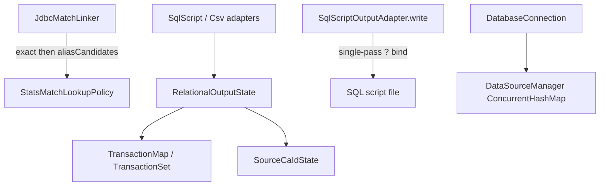

# Requirements

### Overview & Goals
Resolve every outstanding issue in `docs/FIXME.md` across `bbb-shared`, `bbb-update-database`, and `bbb-parse-cricsheet`, preserving existing behavior except where the documented bugs currently corrupt SQL, pooling, or transaction isolation.

### Scope
#### In Scope
- **P1-1**: Safe SQL placeholder substitution in `SqlScriptOutputAdapter.write`
- **P1-2**: Thread-safe `DataSourceManager` with composite cache key
- **P1-3**: Transaction collection encapsulation (no leaked mutable change logs), including `SourceCaIdState` which shares the same pattern
- **P2-4**: Remove property-forwarding boilerplate in `SqlScriptOutputAdapter` and `CsvOutputAdapter`
- **P2-5**: Separate exact vs alias candidates in stats match lookup
- **P2-6**: Delegate `sourceReferencesChanged` to `RelationalOutputState`
- **P2-7**: Non-fragile MariaDB `ENGINE=InnoDB` DDL generation
- **P2-8**: Idiomatic Kotlin / naming cleanups in `DatabaseConnection.kt` and `Database.kt`
- Tests for each behavioral change; mark issues resolved in `docs/FIXME.md`; update `docs/project_memory.md`

#### Out of Scope
- Broader redesign of output adapters beyond the listed smells
- Changing JDBC/Hikari pool sizing or external connection configuration
- New product features

### Functional Requirements
1. SQL script generation remains correct when substituted string literals contain `?` (e.g. venue/event text like `"Why?"`).
2. Concurrent `DatabaseConnection` construction against the same URL+credentials shares one pool; different credentials against the same URL get distinct pools.
3. Match transaction begin/commit/rollback still restores collection state and counters correctly; snapshots no longer expose live mutable change logs.
4. Stats match linking still tries exact team names first, then alias combinations, without callers calling `.drop(1)`.
5. Generated MariaDB DDL still attaches `ENGINE = InnoDB` only to `CREATE TABLE` statements, not indexes.
6. Existing adapter/integration tests continue to pass after boilerplate removal and delegation cleanups.

### Non-Functional Requirements
- Prefer JUnit 5 + Strikt tests; keep changes idiomatic Kotlin (`val`, no dead code, no forced `!!` where avoidable).
- Run `./gradlew clean check --no-daemon` for touched modules before considering the work done.
- No git commits unless explicitly requested.

# Technical Design

### Current Implementation
- **SQL params**: `SqlScriptOutputAdapter.write` (lines 349–53) repeatedly does `replaceFirst("?", ...)` on the evolving string, so a `?` inside a prior literal steals later placeholders.
- **Pools**: `DataSourceManager.datasources` is an unsynchronized `HashMap` keyed only by `connectionString` (`DatabaseConnection.kt`).
- **Transactions**: `TransactionMap`/`TransactionSet.beginTransaction()` return the live internal `changes` map; `RelationalOutputState.snapshot()` and `SourceCaIdState.snapshot()` store those references. Rollback works only because the “snapshot” is really a growing undo log — which breaks encapsulation/immutability. Covered lightly by `TransactionalCollectionsTest`.
- **Adapters**: `SqlScriptOutputAdapter` and `CsvOutputAdapter` each forward 15+ state properties and reimplement `sourceReferencesChanged` instead of calling `RelationalOutputState.sourceReferencesChanged(matchKey, sources)`.
- **Stats lookup**: `StatsMatchLookupPolicy.candidates` always prepends the exact pair; `JdbcMatchLinker.findStatsCaId` does exact lookup itself then `.drop(1)` on candidates (`StatsMatchLinker.kt` 51–71).
- **DDL**: `RelationalSchemaSql.withStorageEngine` uses `replaceFirst(");", ...)` on multi-statement blobs (table + indexes).
- **Style**: dead commented code, `ds_local`, Java semicolons, `ds!!` in `DatabaseConnection`; pass-through upserts, `ballsPersOVer` typo, `Locale.getDefault()` in `Database.getNameParts`.

### Key Decisions
1. **Single-pass placeholder binding** for SQL script writes — scan the template once and substitute values without rescanning inserted literals (fixes corruption; keeps `?`-only templates).
2. **`ConcurrentHashMap` + `DataSourceKey(connectionString, userName, password)`** via `computeIfAbsent` — matches the FIXME remedy and closes both races and credential collisions.
3. **Encapsulated undo-log transactions** rather than deep-copying whole maps: `beginTransaction()` / `rollback()` / `commit()` operate on internal `changes` only; `RelationalOutputState.Snapshot` keeps only scalar counters + opaque `SourceCaIdState` handling (no leaked maps). Same API change for `SourceCaIdState` since it shares `TransactionMap`.
4. **`aliasCandidates(...)`** (or equivalent) on `StatsMatchLookupPolicy`; linker uses that for alias search only — removes ordering coupling without changing match semantics.
5. **MariaDB engine suffix via explicit `$engine` in `CREATE TABLE` templates** (empty for non-MariaDB) instead of string `replaceFirst`.

### Proposed Changes
#### P1-1 — `SqlScriptOutputAdapter.write`
Replace iterative `replaceFirst` with a single-pass builder that walks the SQL template character-by-character (or token-wise), replacing each `?` placeholder with `toSqlLiteral(values[i])` in order, and asserting placeholder/value arity. Add a focused unit test with a value containing `?`.

#### P1-2 — `DatabaseConnection` / `DataSourceManager`
- Introduce internal `data class DataSourceKey(val connectionString: String, val userName: String, val password: String)`.
- Store pools in `ConcurrentHashMap<DataSourceKey, DataSource>` and resolve via `computeIfAbsent`.
- Clean style issues in the same file (issue 8 partial): remove dead comment, rename `ds_local`, drop trailing semicolons, replace `ds!!` with a clear error (e.g. check/lazy failure if unconfigured).

#### P1-3 — Transaction encapsulation
In `TransactionalCollections.kt`:
```kotlin
fun beginTransaction() { check(changes == null); changes = linkedMapOf() }
fun rollback() { /* undo from internal changes */; changes = null }
fun commit() { changes = null }
```
Update `RelationalOutputState.snapshot/restore` and `SourceCaIdState.snapshot/restore` so snapshots no longer hold map change logs; collections roll back from internal state. Update `TransactionalCollectionsTest` to the new API and add a test that a held snapshot object cannot observe mid-transaction mutations (or simply that rollback works without an external map token).

#### P2-4 / P2-6 — Adapter cleanup
In `SqlScriptOutputAdapter` and `CsvOutputAdapter`:
- Delete private getters/setters that only forward to `state`.
- Use `state.people`, `state.nextPersonKey++`, etc. directly.
- Implement `sourceReferencesChanged` as: resolve `matchKey` via `findMatchKey` / `state.matches`, then `state.sourceReferencesChanged(matchKey, sources)`.

#### P2-5 — Stats match candidates
- Add `aliasCandidates(firstTeamName, secondTeamName, firstAliases, secondAliases)` containing only alias combinations (current list without the exact pair).
- Keep `candidates(...)` as exact + aliases if useful for tests, or restructure tests around the split API.
- Change `JdbcMatchLinker.findStatsCaId` to call `aliasCandidates` (no `.drop(1)`).
- Update `StatsMatchLookupPolicyTest` / `StatsMatchLinkerTest` accordingly.

#### P2-7 — Schema DDL
In `RelationalSchemaSql.createStatements`, introduce `val engine = if (dialect == SqlDialect.MARIADB) " ENGINE = InnoDB" else ""` and emit `)$engine;` on each `CREATE TABLE`. Remove `withStorageEngine` / `replaceFirst`.

#### P2-8 — `Database.kt` style
- Inline or remove single-line pass-throughs (`upsertGround`, `upsertPerson`, `upsertTeams`, `upsertDate`, `upsertInnings`) by calling `outputAdapter` at call sites.
- Rename `ballsPersOVer` → `ballsPerOver`.
- Use `Locale.ROOT` in `getNameParts` instead of `Locale.getDefault()`.

#### Docs
- Mark each issue resolved (or replace body with a short “resolved” summary) in `docs/FIXME.md`.
- Append a completion entry to `docs/project_memory.md`.
- Optional small ADR only if we want to record the pool-key + transaction-token decisions; not required for pure bugfixes if project_memory covers them.

### Architecture Diagram


### Risks
- **Transaction API change** touches `SourceCaIdState` as well as `RelationalOutputState`; missing a rollback path would break match-level rollback tests — mitigate by running existing adapter rollback tests plus updated unit tests.
- **Adapter boilerplate removal** is mechanical but wide; mitigate with compile + full `bbb-update-database` test suite.
- **`Locale.ROOT`** can change name casing on non-English default locales (intentional correctness fix); call out in project memory.
- **Password in pool key** keeps credentials in memory as map keys (already true inside Hikari config); acceptable and matches the documented remedy.

# Testing

### Validation Approach
- TDD where behavior changes: write/adjust failing tests first for P1-1, P1-2 (if testable without live DB), P1-3, P2-5, then implement.
- Prefer JUnit 5 + Strikt per project guidelines.
- Finish with `./gradlew :bbb-shared:check :bbb-update-database:check :bbb-parse-cricsheet:check --no-daemon` (or full `clean check`).

### Key Scenarios
1. **SQL write with `?` in a string value** — all subsequent bound parameters remain correct; statement is valid.
2. **TransactionMap/Set rollback** after put/remove/iterator mutations without passing an external change-log map.
3. **Relational/Csv/SqlScript match rollback** existing tests still pass (failed match write restores state).
4. **Stats linker** exact hit short-circuits; alias-only path does not depend on candidate list index 0.
5. **MariaDB schema text** contains `ENGINE = InnoDB` on tables and not mangled index lines.
6. **`sourceReferencesChanged`** behavior unchanged vs prior fingerprint comparison.

### Edge Cases
- Mismatched placeholder vs value counts in `write` (clear failure).
- Nested `beginTransaction` still rejected.
- Empty alias lists → no alias lookups.
- `DataSource` connection access before configure fails clearly (no opaque NPE from `!!`).

### Test Changes
- Extend/update `TransactionalCollectionsTest`.
- Add test coverage for `SqlScriptOutputAdapter` parameter binding with `?` in literals (new focused test or extend `SqlScriptOutputAdapterTest`).
- Update `StatsMatchLookupPolicyTest` / linker tests for `aliasCandidates`.
- Add/adjust schema assertion if one exists; otherwise a small unit test on `RelationalSchemaSql` output for MariaDB vs SQLite.
- No separate final “testing only” stage — tests ship with each implementation stage.

# Delivery Steps

### ✓ Step 1: Fix SQL placeholder binding and DataSource pooling (P1-1, P1-2, P2-8 connection style)
SqlScriptOutputAdapter binds parameters safely in one pass, and DataSourceManager is thread-safe with a composite credential key.

- Add a failing test proving `write` corrupts SQL when a bound string contains `?`, then implement single-pass substitution in `SqlScriptOutputAdapter.write`.
- Replace `DataSourceManager`’s `HashMap` with `ConcurrentHashMap` + `DataSourceKey(connectionString, userName, password)` and `computeIfAbsent` in `DatabaseConnection.kt`.
- Clean `DatabaseConnection.kt` style: remove dead commented code, rename `ds_local`, drop Java-style semicolons, eliminate `ds!!` with a clear failure path.
- Run the relevant unit tests for SQL script output / shared module.

### ✓ Step 2: Encapsulate transactional collection snapshots (P1-3)
Transaction begin/rollback no longer leaks live mutable change logs; adapters still roll back correctly.

- Change `TransactionMap` / `TransactionSet` so `beginTransaction()`, `rollback()`, and `commit()` use only internal `changes` (no returned live map).
- Slim `RelationalOutputState.Snapshot` to scalar counters (plus nested source-CA handling) and update `snapshot()` / `restore()` / `commit()` accordingly.
- Apply the same encapsulation to `SourceCaIdState.snapshot` / `restore` / `finishTransaction`.
- Update `TransactionalCollectionsTest` and confirm existing SqlScript/Csv match-rollback tests still pass.

### ✓ Step 3: Clean output adapters and MariaDB DDL (P2-4, P2-6, P2-7)
Adapters talk to `RelationalOutputState` directly; MariaDB table DDL gets an explicit InnoDB engine suffix.

- Remove property-forwarding boilerplate in `SqlScriptOutputAdapter` and `CsvOutputAdapter`; use `state.*` at call sites.
- Delegate `sourceReferencesChanged` to `state.sourceReferencesChanged(matchKey, sources)` after resolving the match key.
- Replace `RelationalSchemaSql.withStorageEngine` / `replaceFirst(");", ...)` with an explicit `ENGINE = InnoDB` suffix on `CREATE TABLE` templates for `SqlDialect.MARIADB`.
- Add or adjust a small schema-output assertion for MariaDB vs other dialects; run `bbb-update-database` tests.

### ✓ Step 4: Fix stats candidate API and Database.kt style; close out docs (P2-5, P2-8 remainder)
Stats alias lookup no longer uses `.drop(1)`; Database.kt style issues are gone; FIXME and project memory reflect completion.

- Introduce `aliasCandidates(...)` (or equivalent) on `StatsMatchLookupPolicy` and switch `JdbcMatchLinker.findStatsCaId` to use it without `.drop(1)`.
- Update `StatsMatchLookupPolicyTest` / `StatsMatchLinkerTest` for the new API.
- In `Database.kt`: remove redundant upsert pass-throughs, rename `ballsPersOVer` → `ballsPerOver`, use `Locale.ROOT` in `getNameParts`.
- Mark all issues resolved in `docs/FIXME.md` and append a completion section to `docs/project_memory.md`.
- Run `./gradlew clean check --no-daemon` (at least touched modules) and fix any fallout.