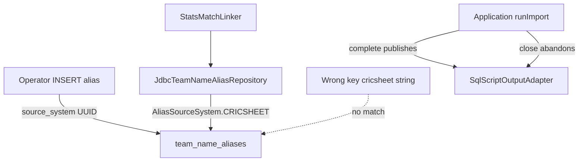

# Requirements

### Overview & Goals

Close the two open P2s in `docs/FIXME.md` so architecture/operator docs match live safety behavior and Cricsheet team-name aliases cannot silently miss on a wrong `source_system` key. Leave all residual P3s deferred.

### Scope

**In scope**
- **P2-1**: Correct stale architecture/ADR prose about SQL-script publish lifecycle and alias migration non-drop policy; keep `docs/FIXME.md` locked closed set in sync.
- **P2-2**: Canonical Cricsheet alias `source_system` = provider-namespace UUID (`f3c879d8-6d5c-5f33-9c7f-4f6c2dcff18b`); expose via tiny type + shared constant; unify production, docs, and all seed/test inserts; add miss-key regression.

**Out of scope**
- All eight residual P3 items in `docs/FIXME.md`.
- Changing SQL-script `complete()`/`close()` runtime behavior (ADR 0049 stays).
- Flyway data migration rewriting existing `'cricsheet'` alias rows (operator DBs already on UUID stay; wrong-key rows remain invisible and are documented as a footgun the regression prevents going forward).
- Switching canonical value to `ProviderId("cricsheet")`.

### User Stories

- As a reviewer, I read architecture docs that match ADR 0049 and live migrations so I do not re-open closed P1 hazards.
- As an operator, I insert aliases under one documented UUID key and the parser resolves them.
- As a maintainer, a regression fails if lookup uses the canonical key while a row exists only under the wrong key (`'cricsheet'`).

### Functional Requirements

1. Docs state: successful import calls `complete()` (publish + `COMMIT;`); `close()` abandons staged SQL (rollback active match if needed, delete staged file when no pending journal).
2. Docs state: current dialect `1__initial_tables.sql` files create `team_name_aliases` with `IF NOT EXISTS` and **do not** `DROP` it; generated SQL preserves aliases the same way.
3. Production `JdbcTeamNameAliasRepository` defaults to the shared tiny-type canonical value (same UUID as today).
4. No test/seed insert for Cricsheet aliases uses literal `'cricsheet'` as `source_system`.
5. Operator docs (`README-DEV.md` already correct; architecture guides clarified) show the UUID and distinguish it from `ProviderId` `"cricsheet"`.
6. After fix, `docs/FIXME.md` marks P2-1/P2-2 closed and keeps the locked closed list accurate.

### Non-Functional Requirements

- Follow existing tiny-type / Arrow patterns in `bbb-shared` identity code.
- Prefer JUnit + Strikt tests; run module/`check` paths touched by the change.
- Do not suppress static analysis; no runtime behavior rollback of closed P1s.

# Technical Design

### Current Implementation

**SQL script lifecycle (correct in code, wrong in docs)**
- `Application` uses adapter with `runImport` then `adapter.complete()`; `use` closes afterward.
- `SqlScriptOutputAdapter` / `ScriptContext.complete()` appends `COMMIT;`, closes writer, journal-publishes staged → final via `JournaledMatchReplace`.
- `close()` rolls back active match if needed, closes writer, deletes staged file when no pending journal — **does not publish** (ADR 0049).

**Alias migrations (correct in code, wrong in docs)**
- `bbb-update-database/migrations/{mysql,postgres,sqlite}/1__initial_tables.sql` use `CREATE TABLE IF NOT EXISTS team_name_aliases` — no `DROP team_name_aliases`.
- `RelationalSchemaSql` creates aliases only when absent.
- Stale prose still claims historical `1__` drops/recreates aliases in:
  - `docs/architecture/database.md` (lines ~93–95, ~109–111)
  - `docs/adr/0006-persistent-team-name-aliases.md` (lines ~49–52)
  - `docs/architecture/applications.md` (SQL close wording ~182–188; ambiguous “`cricsheet` provider namespace” ~51–53)

**source_system split**
- Live default: `JdbcTeamNameAliasRepository(..., sourceSystem = ProviderNamespaces.CRICSHEET.toString())` → UUID string.
- `ProviderNamespaces.CRICSHEET` in `bbb-shared/.../IdentityIds.kt`.
- Linker tests already insert UUID; updater schema/migration tests insert `'cricsheet'`:
  - `DialectMigrationTest.kt`
  - `SqliteMatchIdentityMigrationTest.kt`
  - `RelationalSchemaSqlTest.kt`
- `README-DEV.md` operator SQL already uses the UUID correctly.
- `ProviderId` remains `"cricsheet"` for match_source_reference.provider — **different field, unchanged**.

### Key Decisions

1. **Canonical alias key = namespace UUID** (user-confirmed). Do not switch to `ProviderId` string; do not add a Flyway rewrite migration in this sprint.
2. **Tiny type + constant** (user-confirmed): introduce `@JvmInline value class AliasSourceSystem` (or equivalent name) in `bbb-shared` identity package, with a Cricsheet factory/constant backed by `ProviderNamespaces.CRICSHEET`, so production and tests share one typed source of truth.
3. **P3 deferred** entirely.
4. **Docs-only for P2-1 runtime claims** — no code change to publish/close.

### Proposed Changes

**P2-1 — Documentation**
- Rewrite match-transaction / SQL-script section in `docs/architecture/database.md` to: `runImport` → `complete()` publishes; `close()` abandons; durable hook remains no-op for per-match SQL rows.
- Rewrite alias migration language in `database.md` and ADR 0006: current `1__` migrations and generated DDL preserve aliases; remove “historical still drop/recreate” claim (or rephrase only if referring to pre-fix git history, not checked-in files).
- Fix `applications.md`: SQL-script success-only publish; spell out Cricsheet alias `source_system` as the namespace UUID and contrast with provider id `"cricsheet"`.
- Update `docs/FIXME.md` locked/open tables when both P2s land.

**P2-2 — Code & tests**
- Add `AliasSourceSystem` tiny type next to existing identity types in `IdentityIds.kt` (private ctor, `from`/`of`/`cricsheet()` or `AliasSourceSystem.CRICSHEET` constant using `ProviderNamespaces.CRICSHEET`).
- Change `JdbcTeamNameAliasRepository` default to `AliasSourceSystem.CRICSHEET.value` (or `.toString()` of the value class).
- Replace all Cricsheet alias SQL inserts/deletes that use `'cricsheet'` with the shared constant’s string form.
- Add regression test (prefer next to linker/alias tests in `bbb-parse-cricsheet`): insert alias under wrong key `'cricsheet'`, look up via repository default → empty; insert under canonical UUID → hit. Optionally assert wrong-key + right-key coexistence documents the silent-miss hazard.
- Keep `ProviderId.from("cricsheet")` usages for provider fields as-is.

### Data Models / Contracts

```kotlin
// bbb-shared identity
@JvmInline
value class AliasSourceSystem private constructor(val value: String) {
    companion object {
        val CRICSHEET: AliasSourceSystem =
            AliasSourceSystem(ProviderNamespaces.CRICSHEET.toString())
        // of/from with non-blank validation if useful
    }
}

// production default
class JdbcTeamNameAliasRepository(
    connection: Connection,
    sourceSystem: String = AliasSourceSystem.CRICSHEET.value
)
```

Wire contract remains: `team_name_aliases.source_system` VARCHAR holding UUID text for Cricsheet.

### File Structure

**Modified**
- `bbb-shared/src/main/kotlin/.../identity/IdentityIds.kt` (+ tests if present / new unit tests)
- `bbb-parse-cricsheet/.../TeamNameAliasRepository.kt`
- `bbb-parse-cricsheet` linker/alias tests (+ new miss-key regression)
- `bbb-update-database` tests: `DialectMigrationTest`, `SqliteMatchIdentityMigrationTest`, `RelationalSchemaSqlTest`
- `docs/architecture/database.md`, `docs/architecture/applications.md`
- `docs/adr/0006-persistent-team-name-aliases.md`
- `docs/FIXME.md`
- `docs/project_memory.md` / dated entry after completion
- Touch `README-DEV.md` only if wording can further disambiguate ProviderId vs alias key (already UUID-correct)

**Not modified**
- `SqlScriptOutputAdapter` publish/close implementation
- Flyway `1__` / `2__` migration SQL structure (already non-drop)
- P3 orchestrator / dual-schema / CSV cost items

### Architecture Diagram



### Risks

- **Existing DBs with `'cricsheet'` rows**: still invisible after fix (no migration by choice). Mitigate with clear operator docs + miss-key test; optional follow-up migration if operators report live wrong-key data.
- **Confusing ProviderId vs AliasSourceSystem**: docs must name both explicitly whenever either appears.
- **Doc drift again**: closing text in `FIXME.md` must list corrected files so the next review does not re-derive stale claims.

# Testing

### Validation Approach

- Unit/integration tests with JUnit + Strikt for the new tiny type and alias lookup regression.
- Update existing schema/migration tests that seed aliases so they use the canonical UUID constant.
- Run targeted Gradle tests for `bbb-shared`, `bbb-parse-cricsheet`, and `bbb-update-database`, then `./gradlew clean check --no-daemon` (or at least the affected modules) before calling P2s done.
- Manual doc review checklist against ADR 0049 and live migration files (no code path change for P2-1).

### Key Scenarios

1. Canonical UUID insert → `JdbcTeamNameAliasRepository.statsTeamIds` returns the stats team id.
2. Wrong-key `'cricsheet'` insert only → lookup with default source system returns empty (miss-key regression).
3. Migration/schema re-apply / uniqueness tests still pass after seed key change.
4. Linker tests that already use `ProviderNamespaces.CRICSHEET.toString()` keep passing; prefer migrating them to `AliasSourceSystem.CRICSHEET` for one constant.

### Edge Cases

- Provider field `ProviderId("cricsheet")` must not be “fixed” to the UUID.
- Blank/invalid `AliasSourceSystem` construction rejected if validation is added.
- DELETE helpers in migration tests that filter `source_system = 'cricsheet'` must use the canonical key too.

### Test Changes

- Add: miss-key regression (parse-cricsheet alias repository or linker test class).
- Add/adjust: tiny-type construction tests if non-trivial validation is introduced.
- Update: `DialectMigrationTest`, `SqliteMatchIdentityMigrationTest`, `RelationalSchemaSqlTest` alias SQL.
- No intentional skips.

# Delivery Steps

### ✓ Step 1: Correct architecture and ADR prose for P2-1
Docs match ADR 0049 and the live non-drop alias policy; no runtime publish/close changes.

- Rewrite SQL-script lifecycle in `docs/architecture/database.md`: `runImport` → `complete()` publishes + `COMMIT;`; `close()` abandons staged output.
- Fix SQL-script close wording in `docs/architecture/applications.md` the same way.
- Rewrite alias migration language in `database.md` and `docs/adr/0006-persistent-team-name-aliases.md` so current `1__` migrations / generated DDL do not drop `team_name_aliases`.
- Clarify in `applications.md` that Cricsheet alias `source_system` is the provider-namespace UUID, distinct from `ProviderId` `"cricsheet"`.
- Do not change `SqlScriptOutputAdapter` or migration SQL behavior.

### ✓ Step 2: Introduce AliasSourceSystem and wire production lookup
One typed canonical Cricsheet alias key is the production default.

- Add `@JvmInline value class AliasSourceSystem` (private constructor) in `bbb-shared` `IdentityIds.kt` with `CRICSHEET` built from `ProviderNamespaces.CRICSHEET.toString()`.
- Default `JdbcTeamNameAliasRepository.sourceSystem` to `AliasSourceSystem.CRICSHEET.value`.
- Add focused unit tests for the tiny type if validation/factories are non-trivial.
- Leave `ProviderId` / match_source_reference provider strings unchanged.

### ✓ Step 3: Unify test seeds, add miss-key regression, close FIXME
All Cricsheet alias seeds use the canonical UUID; silent wrong-key miss is locked by a failing test; P2s marked closed.

- Replace `'cricsheet'` alias inserts/deletes in `DialectMigrationTest`, `SqliteMatchIdentityMigrationTest`, and `RelationalSchemaSqlTest` with `AliasSourceSystem.CRICSHEET.value` (or shared test helper).
- Align linker/alias test helpers on the same constant where they still inline the UUID.
- Add regression: row under `'cricsheet'` is invisible to default lookup; row under canonical UUID resolves.
- Update `docs/FIXME.md` (move P2-1/P2-2 to locked closed; keep P3 deferred) and append `docs/project_memory` entry for what shipped.
- Run affected module tests / `check` and fix any fallout without suppressions.