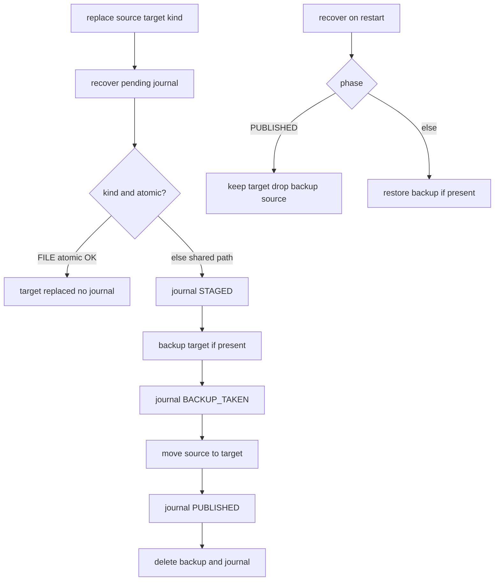

# Requirements

### Overview & Goals

Close the open items in `docs/FIXME.md` on the current write-path / parse-link codebase:

1. **P2-1** — one journal recovery machine for FILE and DIRECTORY with a single `BACKUP_TAKEN` meaning.
2. **P2-2** — stop fail-open provenance change detection on JDBC `SQLException`.
3. **Residual P3s 1–9** — identity/SQL hygiene, `SourceCaId` at write/link edges, parse mapper cleanup, and engine-applied generated MariaDB/Postgres DDL tests.

**Approval bar (from FIXME):** not done until P2-1 and P2-2 are closed; architecture of session/sinks/durable phases/identity core/link criteria split must stay.

### Scope

#### In Scope

| ID | Item |
|---|---|
| P2-1 | Unify `JournaledMatchReplace` publish + recover; restore-unless-`PUBLISHED` policy |
| P2-2 | `JdbcIdentityStore.sourceReferencesChanged` propagates `SQLException` |
| P3-1 | Fold `RelationalOutputState` into `IdentityCore` |
| P3-2 | Compose `sourceCaOwnership` from core + DB rows |
| P3-3 | Shared UPDATE SQL helper (end JDBC/script duplication) |
| P3-4 | Move `setJdbcValue` next to the JDBC sink |
| P3-5 | `MatchRecord.sourceCaId` / `reconcileSourceCaId` use `SourceCaId?` |
| P3-6 | Map `StatsLinkResult` → failure without `IllegalStateException` hop |
| P3-7 | `StatsMatchRepository.caIds` returns `List\u003cSourceCaId\u003e` |
| P3-8 | Collapse thin alias resolver adapter in `fromConnections` |
| P3-9 | Apply generated MariaDB/Postgres DDL via testcontainers |
| Docs | Update `docs/FIXME.md` (and ADR/project_memory as needed) |

#### Out of Scope (P3-10, still deferred)

- Splitting `Database.writeMatch` (~300-line orchestrator)
- CLI factory verbosity
- `getNameParts` heuristics
- Parameterizing hardcoded Postgres schema name `acs_ball_by_ball`

Locked closed P1s stay locked; do not reopen without regression proof.

### User Stories

- As an importer, I want journal crash recovery to behave the same for SQL scripts and CSV bundles so a half-published target is never kept under one kind and rolled back under the other.
- As an importer, I want provenance query failures to abort loudly so a changed source cannot be silently skipped.
- As a maintainer, I want residual write/link nits cleaned so the next thermo-nuclear pass stays at P1=0 and these P2s gone.

### Functional Requirements

1. **Journal recovery (single policy)**  
   - Optional atomic FILE move remains journal-free.  
   - Non-atomic FILE and DIRECTORY share: `STAGED` → backup if present → `BACKUP_TAKEN` → move source → `PUBLISHED` → delete backup/journal.  
   - Recover: `PUBLISHED` → keep target, drop backup/source; otherwise restore backup when present.  
   - No separate `recoverFile` / `recoverDirectory` / dual rollback machines; no new `when (kind)` policy forks.

2. **Provenance**  
   - Remove blanket `SQLException` catch in `sourceReferencesChanged`.  
   - Errors propagate to `Database.writeMatch`; skip path must not treat query failure as “unchanged”.

3. **P3 behavior**  
   - Identity maps/counters/snapshots live only in `IdentityCore`.  
   - JDBC ownership = DB rows + `identityCore.sourceCaOwnership(...)`.  
   - Wire JSON `Info.sourceCaId` may remain `String?`; write port and link repository edges use `SourceCaId`.  
   - Generated MariaDB/Postgres DDL applies successfully on containers (tables/indexes usable; alias bootstrap still does not drop operator aliases).

### Non-Functional Requirements

- Tests: JUnit 5 + Strikt; TDD for new recovery/provenance cases.
- Existing adapter parity, ADR 0046 durable commit, and closed P1 behavioral locks must keep passing.
- `./gradlew clean check --no-daemon` green for touched modules (`bbb-update-database`, `bbb-parse-cricsheet`, and dependents as needed).

# Technical Design

### Current Implementation

**P2-1 —** `bbb-update-database/.../JournaledMatchReplace.kt`

- `replace` branches to `replaceFile` vs `publishDirectory`.
- FILE: atomic move fast path; fallback journals `STAGED` → optional backup → `BACKUP_TAKEN` → move → `PUBLISHED`.
- DIRECTORY: always journals; on `BACKUP_TAKEN` + target present, **recovery commits** (delete source/backup).
- FILE recovery on `BACKUP_TAKEN`/`STAGED` always **restores** backup via `restoreFileBackup`.
- Tests (`JournaledMatchReplaceTest`) cover happy path + legacy `SOURCE_MOVED`; **no** `BACKUP_TAKEN` target present/absent matrix for both kinds.

**P2-2 —** `JdbcIdentityStore.sourceReferencesChanged` (lines 81–106)

- Queries `match_source_reference`; on any `SQLException` logs “table unavailable” and returns `false`.
- Consumed by `Database.writeMatch` when `!shouldParse` via `check(!sourceReferencesChanged(...))`.

**P3 hotspots**

- `IdentityCore` delegates maps to `RelationalOutputState`.
- `JdbcIdentityStore.sourceCaOwnership` re-merges allocator pending/registered instead of composing core ownership + DB.
- UPDATE SQL duplicated in `JdbcRowSink.update` and `SqlScriptOutputAdapter` `emitRow`.
- `setJdbcValue` top-level in `JdbcIdentityStore.kt`; used by sink + store bind helpers.
- `MatchRecord.sourceCaId: String?`; session re-validates with `SourceCaId.from`.
- `CricSheetParser.sourceCaId` maps `StatsLinkResult` → `IllegalStateException` → outer `ParseFailure`.
- `StatsMatchRepository.caIds` → `List\u003cString\u003e`; linker wraps `SourceCaId`.
- `StatsMatchLinker.fromConnections` builds a one-line `StatsTeamAliasResolver` lambda over `JdbcTeamNameAliasRepository`.
- `RelationalSchemaSqlTest` string-checks MariaDB/Postgres; SQLite is engine-applied; `DialectMigrationTest` already uses MySQL/Postgres testcontainers for **migrations** only.

### Key Decisions

| Decision | Choice | Rationale |
|---|---|---|
| Recovery policy | Restore backup unless phase is `PUBLISHED` | Single meaning for `BACKUP_TAKEN`; fail safe on crash between content move and journal publish |
| Provenance errors | Propagate `SQLException` (no catch) | Fail closed; table is in generated schema/migrations |
| Identity merge | Fold `RelationalOutputState` into `IdentityCore` | One transactional identity owner; delete pass-through type |
| Deferred P3-10 | Exclude | Keep orchestrator/CLI/name-parts/schema-name work deferred |
| Generated DDL proof | Testcontainers apply for MariaDB + Postgres | Same strength as migration tests; closes coverage gap |
| Wire vs domain CA id | `Info.sourceCaId` stays `String?`; ports use `SourceCaId?` | Avoid churning shared JSON contract; validate at write/link edges |

### Proposed Changes

#### P2-1 — One journal machine

Refactor `JournaledMatchReplace` toward:

1. Keep FILE atomic-move try/catch with no journal.
2. Shared non-atomic path parameterized only by path ops (file vs directory delete/move), **not** by recovery policy:
   - write journal `STAGED`
   - if target exists → move target → backup → `BACKUP_TAKEN`
   - move source → target → `PUBLISHED`
   - delete backup + journal
3. Single `recover(target, kind)` body after reading journal record:
   - `PUBLISHED` → keep target; delete backup/source (directory-aware cleanup)
   - else → restore backup onto target if backup exists; clean leftovers
4. Delete `recoverFile`, `recoverDirectory`, and dual rollback helpers once inlined into the one path (or one shared rollback used by both live failure and recover).
5. Tests in `JournaledMatchReplaceTest`:
   - `BACKUP_TAKEN` + target present → restore old content (FILE and DIRECTORY)
   - `BACKUP_TAKEN` + target absent → restore from backup (both)
   - `STAGED` restore behavior (both as needed)
   - `PUBLISHED` / legacy `SOURCE_MOVED` keep target (regression)
   - Force non-atomic FILE path via move stub throwing `AtomicMoveNotSupportedException` where needed



#### P2-2 — Provenance fail-closed

In `JdbcIdentityStore.sourceReferencesChanged`:

- Remove `try/catch (SQLException)`.
- Let failures surface through `RelationalMatchSession` → `Database.writeMatch`.
- Add unit/integration test: connection/statement that throws non-missing-table `SQLException` does **not** return `false` / does not allow silent skip (assert exception or failed write path).

#### P3-1 / P3-2 — Identity

- Move fields, `snapshot`/`restore`/`commit`, and `sourceReferencesChanged` helpers from `RelationalOutputState` into `IdentityCore`.
- Delete `RelationalOutputState.kt` (or reduce to nothing if anything else referenced it — today only IdentityCore).
- `JdbcIdentityStore.sourceCaOwnership`:
  ```kotlin
  val core = identityCore.sourceCaOwnership(sourceCaId)
  // query DB owners + uncanonical key
  return SourceCaIdOwnership(
      (dbCanonicalOwners + core.canonicalOwners).distinct(),
      uncanonicalMatchKey ?: core.uncanonicalMatchKey
  )
  ```
  (exact field names per `SourceCaIdOwnership`)

#### P3-3 / P3-4 — SQL/JDBC hygiene

- Add `RelationalWriteSupport.updateSql(table, columns, whereColumns, whereValues)` (or equivalent) producing assignment + condition SQL shared by `JdbcRowSink` and script `emitRow`.
- Move `setJdbcValue` to `JdbcRowSink.kt` (or small `JdbcBinding.kt` beside the sink); keep `internal` visibility for `JdbcIdentityStore.bind`.

#### P3-5 — Write-port tiny type

- `MatchRecord.sourceCaId: SourceCaId?`
- `OutputAdapter.reconcileSourceCaId(..., sourceCaId: SourceCaId?)`
- `Database` converts envelope `Info.sourceCaId: String?` once at the edge (`SourceCaId.from` / null).
- Session drops redundant string re-parse where type already guarantees validity (keep defensive checks only if still needed for allocator string storage).

#### P3-6 / P3-7 / P3-8 — Parse link

- `StatsMatchRepository.caIds` → `List\u003cSourceCaId\u003e` (construct at JDBC edge with `SourceCaId.from`).
- `StatsMatchLinker.lookupCandidate` uses typed list directly.
- `CricSheetParser.linkMatch`: fold `StatsLinkResult` into success/`ParseFailure` (or throw a single domain-meaningful exception type only if processFile must stay exception-based) — **no** `StatsLinkResult` → `IllegalStateException` → message scrape.
- Collapse alias adapter: e.g. `JdbcTeamNameAliasRepository` implements `StatsTeamAliasResolver` (or drop `TeamNameAliasRepository` if only one consumer), so `fromConnections` does not build a mapping lambda.

#### P3-9 — Engine-applied generated DDL

- Extend tests (likely `RelationalSchemaSqlTest` or sibling) using `MySQLContainer` / `PostgreSQLContainer` as in `DialectMigrationTest`.
- Apply `RelationalSchemaSql` output (split statements safely; handle MariaDB `USE` / Postgres `search_path`).
- Assert core tables exist, unique alias triple enforced, re-apply does not drop alias row (parity with SQLite test).

#### Docs

- Mark P2-1/P2-2 closed in `docs/FIXME.md`; note P3 1–9 done; keep P3-10 deferred.
- Short ADR if recovery policy is considered an architectural decision (optional but preferred per project guidelines).
- Sprint/task completion: `docs/project_memory.md` via project conventions when implementation finishes.

### File Structure

**Modify**

- `bbb-update-database/src/main/kotlin/.../adapter/JournaledMatchReplace.kt`
- `bbb-update-database/src/test/kotlin/.../adapter/JournaledMatchReplaceTest.kt`
- `bbb-update-database/src/main/kotlin/.../adapter/JdbcIdentityStore.kt`
- `bbb-update-database/src/main/kotlin/.../adapter/IdentityCore.kt`
- `bbb-update-database/src/main/kotlin/.../adapter/JdbcRowSink.kt`
- `bbb-update-database/src/main/kotlin/.../adapter/SqlScriptOutputAdapter.kt`
- `bbb-update-database/src/main/kotlin/.../adapter/RelationalWriteSupport.kt`
- `bbb-update-database/src/main/kotlin/.../adapter/OutputAdapter.kt` (`MatchRecord`, port signatures)
- `bbb-update-database/src/main/kotlin/.../adapter/SessionBackedOutputAdapter.kt`
- `bbb-update-database/src/main/kotlin/.../adapter/relational/RelationalMatchSession.kt`
- `bbb-update-database/src/main/kotlin/.../database/Database.kt`
- `bbb-update-database/src/test/kotlin/.../adapter/RelationalSchemaSqlTest.kt` (or new container test class)
- `bbb-parse-cricsheet/.../StatsMatchRepository.kt`
- `bbb-parse-cricsheet/.../StatsMatchLinker.kt`
- `bbb-parse-cricsheet/.../TeamNameAliasRepository.kt`
- `bbb-parse-cricsheet/.../CricSheetParser.kt`
- Matching tests under both modules
- `docs/FIXME.md` (+ ADR / `project_memory` on completion)

**Delete**

- `bbb-update-database/.../adapter/RelationalOutputState.kt` (after fold)

### Risks

| Risk | Mitigation |
|---|---|
| DIRECTORY recovery behavior change (was commit-on-`BACKUP_TAKEN`+target) | Explicit tests; document policy in FIXME/ADR |
| Testcontainers flaky/slow CI | Reuse existing MySQL 8.4 / Postgres 17 images and patterns from `DialectMigrationTest` |
| `SourceCaId` signature churn in tests | Update call sites systematically; keep wire `String?` |
| Identity snapshot type renames break restores | Keep snapshot binary-compatible within process; update `require(snapshot is ...)` |

# Testing

### Validation Approach

- TDD for P2 recovery matrix and provenance exception behavior first.
- Re-run existing journal, adapter parity, identity, linker, and schema tests after each stage.
- Module checks: `bbb-update-database` and `bbb-parse-cricsheet` (then broader `./gradlew clean check --no-daemon` before done).

### Key Scenarios

1. FILE non-atomic replace success; DIRECTORY replace success (existing).
2. Recover `BACKUP_TAKEN` with target present → old content restored (FILE + DIRECTORY).
3. Recover `BACKUP_TAKEN` with target absent → backup restored (both).
4. Recover `PUBLISHED` / legacy `SOURCE_MOVED` → new target kept.
5. Provenance query throws `SQLException` → not treated as unchanged / import does not silent-skip.
6. Provenance happy path still detects digest/provider changes when table readable.
7. Identity snapshot/rollback still works after `IdentityCore` fold.
8. `sourceCaOwnership` includes both in-memory pending and DB owners without double-logic drift.
9. Linker returns typed `SourceCaId`; ambiguous/not-found map to parse failures without `IllegalStateException` bridge.
10. Generated MariaDB and Postgres DDL apply on containers; alias uniqueness + non-drop bootstrap hold.

### Edge Cases

- Atomic FILE move still skips journal entirely.
- Empty `match_source_reference` rows → unchanged (`false`), distinct from query failure.
- Invalid `sourceCaId` string at Database edge still rejected via tiny type.
- Invalid alias / skipped link paths unchanged functionally.

### Test Changes

- Expand `JournaledMatchReplaceTest`.
- Add provenance failure test near JDBC identity / database tests.
- Update parse linker/repository/parser tests for `SourceCaId` and failure mapping.
- Add testcontainers generated-schema apply tests for MariaDB + Postgres.
- Fix compile breakages in adapter/session tests after `MatchRecord` type change.

# Delivery Steps

### ✓ Step 1: Unify JournaledMatchReplace recovery (P2-1)
FILE and DIRECTORY share one journal phase machine; recovery restores backup unless PUBLISHED.

- Add failing tests for `BACKUP_TAKEN` with target present and absent for both `JournaledReplaceKind.FILE` and `DIRECTORY` (force non-atomic FILE via move stub when needed).
- Refactor `JournaledMatchReplace.kt` to one non-atomic sequence: `STAGED` → backup → `BACKUP_TAKEN` → move source → `PUBLISHED` → cleanup.
- Implement single recover policy: `PUBLISHED` keeps target; otherwise restore backup when present; delete dual `recoverFile`/`recoverDirectory`/divergent rollbacks.
- Keep atomic FILE fast path and legacy `SOURCE_MOVED` → `PUBLISHED` mapping.
- Green existing journal tests plus the new matrix.

### ✓ Step 2: Fail-closed provenance detection (P2-2)
Provenance SQLException no longer reports “unchanged” and cannot silent-skip imports.

- Add a test where the provenance query throws a non-missing-table `SQLException` and the skip/guard path does not treat the match as unchanged.
- Remove the blanket `catch (SQLException)` in `JdbcIdentityStore.sourceReferencesChanged` so errors propagate.
- Confirm happy-path change detection still works when `match_source_reference` is readable.
- Keep `Database.writeMatch` check messaging intact.

### ✓ Step 3: Identity fold and JDBC/SQL hygiene (P3-1–4)
IdentityCore owns state directly; ownership composes core+DB; UPDATE SQL and JDBC binding are shared cleanly.

- Fold `RelationalOutputState` maps/counters/snapshot/commit into `IdentityCore`; delete the pass-through type and fix snapshot type checks/tests.
- Change `JdbcIdentityStore.sourceCaOwnership` to compose `identityCore.sourceCaOwnership(sourceCaId)` with DB rows (no re-merge of pending/registered allocator maps).
- Extract shared UPDATE SQL builder in `RelationalWriteSupport` and use it from `JdbcRowSink` and `SqlScriptOutputAdapter`.
- Move `setJdbcValue` next to the JDBC sink (or adjacent binder file); update `JdbcIdentityStore` binds.
- Run identity/session/adapter tests for regressions.

### ✓ Step 4: SourceCaId edges and parse-link cleanup (P3-5–8)
Write port and stats lookup edges use SourceCaId; parser maps StatsLinkResult without IllegalStateException hop.

- Change `MatchRecord.sourceCaId` and `reconcileSourceCaId` to `SourceCaId?`; convert once in `Database` from envelope `String?`.
- Simplify `RelationalMatchSession` to consume the tiny type (drop redundant string re-parse where safe).
- `StatsMatchRepository.caIds` returns `List<SourceCaId>` built at the JDBC edge; update `StatsMatchLinker`.
- Map `StatsLinkResult` to parse success/failure directly in `CricSheetParser` (no private `IllegalStateException` bridge).
- Collapse thin `TeamNameAliasRepository` / `StatsTeamAliasResolver` adapter in `fromConnections` (repository implements resolver or single interface).
- Update parse-cricsheet and update-database tests/call sites.

### ✓ Step 5: Engine-apply generated DDL and close FIXME (P3-9 + docs)
Generated MariaDB/Postgres DDL is applied on testcontainers; FIXME reflects closed P2s and finished residual P3s 1–9.

- Add testcontainers tests that apply `RelationalSchemaSql` output for MariaDB and Postgres (reuse image/patterns from `DialectMigrationTest`).
- Assert tables/indexes usable, alias unique triple enforced, and re-apply does not drop saved aliases.
- Update `docs/FIXME.md` (P2-1/P2-2 closed; P3 1–9 done; P3-10 still deferred); add a short ADR for the unified journal recovery policy if appropriate.
- Run `./gradlew clean check --no-daemon` for affected modules; note project_memory update on completion per guidelines.