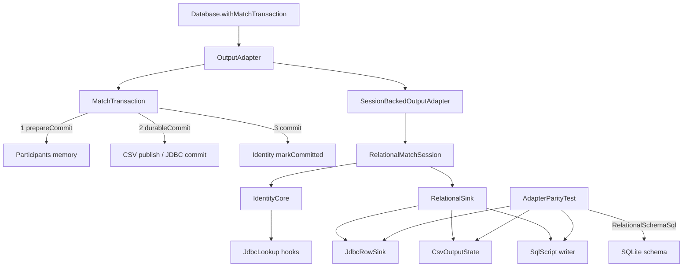

# Requirements

### Overview & Goals

Clear the entire **P2** backlog in `docs/FIXME.md` (18 items, **0 open P1s**) so the next thermo-nuclear review maps findings to this closed set instead of inventing rotating severities.

**Locked decisions (from clarification):**
- Scope: **full P2 set**; P3 stays deferred.
- P2-1: **add SQLite apply-script → read-back parity** (keep calling the suite full adapter parity).
- P2-3: **`commit()` requires an active transaction** (throw if inactive); no flush dual-API.
- P2-2: **participant `durableCommit` hook** on the shared phase machine.
- P2-6: **one transactional identity core + JDBC lookup-miss hooks**.
- P2-4/5: parity/dialect smoke schema truth = **`RelationalSchemaSql` generated DDL**.

### Scope

#### In Scope
- All P2 items A–D (correctness, structural debt, parse/link/policy, ops/dialect).
- Tests first (JUnit + Strikt); `./gradlew :bbb-update-database:check` and affected modules green.
- Update `docs/FIXME.md` as items close; ADR(s) for durable-commit and identity-core decisions; touch `docs/project_memory.md` / architecture notes if module boundaries change.

#### Out of Scope
- P3 items (`getNameParts`, splitting `Database.writeMatch`, Hikari property mix, CLI factory verbosity).
- Reopening closed P1s unless a regression is proven.
- Changing production write model away from `RelationalMatchSession` + `RelationalSink`.

### User Stories

- As a maintainer, I want one honest match-transaction commit phase so CSV publish and JDBC `connection.commit()` cannot outrun identity finalization.
- As a maintainer, I want adapter parity (session / JDBC / CSV / **SQL script on SQLite**) against **generated** schema so DDL drift fails tests.
- As a maintainer, I want one identity brain and no dead dual column APIs so write-path ownership is obvious.
- As a parser owner, I want sealed link results as the domain API and empty exclusion policy files to be valid.

### Functional Requirements

1. **Durable commit (P2-2, P2-3):** `MatchTransaction.commit` runs `prepareCommit` (memory only) → **all** participants’ `durableCommit` → `commit`/`markCommitted`. CSV publish and JDBC `connection.commit()` live only in `durableCommit`. `OutputAdapter.commit()` / `MatchTransaction.commit()` **require** `isActive`; inactive commit throws. Failure before durable → full rollback; after durable → best-effort mark/cleanup with explicit policy and tests.
2. **SQL-script parity (P2-1):** At least one path generates a SQLite script, applies it to SQLite, reads `matches` facts, and asserts equality with session/JDBC/CSV facts for reuse / source-CA / reconcile scenarios.
3. **Schema truth (P2-4, P2-5):** `AdapterParityTest` builds SQLite from `RelationalSchemaSql` (not hand-rolled mini-schema). Add at least one apply/metadata smoke per dialect (SQLite already execute; MariaDB/Postgres smoke or apply where feasible without requiring Docker for the default green bar if containers missing—document profile).
4. **Identity + session wiring (P2-6, P2-7):** Single core for maps/sets/snapshot/commit/source-CA; JDBC only supplies lookup-on-miss. `SessionBackedOutputAdapter` constructed with session (or factory), no two-phase `lateinit`.
5. **Dead API / match_person / replaceFile (P2-8–10):** Remove `*_JDBC_COLUMNS`, `MATCH_PERSON_INSERT_COLUMNS`, unused insert helpers; `insertMatchPerson` uses `allocateKey` / same identity path; delete `replaceFile` wrapper; tests call `JournaledMatchReplace` directly.
6. **Journal + CSV lifecycle (P2-11, P2-12):** One shared phase enum for file/directory replace; journal owns staged source lifecycle; `CsvBundlePublisher.withTemporaryBundle` must not unconditionally wipe source when journal still needs it.
7. **Link/policy (P2-13–15):** Sealed `StatsLinkResult` remains domain API; map to failures only at CLI/file boundary (private/`ParseFailure`); retire public exception taxonomy where nothing external needs it. Rename/colocate link vs lookup policy files. `PolicyResourceLoader` allows empty exclusion lists; missing resource still hard-fails.
8. **Ops/tiny types (P2-16–18):** Parameterize or hard-invariant-test MariaDB schema name in `RelationalSchemaSql`; non-Docker unit test of MariaDB stats SQL/bind shape; introduce validated tiny types for source CA / stats team ids at boundaries (storage may stay scalar).

### Non-Functional Requirements

- Preserve single write brain: session → sink for JDBC / SQL-script / CSV.
- No production write-path file over ~1k lines; prefer small functions, Arrow/`Either` where already used, sealed errors with `message`.
- Do not break closed P1 invariants (source vs stats names, script target rejects `mysql`, aliases not dropped by bootstrap, etc.).

# Technical Design

### Current Implementation

Primary module: `bbb-update-database` write adapters under `parse/database/adapter/`.

| Area | Key types / files |
|---|---|
| Tx | `MatchTransaction`, `MatchTransactionParticipant` (`prepareCommit` exists; durable is a **lambda** on `commit`; inactive commit still runs participants and **skips rollback**) |
| Adapters | `JdbcOutputAdapter` — `durableCommit = connection.commit()` **before** participant `commit` (identity finalize); `CsvOutputState.prepareCommit` **publishes** durable CSV; `SqlScriptOutputAdapter` + bottom `replaceFile` wrapper |
| Session | `SessionBackedOutputAdapter` + `initializeSession`; `RelationalMatchSession` / `RelationalSink` |
| Identity twins | `JdbcIdentityStore` (~327) vs `InMemoryIdentityStore` + `RelationalOutputState` |
| Columns | `RelationalWriteSupport` dual `*_JDBC_COLUMNS` / `MATCH_PERSON_INSERT_*`; `insertMatchPerson` uses `values = listOf(null,…)` + `generatedColumns` |
| Journal | `JournaledMatchReplace` — `SOURCE_MOVED` vs `PUBLISHED`; `CsvBundlePublisher.withTemporaryBundle` always deletes bundle in `finally` |
| Parity | `AdapterParityTest.createSchema` hand-rolled SQLite subset; no SQL-script apply→read path |
| Schema | `RelationalSchemaSql` (hardcoded `USE acs_ball_by_ball;` for MariaDB) |
| Parse/link | `bbb-parse-cricsheet`: `StatsLinkResult` + public `ParseLinkError` hierarchy; `StatsLookupPolicy.kt` holds `StatsMatchLinkPolicy`; `StatsMatchLookupPolicy` separate; `PolicyResourceLoader` rejects empty files |
| Stats IT | `MariaDbStatsMatchRepositoryTest` Docker-gated |

Production `Database.withMatchTransaction` always `beginMatch()` then `commit()` — inactive flush is unused.

### Key Decisions

1. **Participant `durableCommit` phase** — shared machine owns order and failure policy; adapters implement the hook instead of a side lambda.
2. **Strict active transaction** — `commit()` without `begin` throws; KDoc updated; no `flush()` API this pass.
3. **IdentityCore + `JdbcIdentityLookup`** — one transactional brain; JDBC queries only on cache miss; normalize public-match ownership representation.
4. **Generated DDL as parity truth** — execute `RelationalSchemaSql` for SQLite parity DB and dialect smokes.
5. **Full P2 closure** including journal phase enum, CSV staged ownership under journal, sealed-only link domain API, empty policies, schema name, binder shape test, boundary tiny types.

### Proposed Changes

#### A. Transaction contract

```kotlin
internal interface MatchTransactionParticipant {
    fun begin()
    fun prepareCommit() = Unit      // memory / validation only
    fun durableCommit() = Unit      // CSV publish, JDBC connection.commit, etc.
    fun commit()                    // markCommitted / restore autoCommit
    fun rollback()
}

// MatchTransaction.commit():
// check(isActive)
// prepare all → durable all → mark all → isActive = false
// on failure: if durable not started → rollback participants; if durable started → documented best-effort
```

- Move CSV `bundlePublisher.publish(...)` from `CsvOutputState.prepareCommit` → `durableCommit`.
- Move JDBC `connection.commit()` into `connectionTransaction.durableCommit()`; `commit()` only restores autoCommit / marks identity.
- `OutputAdapter` KDoc: commit requires active match transaction.
- Expand `MatchTransactionTest` for phase order, inactive throw, pre/post-durable failure.

#### B. Parity + schema

- Replace `AdapterParityTest.createSchema` with applying `RelationalSchemaSql` for SQLite (filter/`execute` statements safely).
- Add harness path: `SqlScriptOutputAdapter` (sqlite) → write match/reconcile → close → apply script to fresh SQLite → `matchFacts` equal session/JDBC/CSV.
- `RelationalSchemaSqlTest`: keep string contracts; add execute/metadata smoke per dialect where practical (SQLite required; MariaDB/Postgres apply under existing Docker assumptions or statement-parse smoke).

#### C. Structural cleanup

- **Identity:** extract shared core used by in-memory store; `JdbcIdentityStore` becomes thin miss→query + `databaseGenerated` allocateKey; delete duplicated choreography.
- **SessionBackedOutputAdapter:** constructor/`factory` injects `RelationalMatchSession` (subclasses pass built session once).
- **RelationalWriteSupport:** single column lists + generated-column filtering helpers only; update `RelationalWriteSupportTest`.
- **insertMatchPerson:** add `IdentitySequence.MATCH_PERSON` (or DB-generated path consistent with other entities); no null-id protocol.
- **Delete** top-level `replaceFile` in `SqlScriptOutputAdapter.kt`; retarget `SqlScriptOutputAdapterFileMoveTest` to `JournaledMatchReplace`.

#### D. Journal / CSV ownership

- Introduce shared phase enum (e.g. `STAGED_IN_PLACE` / `BACKUP_TAKEN` / …) used by both FILE and DIRECTORY recovery `when`s; stop dual `SOURCE_MOVED`/`PUBLISHED` names for the same idea.
- Journal owns staged directory lifetime; change `CsvBundlePublisher` so temporary bundle deletion is conditional / journal-driven (recovery tests remain green).

#### E. Parse / policy / ops

- Keep `StatsLinkResult`; boundary mapper in parser/CLI only; demote or internalize `ParseLinkError` types; update tests that catch exceptions to boundary behavior.
- Rename `StatsLookupPolicy.kt` → `StatsMatchLinkPolicy.kt` (or colocate with clear names).
- `PolicyResourceLoader`: allow empty line lists for exclusions; missing resource still throws; update `PolicyResourceLoaderTest`.
- `RelationalSchemaSql`: parameterize MariaDB database name **or** lock `acs_ball_by_ball` with a failing test if changed + document invariant.
- Add pure unit test of MariaDB stats repository SQL/bind shape (no Docker).
- Tiny types (e.g. `SourceCaId`, stats team id value class) at parse/write edges with validation factories; wire gradually without breaking jOOQ/JDBC scalars at storage.

### Architecture Diagram



### File Structure

**Modify (representative):**
- `bbb-update-database/.../adapter/MatchTransaction.kt` (+ test)
- `OutputAdapter.kt`, `JdbcOutputAdapter.kt`, `csv/CsvOutputAdapter.kt`, `csv/CsvOutputState.kt`, `csv/CsvBundlePublisher.kt`
- `SqlScriptOutputAdapter.kt`, `JournaledMatchReplace.kt` (+ tests)
- `SessionBackedOutputAdapter.kt`, dialect `SqlOutputAdapter`s
- `MatchIdentityStore.kt`, `InMemoryIdentityStore.kt`, `JdbcIdentityStore.kt`, `RelationalOutputState.kt`
- `relational/RelationalMatchSession.kt`, `RelationalWriteSupport.kt`
- `RelationalSchemaSql.kt` (+ test)
- `adapter/AdapterParityTest.kt`, related adapter tests
- `bbb-parse-cricsheet/.../StatsMatchLinker.kt`, `CricSheetParser.kt`, policy files, `MariaDbStatsMatchRepository*`
- `bbb-cli-shared/.../PolicyResourceLoader.kt` (+ test)
- `docs/FIXME.md`, ADR under `docs/adr/`, `docs/project_memory.md` as needed

**Add (as needed):** identity core type(s), journal phase enum, boundary tiny types, SQL/bind shape unit test, ADRs for durable commit + identity core.

### Risks

- **Post-durable failure** cannot truly un-publish CSV / un-commit JDBC — tests must document best-effort behavior, not fake atomicity.
- **Generated full schema** may be richer than mini-schema; parity inserts must satisfy NOT NULL/FK or use ordered bootstrap subset still **produced by** the generator.
- **Identity collapse** is high-regression — rely on `AdapterParityTest`, `RelationalMatchSessionTest`, SQLite/CSV adapter tests; TDD each seam.
- **Exception taxonomy removal** may touch CLI exit mapping — keep boundary failures user-visible.
- **Tiny types** sprawl — introduce at edges first; avoid rewriting all SQL layers in one go.

# Testing

### Validation Approach

- TDD / red-green-refactor per stage (JUnit 5 + Strikt).
- After each stage: targeted module tests, then `./gradlew :bbb-update-database:check` (and `:bbb-parse-cricsheet:check` / `:bbb-cli-shared:check` when those modules change).
- Prefer proving each P2 with a focused failing test before production change.

### Key Scenarios

1. **MatchTransaction:** prepare → durable → mark order; inactive `commit` throws; failure in prepare rolls back; failure in durable does not pretend full undo but leaves defined state.
2. **JDBC:** identity maps only finalize after successful `connection.commit` hook ordering; rollback restores connection autoCommit.
3. **CSV:** publish occurs in durable phase; rollback before durable restores memory and does not publish; journal recovery still restores previous bundle.
4. **Parity:** session = JDBC = CSV = **applied SQLite script** match facts for insert reuse, source-CA reconcile, conflict reject.
5. **Schema:** parity DB created via `RelationalSchemaSql`; dialect smoke does not silently diverge on core tables/indexes.
6. **match_person / write support:** no null-id protocol; dead JDBC column symbols gone; tests updated.
7. **Journal phases:** single phase vocabulary recovery for FILE and DIRECTORY.
8. **Link/policy:** sealed results drive domain; boundary maps failures; empty exclusion policy loads; missing resource still fails.
9. **Stats binder:** unit test locks SQL/bind shape without Docker.

### Edge Cases

- Commit without begin; nested begin still rejected.
- Durable succeeds, markCommitted throws (suppressed/logged policy).
- CSV journal present while outer helper would have deleted staged dir.
- Alias / source-CA conflict paths still match closed P1 behavior.
- MariaDB schema name invariant or parameterized substitution.

### Test Changes

- Extend: `MatchTransactionTest`, `AdapterParityTest`, `CsvOutputAdapterTest`, `SqlScriptOutputAdapter*`, `JournaledMatchReplaceTest`, `RelationalWriteSupportTest`, `RelationalMatchSessionTest`, `PolicyResourceLoaderTest`, stats linker/parser tests.
- Add: SQL-script apply parity test; identity core unit tests; MariaDB binder shape unit test; schema name invariant test if not parameterized.
- Avoid relying on Docker for default green bar except existing optional ITs.

# Delivery Steps

### ✓ Step 1: Repair durable commit phases and strict commit contract
MatchTransaction runs prepare → durableCommit → markCommitted; commit requires an active transaction; CSV/JDBC durable I/O only in durableCommit.

- TDD `MatchTransactionTest` for phase order, inactive-commit throw, and failure policy before/after durable.
- Add `durableCommit()` to `MatchTransactionParticipant`; remove dishonest inactive-commit path and side-lambda-only durable design (keep optional adapter orchestration thin).
- Move `CsvOutputState` publish from `prepareCommit` into `durableCommit`; keep prepare memory-only.
- Move JDBC `connection.commit()` into connection participant `durableCommit`; identity/session `commit` only marks memory / restores autoCommit.
- Update `OutputAdapter` KDoc; ensure `Database.withMatchTransaction` still the sole production pattern.
- Run focused tx/CSV/JDBC adapter tests.

### ✓ Step 2: Close SQL-script parity and generated-schema test truth
Adapter parity includes apply-SQLite-script → read matches facts; parity/schema tests use RelationalSchemaSql DDL.

- Replace `AdapterParityTest.createSchema` hand-rolled DDL with executing generated SQLite schema from `RelationalSchemaSql`.
- Add parity path: write via sqlite `SqlScriptOutputAdapter`, apply script to SQLite, assert match facts vs session/JDBC/CSV (reuse + source-CA reconcile).
- Strengthen `RelationalSchemaSqlTest` with per-dialect apply or metadata smoke (SQLite required).
- Keep closed P1 bootstrap/alias behaviors covered.
- Green `:bbb-update-database` parity/schema tests.

### ✓ Step 3: Delete dead write APIs, match_person magic, and replaceFile wrapper
Single column-list API; match_people uses normal identity allocation; JournaledMatchReplace called directly.

- Remove `*_JDBC_COLUMNS`, `MATCH_PERSON_INSERT_COLUMNS`, and unused insert helpers from `RelationalWriteSupport`; fix `RelationalWriteSupportTest`.
- Change `RelationalMatchSession.insertMatchPerson` to `allocateKey` / generated-key path (extend `IdentitySequence` as needed); drop null-id protocol.
- Delete `replaceFile` compatibility wrapper at bottom of `SqlScriptOutputAdapter.kt`; point `SqlScriptOutputAdapterFileMoveTest` at `JournaledMatchReplace`.
- Optionally start constructor-injection cleanup on `SessionBackedOutputAdapter` if it unblocks tests without waiting for full identity merge.

### ✓ Step 4: Collapse identity twins and session construction
One IdentityCore for transactional maps/snapshot/commit/source-CA; JDBC only lookup-on-miss; session injected without lateinit init.

- Extract shared identity core from `InMemoryIdentityStore` / `RelationalOutputState`.
- Rewrite `JdbcIdentityStore` as core + query hooks; normalize public-match ownership model.
- Wire `RelationalMatchSession` through constructor/factory on `SessionBackedOutputAdapter` and dialect adapters (`JdbcOutputAdapter`, CSV, SQL script).
- Expand parity and session tests for cache miss, source-CA ownership, snapshot/rollback.
- Full `:bbb-update-database:check` for write-path regressions.

### ✓ Step 5: Unify journal phases and CSV staged lifecycle ownership
One journal phase vocabulary for file and directory replace; journal owns staged source lifetime end-to-end.

- Replace dual `SOURCE_MOVED` / `PUBLISHED` names with a shared phase enum used by FILE and DIRECTORY recovery.
- Adjust `JournaledMatchReplace` + `CsvBundlePublisher.withTemporaryBundle` so staged dirs are not unconditionally deleted while a journal still needs the source.
- Extend `JournaledMatchReplaceTest` and CSV publication recovery tests.
- Confirm SQL-script close/replace still journal-safe.

### ✓ Step 6: Clean link/policy dual models and empty exclusion files
Sealed StatsLinkResult is the domain API; policies named clearly; empty exclusion policy files load successfully.

- Keep sealed results; map to failures only at parser/CLI boundary; internalize or remove public `ParseLinkError` taxonomy if unused externally; update parser/linker tests.
- Rename/colocate `StatsMatchLinkPolicy` file vs `StatsMatchLookupPolicy` for clarity.
- Allow empty lists in `PolicyResourceLoader` (missing resource still fails); update `PolicyResourceLoaderTest` and exclusion loading call sites.
- Green `:bbb-parse-cricsheet:check` and `:bbb-cli-shared:check`.

### ✓ Step 7: Finish ops leftovers, tiny types, docs, and FIXME closure
MariaDB schema name safe, stats binder shape unit-tested, boundary tiny types introduced; FIXME P2 list closed with ADR/memory updates.

- Parameterize MariaDB schema/database name in `RelationalSchemaSql` **or** lock `acs_ball_by_ball` with an invariant test + docs.
- Add non-Docker unit test for MariaDB stats repository SQL/bind shape; keep Docker IT optional.
- Introduce validated tiny types for source CA id / stats team id at parse and write edges (storage scalars OK).
- Mark all P2 items resolved (or explicitly deferred with reason) in `docs/FIXME.md`; add ADRs for durable-commit and identity-core; update `docs/project_memory.md` / architecture notes if needed.
- Final `./gradlew clean check --no-daemon` on affected modules; note any coverage gaps.