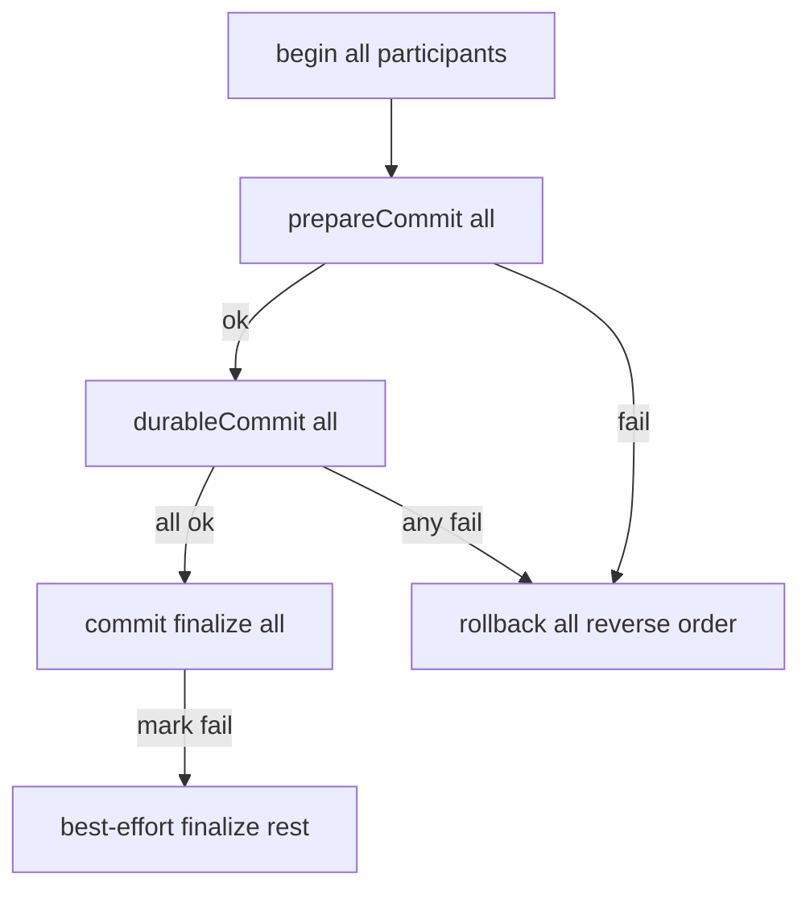

# Requirements

### Overview & Goals

Resolve the three definitive open P2s in `docs/FIXME.md` in the recommended order, then lock them closed in that file. Residual P3s stay deferred.

### Scope

#### In Scope
- **P2-1** (`P2-ALIAS-DIAGNOSTIC-STATS-NAME`): dual source/stats names in operator-visible miss text; regression for wrong-keyed female aliases
- **P2-2** (`P2-TX-DURABLE-FAILURE-FINALIZE`): durable-commit failure rolls **all** participants back and does **not** finalize identity; JDBC never restores autocommit via the success `commit()` path on a failed durable txn
- **P2-3** (`P2-CRICSHEET-JSON-ROUNDTRIP`): replace JSON key-map round-trip with one decode + explicit Kotlin `CricSheet` → `BbbMatchData` mapper
- Update `docs/FIXME.md` so fixed P2s move to locked-closed
- Tests for each P2 (JUnit + Strikt); `./gradlew check` green for touched modules

#### Out of Scope
- Residual P3 list (long `Database.writeMatch`, dual schema sources, `getNameParts` heuristics, etc.)
- Optional P2-1 alias write-time warn/reject guard (**diagnostics only**, per decision)
- Reopening locked-closed P1s without new evidence

### User Stories
- As an operator inserting `team_name_aliases` after a link miss, I want miss text to show the **source** alias key (and stats name for context) so I do not store the wrong key.
- As a caller of `MatchTransaction` / JDBC adapters, I want durable failure to leave identity and connection state as if the match never committed.
- As a maintainer of parse-cricsheet, I want a direct typed mapper instead of a generic JSON rewrite over duplicated DTOs.

### Functional Requirements
1. `MatchLookupCriteria.toString()` (and thus NotFound/Ambiguous parser/log messages) include both source and stats team names when they differ (and remain clear when equal).
2. Alias keyed `"Australia Women"` does **not** resolve a female source team `"Australia"`; alias keyed `"Australia"` does.
3. On `durableCommit()` failure before all durable participants succeed: roll **every** participant back; do **not** call participant `commit()` / identity finalize; `isActive` ends false so outer `Database.withMatchTransaction` rollback is a no-op.
4. After all durable participants succeed, post-durable `commit()` mark failures keep best-effort finalize of remaining participants (unchanged).
5. JDBC participant: durable path only `connection.commit()`; restore autocommit only via successful finalize or via `rollback()` (`rollback` then restore) — never `setAutoCommit(true)` as the durable-failure recovery path.
6. `CricSheetConverter.convert(CricSheet)` maps field-by-field (including warehouse `matchType` / `w` prefix); `normalizeKeys` and `SOURCE_KEYS` deleted.

### Non-Functional Requirements
- Follow existing feature/module boundaries (`bbb-parse-cricsheet`, `bbb-update-database`, `bbb-cli-shared` contracts unchanged on the wire).
- Prefer small functions, sealed errors already in place, TDD-style tests with Strikt.
- Do not change production SQL publish / CSV recovery / provenance / alias non-drop contracts.

# Technical Design

### Current Implementation

**P2-1 — alias diagnostics**
- `bbb-parse-cricsheet/.../StatsMatchLinker.kt`: lookup uses `aliasesFor(sourceFirstTeam/sourceSecondTeam)` and stats names via `TeamNamePolicy`, but `MatchLookupCriteria.toString()` is only `"$statsFirstTeam vs $statsSecondTeam on $matchDate …"`.
- `CricSheetParser.linkMatch` embeds `result.criteria` in NotFound/Ambiguous messages, so operators see stats-shaped names.
- Existing female happy-path: `StatsMatchLinkerTest` `given a female match alias under its source team name then ca id is returned` (alias key `"Australia"`).

**P2-2 — durable failure**
- `MatchTransaction.commit()` on durable failure calls `commitParticipants(failure)` then clears `isActive` — identity finalize runs; outer rollback is a no-op.
- Test locks that contract: `MatchTransactionTest` `given durable failure when committing then finalization is best effort without rollback`.
- Participants: `RelationalMatchSession.transactionParticipant()` (identity snapshot/commit/restore), `JdbcOutputAdapter.connectionTransaction` (`durableCommit` = JDBC commit; `commit` = `restoreAutoCommit()`; `rollback` = JDBC rollback + restore), `CsvOutputState` (publish on durable; clear pending on commit; restore snapshot on rollback).
- Order is always session first, sink second (`JdbcOutputAdapter`, `CsvOutputAdapter`).

**P2-3 — Cricsheet round-trip**
- `CricSheetConverter.convert(CricSheet)` encodes → `normalizeKeys`/`SOURCE_KEYS` → rewrites `info`→`match` + warehouse `matchType` → decodes `BbbMatchData`.
- Wire DTOs already differ usefully: `source/CricSheet.kt` (snake_case `@SerialName`, root `info`) vs `bbb-cli-shared/.../BbbMatchData.kt` (camelCase, root `match`, optional `sourceCaId`). Keep both types.

### Key Decisions
1. **P2-1 diagnostics only** — dual names in criteria text + regressions; no alias insert guard.
2. **P2-2 rollback-all inside `MatchTransaction`** — on durable failure, reverse-order `rollback()` all participants, suppress secondary failures onto the durable exception, set `isActive = false`, do not finalize. Outer `Database` catch rollback remains safe no-op.
3. **P2-2 keep post-durable mark best-effort finalize** — only after every `durableCommit` succeeds.
4. **P2-3 keep two DTO graphs; explicit mapper** — no shared single type; delete JSON rewrite helpers.
5. **P3 residual untouched**; lock fixed P2s in `docs/FIXME.md` when done.

### Proposed Changes

#### P2-1 Alias diagnostics
- Change `MatchLookupCriteria.toString()` to surface both names, e.g. when source ≠ stats: `source "Australia" (stats "Australia Women") vs source "…" (stats "…") on <date> …`; when equal, keep a compact form that still makes the alias key obvious (prefer always showing `source "…"` as the primary key operators must insert).
- Add `StatsMatchLinkerTest` regressions:
  - female match, alias keyed `"Australia Women"` → still `NotFound` (does not resolve).
  - female match, alias keyed `"Australia"` → `Linked` (existing test retained/aligned).
- Assert NotFound/Ambiguous message/`criteria.toString()` contains source name and does not teach stats-only as the sole key.
- No change to lookup algorithm itself.

#### P2-2 Durable-failure rollback
- In `MatchTransaction.commit()` durable `catch`:
  - replace `commitParticipants(failure)` with `rollbackParticipants(participants.asReversed(), failure)`
  - `isActive = false`; rethrow durable failure (with suppressed rollback errors)
- Replace the “best effort without rollback” test with: durable failure → all rollbacks, **no** `commit`/finalize events, `isActive == false`.
- Keep “mark failure after durable commit then remaining participants are finalized”.
- JDBC: no behavioral change required on the happy path; durable-failure recovery must go through `rollback()` only. Add a focused test (unit double or thin JDBC-facing test if one already exists nearby) proving durable failure does not invoke success-path `restoreAutoCommit` alone. If `JdbcOutputAdapter` needs a tiny split so tests can observe phases, keep it minimal.
- CSV/SQL script participants already implement rollback correctly; they benefit automatically from the orchestrator change.

#### P2-3 Direct Cricsheet mapper
- Rewrite `CricSheetConverter.convert(cricSheet: CricSheet): BbbMatchData` as pure Kotlin mapping:
  - drop `meta`
  - map `info` → `BbbMatchData.match` (`Info`) including nested event/officials/outcome/toss/etc.
  - map innings/overs/deliveries/replacements (`in`/`out` already bound as `cameIn`/`wentOut` on source types)
  - apply existing `warehouseMatchType(matchType, gender)` into warehouse `matchType`
  - pass through `players` / `registry` / other `JsonObject`/`JsonElement` fields as today
- Delete `normalizeKeys`, `SOURCE_KEYS`, and JSON encode/decode round-trip inside `convert(CricSheet)`.
- Keep `convert(rawBytes, providerRecordKey)` envelope/digest behavior unchanged (still one `CricSheet` decode).
- Add focused converter unit tests (fixture JSON or constructed `CricSheet`) covering: matchType encoding (male/female), replacements cameIn/wentOut, nested delivery fields, unknown keys ignored at decode.
- Existing `CricSheetParserTest` remains the integration backstop.

#### Docs
- Move P2-1..P2-3 into **Locked closed** in `docs/FIXME.md` with short “why it stays closed” notes; leave P3 residual and review guardrails intact.

### File Structure
- **Modify:**
  - `bbb-parse-cricsheet/.../StatsMatchLinker.kt`
  - `bbb-parse-cricsheet/.../StatsMatchLinkerTest.kt`
  - `bbb-parse-cricsheet/.../CricSheetConverter.kt`
  - `bbb-parse-cricsheet/.../CricSheetParserTest.kt` (only if message assertions need updates)
  - `bbb-update-database/.../MatchTransaction.kt`
  - `bbb-update-database/.../MatchTransactionTest.kt`
  - `bbb-update-database/.../JdbcOutputAdapter.kt` (only if needed for safer/testable durable failure)
  - `docs/FIXME.md`
- **Add:**
  - `bbb-parse-cricsheet/.../CricSheetConverterTest.kt` (mapper coverage)

### Risks
- **Partial CSV durable publish:** if `CsvOutputState.durableCommit` fails mid-publish, in-memory rollback cannot unpublish files already written. Accept as existing sink limitation; in-memory/identity contract still corrected. Out of scope to add compensating file cleanup unless a test already requires it.
- **Mapper parity:** field omissions vs old JSON path — mitigate with converter tests + parser fixtures.
- **Message churn:** any tests asserting exact NotFound strings must be updated with dual-name format.

# Testing

### Validation Approach
- TDD per P2: failing test first, minimal implementation, refactor.
- Run module checks: `bbb-parse-cricsheet` and `bbb-update-database`, then `./gradlew check --no-daemon` as final gate for touched work.

### Key Scenarios
1. **P2-1:** female `Australia` miss text includes source `Australia` and stats `Australia Women`; alias under stats name does not link; alias under source name does.
2. **P2-2:** durable failure → rollback events only (no finalize); prepare failure still rolls back; full success phase order unchanged; post-durable mark failure still finalizes remaining.
3. **P2-3:** sample Cricsheet documents convert to equivalent `BbbMatchData` (matchType, teams, deliveries, replacements) without JSON key rewriting.

### Edge Cases
- Source name already equals stats name (male teams) — message still unambiguous.
- Durable failure on second participant after first durable no-op/success — both rolled back.
- JDBC durable failure must not leave pending work committed via `setAutoCommit(true)`.
- Female match types get `w` prefix; unknown source match types still throw.

### Test Changes
- Update/replace `MatchTransactionTest` durable-failure contract test.
- Extend `StatsMatchLinkerTest` with wrong-key / right-key female alias pair and criteria string assertion.
- Add `CricSheetConverterTest`.
- Adjust parser tests only if they pin old criteria strings.

# Delivery Steps

### ✓ Step 1: Fix P2-1 alias miss diagnostics
Operator-visible link misses show source alias keys (with stats names for context); wrong-keyed female aliases do not resolve.

- Update `MatchLookupCriteria.toString()` in `StatsMatchLinker.kt` to include both source and stats team names (source is the alias key operators must insert).
- Add/adjust `StatsMatchLinkerTest` regressions: alias key `"Australia Women"` does not link female `"Australia"`; alias key `"Australia"` does; miss text cannot be used as a stats-only insert recipe.
- Touch `CricSheetParser` only if message formatting needs an explicit tweak beyond criteria `toString()`.
- Leave lookup/alias resolution algorithm unchanged; no optional warn/reject guard.

### ✓ Step 2: Fix P2-2 durable-failure rollback contract
Durable-commit failure leaves identity and sink state as if the match never committed.

- Change `MatchTransaction.commit()` so a `durableCommit` failure rolls **all** participants back (reverse order), does not call participant `commit()`/finalize, clears `isActive`, and rethrows with suppressed rollback errors.
- Keep best-effort finalize only for post-durable mark failures after every durable participant succeeded.
- Replace `MatchTransactionTest` “best effort without rollback” with the new rollback-all contract; retain prepare-failure and post-durable mark-failure coverage.
- Verify `JdbcOutputAdapter` recovery on durable failure uses `rollback()` then restore autocommit only — never success-path `restoreAutoCommit()` alone on a live failed txn; adjust adapter only if required for correctness or a tight test.
- Confirm CSV/SQL script adapters inherit the orchestrator fix via existing participant `rollback()` implementations.

### ✓ Step 3: Replace Cricsheet JSON round-trip with direct mapper
`CricSheetConverter` performs one decode plus an explicit Kotlin map to `BbbMatchData`; `normalizeKeys`/`SOURCE_KEYS` are gone.

- Implement field-by-field `CricSheet` → `BbbMatchData` mapping (info→match, innings/deliveries/replacements, warehouse `matchType` via existing `warehouseMatchType`).
- Delete JSON encode → key rewrite → decode path and helpers.
- Keep envelope/digest `convert(rawBytes, providerRecordKey)` behavior and both DTO hierarchies (`source/CricSheet.kt` vs `clishared/.../BbbMatchData.kt`).
- Add `CricSheetConverterTest` for matchType gender prefix, replacements, and nested delivery parity; keep `CricSheetParserTest` as integration backstop.

### ✓ Step 4: Lock P2s in FIXME and run checks
P2-1..P2-3 are documented as locked closed and module checks pass.

- Move the three fixed items into the Locked closed table in `docs/FIXME.md` with brief rationale; keep residual P3s and review guardrails.
- Run targeted then full relevant Gradle `check` for `bbb-parse-cricsheet` and `bbb-update-database` (and broader `./gradlew check --no-daemon` if required by project guidelines after the change set).
- Fix any test/assertion fallout from criteria message or mapper parity without suppressing warnings.