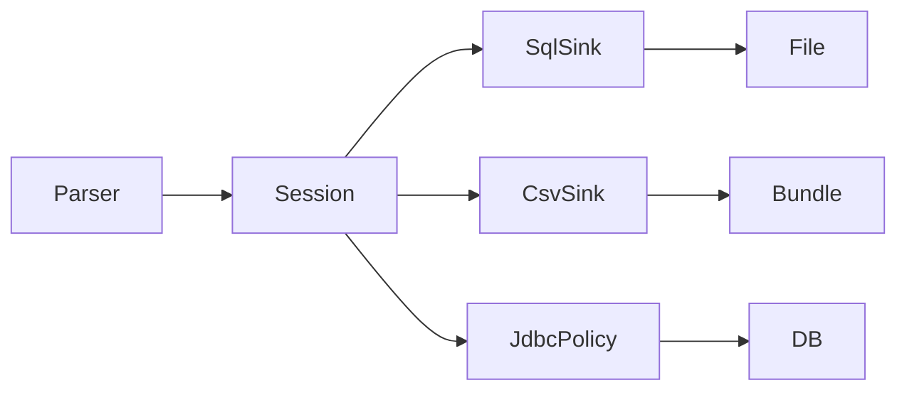

# Requirements

### Overview & Goals

Land the full `docs/FIXME.md` remediation for the relational output path and related parse/link debt. Goal: **one domain write model**, **one SourceCaId policy**, **one journaled replace machine**, **schema-enforced alias uniqueness**, **policy lists as versioned resources**, plus the listed linker/JDBC/parse cleanups.

**Important current state:** ADR 0042 / FIXME “Done this pass” / a project_memory entry were written as if this already shipped, but the codebase still has the pre-remediation shape (`SqlScriptOutputAdapter` ~484 LOC and `CsvOutputAdapter` ~329 LOC still own full domain writes; no `relational/` package, no `2__*.sql`, no `policies/` resources). This plan **implements the real code** and **corrects those docs** to match reality.

### Scope

#### In Scope
- Collapse SqlScript + Csv domain writes into `RelationalMatchSession` + thin sinks; JDBC reuses shared SourceCaId allocator + write helpers
- Single SourceCaId assignment policy (no CSV column ordinals; no forked lifecycle rules)
- Shared `JournaledMatchReplace` for SQL script file replace and CSV directory publish
- CSV transaction model: stop double-snapshotting `deliveryFielders` / distrust of `RelationalOutputState`
- Additive migrations `2__team_name_aliases_unique.sql` (mysql/postgres/sqlite) — unique on `(source_system, source_team_name, stats_team_id)`; keep `1__initial_tables.sql` immutable going forward
- Align `RelationalSchemaSql` CREATE for aliases with the same uniqueness
- Move `StatsLookupPolicy` / `TeamNamePolicy` exception lists to classpath resources under `policies/`
- Linker: one shared `JdbcStatsMatchRepository` instance
- Remove JDBC `.drop(1)` value-list coupling
- Candidates API: keep only split public surface if production does not need combined `candidates()`
- Sealed parse/link error hierarchy (replace bare `IllegalStateException` subclasses)
- Docs: rewrite ADR 0042 if needed for accurate schema; reset FIXME status until code lands; honest project_memory entry + light split/hygiene note

#### Out of Scope
- Full JDBC collapse into the same in-memory session (identity-return / live SQL remains adapter-owned; follow-up only)
- Rewriting sealed Flyway/baseline history of already-applied `1__` contents beyond additive `2__`
- Non-FIXME product features

### User Stories

- As a maintainer, I change match/source-CA write rules once and SqlScript + Csv stay correct.
- As an operator, duplicate `team_name_aliases` rows fail at the DB, not only in app logic.
- As a contributor, tournament/team exception lists are reviewable text resources, not Kotlin `setOf`.
- As a CLI user, parse/link failures share one sealed error family with stable messages.

### Functional Requirements

1. `OutputAdapter` behavior for SqlScript and Csv is preserved for existing tests (inserts, upserts, transactions, source CA assignment, atomic publish).
2. SourceCaId outcomes are explicit (`Reject` / `NoOp` / `RegisterNow` / `PendingUpdate` or equivalent); CSV updates match rows by **named column**, never ordinal `3`.
3. Crash recovery for SQL script replace and CSV bundle publish goes through one journal utility; recovery-on-start still works.
4. Fresh and migrated DBs reject duplicate alias triples.
5. Missing/empty policy resources fail fast at load.
6. `./gradlew :bbb-update-database:check :bbb-parse-cricsheet:check :bbb-cli-shared:check` passes.

### Non-Functional Requirements

- Composition over inheritance (session + sinks, not a deep adapter base hierarchy).
- Idiomatic Kotlin; JUnit + Strikt tests for new units.
- ADR documents the session/sinks decision; ARCHITECTURE touch only if module boundaries change meaningfully.

# Technical Design

### Current Implementation

- **Adapters:** `bbb-update-database/.../adapter/SqlScriptOutputAdapter.kt`, `.../csv/CsvOutputAdapter.kt`, `.../JdbcOutputAdapter.kt` each implement full `OutputAdapter` domain writes.
- **Shared pieces already present:** `RelationalOutputState`, `RelationalWriteSupport`, `SourceCaIdState`, `TransactionalCollections`, `RelationalSchemaSql`.
- **Durability:** `SqlScriptOutputAdapter.replaceFile` + journal helpers; `CsvBundlePublisher.publishBundleAtomically` + parallel journal phases.
- **CSV tx:** `beginMatch` snapshots adapter buffers **and** double-handles `deliveryFielders` already in state.
- **Schema:** `migrations/{mysql,postgres,sqlite}/1__initial_tables.sql` — `team_name_aliases` has no unique key (only index on `stats_team_id`).
- **Policies:** `bbb-parse-cricsheet/.../StatsLookupPolicy.kt`, `bbb-cli-shared/.../TeamNamePolicy.kt` hardcode sets.
- **Linker:** `JdbcMatchLinker` secondary ctor builds `JdbcStatsMatchRepository` twice; errors are `*Exception : IllegalStateException`.

### Key Decisions

1. **Session + sinks** (user-approved): `RelationalMatchSession` owns state, match write decision, key allocation, row construction, and SourceCaId policy application; sinks only emit.
2. **JDBC partial reuse:** keep DB I/O in `JdbcOutputAdapter`; inject/reuse `SourceCaIdAllocator` (or evolved `SourceCaIdState` API) + `RelationalWriteSupport` SQL/param helpers — not a third copy of domain conditionals where avoidable.
3. **One `JournaledMatchReplace`:** parameterize path kind (single file vs directory bundle); adapters call utility only.
4. **Alias uniqueness:** additive `2__team_name_aliases_unique.sql` on **`(source_system, source_team_name, stats_team_id)`** (actual columns — not the mistaken `(match_type, team_name)` in the draft ADR text).
5. **Policy home:** versioned classpath resources (e.g. `policies/*.txt` or JSON) loaded once; fail-fast.
6. **Docs honesty:** treat existing “landed” markers as premature; implementation rewrites status when code is real.

### Proposed Changes

#### Relational session + sinks

New package under update-database adapters, e.g. `adapter/relational/`:

- `RelationalMatchSession` — implements domain orchestration used by SqlScript/Csv (methods mirroring the duplicated upsert/insert surface, or a narrower internal API the adapters forward to).
- `RelationalSink` (or two small interfaces): `SqlStatementSink.emit(sql, args…)`, `CsvRowSink.emit(table, columns, values)` / pending-row APIs.
- Evolve `SourceCaIdState` → **`SourceCaIdAllocator`** with sealed assignment outcomes; session applies outcomes; sinks persist (`UPDATE` lines, named CSV column patch, JDBC execute).

Thin adapters:

- `SqlScriptOutputAdapter`: open writer, schema header, tx markers, delegate domain methods to session, flush pending SourceCaId SQL on commit, call `JournaledMatchReplace` on close/replace.
- `CsvOutputAdapter`: hold pending row maps as sink-local data; session owns `RelationalOutputState`; commit flushes SourceCaId by column name; publish via publisher + shared journal utility.
- `JdbcOutputAdapter`: replace local reconcile forks with allocator outcomes; replace `.drop(1)` with explicit non-identity value lists/helpers.

#### Journaled replace

- Extract `JournaledMatchReplace` (phases, properties journal, fsync, backup, rollback, recover-on-start) used by:
  - SQL script staged→final file replace
  - CSV temp bundle → output directory publish
- Ensure **single** journal layer: if adapter/session already transactional for domain state, publisher must not invent a second semantic snapshot of the same domain data (fix item 4: adapter-local snapshot only for sink buffers, not `deliveryFielders`).

#### Schema

- Add `bbb-update-database/migrations/{mysql,postgres,sqlite}/2__team_name_aliases_unique.sql`.
- Update `RelationalSchemaSql` alias DDL for greenfield script output to include the unique constraint.
- Do **not** further rewrite sealed baseline semantics except as required for greenfield consistency documented in ADR.

#### Policies

- Resources e.g. `bbb-parse-cricsheet/src/main/resources/policies/stats-all-season-exclusions.txt`, `stats-season-exclusions.txt`, and `bbb-cli-shared/src/main/resources/policies/female-competition-exceptions.txt`, `female-team-exceptions.txt` (exact split mirrors current sets).
- Loaders in `StatsLookupPolicy` / `TeamNamePolicy`; unit tests cover parse + fail-fast.

#### Parse / linker cleanups

- `JdbcMatchLinker(stats, alias)`: one `JdbcStatsMatchRepository` shared with alias resolver.
- Sealed hierarchy e.g. `sealed class ParseLinkError` / keep throwing wrappers if CLI needs exceptions, but single family.
- Delete or internalize combined `candidates()` if only split APIs are used.

### File Structure

**Add**

- `bbb-update-database/src/main/kotlin/.../adapter/relational/RelationalMatchSession.kt`
- `.../relational/RelationalSink.kt` (or Sql/Csv sink types)
- `.../relational/SourceCaIdAllocator.kt` (if split from `SourceCaIdState`)
- `.../relational/JournaledMatchReplace.kt` (or `adapter/journal/`)
- `migrations/*/2__team_name_aliases_unique.sql`
- `**/resources/policies/*`
- Tests beside existing adapter/session suites

**Modify**

- `SqlScriptOutputAdapter.kt`, `CsvOutputAdapter.kt`, `CsvBundlePublisher.kt`, `JdbcOutputAdapter.kt`
- `SourceCaIdState.kt` / callers, `RelationalSchemaSql.kt`, `RelationalOutputState.kt` as needed
- `StatsLookupPolicy.kt`, `TeamNamePolicy.kt`, `StatsMatchLinker.kt` (+ tests)
- `docs/FIXME.md`, `docs/adr/0042-...md` (fix constraint names), `docs/project_memory.md`, optionally `docs/ARCHITECTURE.md`

### Risks

- **Behavioral drift** between sinks while moving logic — mitigate by keeping existing adapter tests green and adding session unit tests first where practical.
- **Journal unification** subtle OS/move differences — port both existing test suites (`SqlScriptOutputAdapterFileMoveTest`, CSV publish failure tests).
- **Migration on DBs with duplicate aliases** — unique constraint apply may fail; document cleanup prerequisite.
- **Premature docs** may confuse reviewers — correct in the same delivery.

# Testing

### Validation Approach

- TDD-friendly unit tests for session, allocator outcomes, journal utility, policy resource loading.
- Keep/extend existing adapter tests as regression harness for SqlScript, Csv, Jdbc.
- Module checks: `./gradlew :bbb-update-database:check :bbb-parse-cricsheet:check :bbb-cli-shared:check`.

### Key Scenarios

- Session allocates keys and emits identical logical rows to Sql and Csv sinks for a minimal match write.
- SourceCaId: reject double-owner; pending update applied on commit; CSV updates by column name.
- Journaled replace: backup/rollback/recover paths for file and directory.
- Alias migration: second identical triple insert fails.
- Policy resources: known exclusion/exception behavior unchanged vs previous hardcodes; missing resource fails fast.
- Linker secondary constructor uses one stats repo; sealed errors still fail fast with clear messages.

### Edge Cases

- Atomic move unsupported fallback (existing SQL script test).
- CSV copy/publish failure removes temp bundle.
- JDBC upsert paths without identity-column drop hacks.
- Empty policy file rejected.

### Test Changes

- Add: `RelationalMatchSessionTest`, `SourceCaIdAllocatorTest` (evolve existing `SourceCaIdStateTest`), `JournaledMatchReplaceTest`, policy loader tests, migration assertion in dialect tests if pattern exists (`DialectMigrationTest`).
- Update: adapter tests only where construction/wiring changes.

# Delivery Steps

### ✓ Step 1: Session foundation + SourceCaId policy
RelationalMatchSession, sinks contracts, and SourceCaIdAllocator exist with unit tests; domain write logic can run without Sql/Csv duplication.

- Add `adapter/relational/` types: `RelationalMatchSession`, sink interfaces, wire `RelationalOutputState` + `RelationalWriteSupport`.
- Evolve `SourceCaIdState` into explicit assignment outcomes (`SourceCaIdAllocator`); forbid ordinal CSV column updates in design of the API.
- Cover allocator reject/noop/register/pending and a minimal session write path with JUnit/Strikt.
- Leave production adapters delegating only after the next stage if needed; prefer session tests green first.

### ✓ Step 2: Thin SqlScript + Csv adapters + CSV tx cleanup
SqlScript and Csv adapters are thin sinks over the session; CSV no longer double-snapshots state-owned collections.

- Refactor `SqlScriptOutputAdapter` to delegate upsert/insert/match decision/SourceCaId to the session; keep dialect SQL emission + BEGIN/COMMIT script semantics.
- Refactor `CsvOutputAdapter` similarly; snapshot only sink-local buffers (`pendingRows` / `matchRows` / `matchPeople`); stop special-casing `deliveryFielders`.
- Update SourceCaId CSV flush to named column / typed row map.
- Keep existing `SqlScriptOutputAdapterTest` / `CsvOutputAdapterTest` passing.

### ✓ Step 3: JournaledMatchReplace + JDBC reuse
One journal utility owns file and directory replace; JDBC reuses allocator and drops `.drop(1)` coupling.

- Extract `JournaledMatchReplace` from `SqlScriptOutputAdapter` replace/journal helpers and `CsvBundlePublisher` publish/recovery.
- Point both call sites at the utility; preserve recover-on-start and move fallbacks; migrate `SqlScriptOutputAdapterFileMoveTest` and CSV publish failure tests.
- Teach `JdbcOutputAdapter` to use shared SourceCaId policy outcomes and explicit JDBC value helpers (no `.drop(1)` on identity lists).
- Run update-database check suite.

### ✓ Step 4: Alias unique migrations + schema SQL
Additive unique constraint on team_name_aliases exists for all dialects and greenfield script DDL matches.

- Add `2__team_name_aliases_unique.sql` under mysql/postgres/sqlite on `(source_system, source_team_name, stats_team_id)`.
- Align `RelationalSchemaSql` CREATE TABLE for aliases.
- Extend migration/dialect tests as appropriate; document cleanup if duplicates exist.

### ✓ Step 5: Policy resources, linker/parse cleanups, docs truth
Policies load from versioned resources; linker/parse nits closed; docs match the real tree.

- Move Stats/Team exception lists to `policies/` classpath resources; fail-fast loaders; preserve behavior via tests.
- Fix `JdbcMatchLinker` double repository construction; sealed parse/link errors; trim combined `candidates()` if unused.
- Correct ADR 0042 (constraint columns), rewrite `docs/FIXME.md` status from premature “all done” to accurate completion only after code exists, add honest `project_memory` entry + hygiene note for oversized log.
- Final: `./gradlew :bbb-update-database:check :bbb-parse-cricsheet:check :bbb-cli-shared:check`.