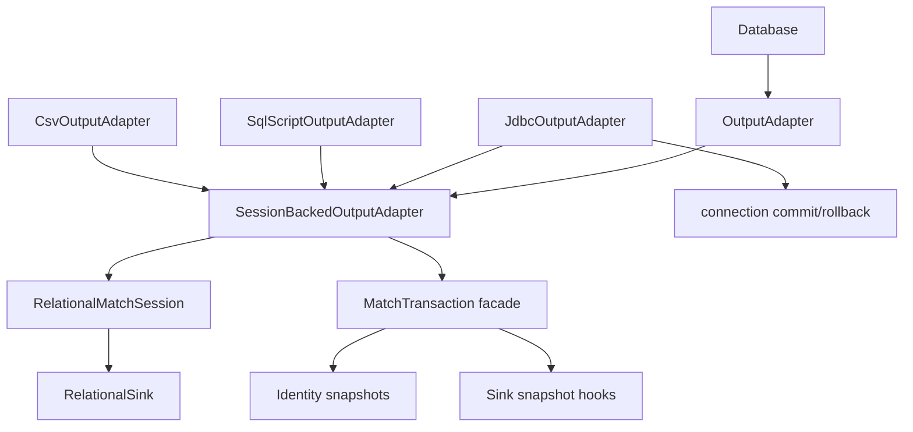
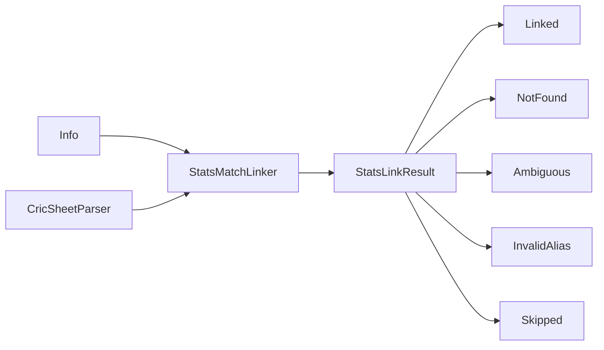

# Requirements

### Overview & Goals

Work through `docs/FIXME.md`: close the **2 true P1 blockers**, then deliver the **full P2 list (24 items)**. P3 stays deferred. Do **not** reopen closed write-path P1s (single `RelationalMatchSession` brain, session/JDBC parity suite as specified, durable alias bootstrap on generated SQL) unless they regress.

**Chosen direction (confirmed):**
- P1.2 → **MariaDB-only generated scripts** (stop treating `mysql` as interchangeable)
- Write path → **`SessionBackedOutputAdapter` base** keeping `OutputAdapter` for `Database`
- Transactions → **single match-tx facade** with sink hooks; JDBC owns `connection.commit()`
- Linker outcomes → **sealed `StatsLinkResult`** (exceptions only for infra failure)

### Scope

#### In Scope
- **P1.1** Female alias lookup: raw **source** team names for aliases; `TeamNamePolicy` only for stats name lookup
- **P1.2** Reject/document `--db mysql`; keep MariaDB script dialect; no silent MySQL-unsafe bootstrap
- **P2 write-path / tx (1–9)** Session-backed base, match-tx facade, JDBC commit ownership, CSV second-state collapse, allocator API trim, `writeAllPeople` envelope, one uniqueness gate, `close()` parity, pure helpers out of `Database.kt`
- **P2 correctness / ops (10–15)** CSV non-empty dir safety, parity suite sink facts, schema contract alignment, cutover alias restore docs, migration `2__` preflight/guidance, `DataSourceManager` pool key + shutdown
- **P2 parse / link (16–20)** Sealed link results, simplified lookup attempts, policy ownership cleanup, parser takes validated input, linker rename/`fromConnections`
- **P2 docs / hygiene (21–24)** `project_memory` split/index, architecture/ADR drift fixes, policy resource pointers, honest `FIXME.md` verdict
- Tests for every behavioral change; `./gradlew clean check --no-daemon` green for touched modules
- ADR(s) for architectural decisions; update `docs/ARCHITECTURE.md` / `docs/architecture/applications.md` where flows change

#### Out of Scope
- P3 items (`replaceFile` wrapper, magic `insertMatchPerson` protocol, journal phase vocabulary, dead column helpers, empty policy files, tiny-types at all boundaries, dead `updatedRows` param) unless forced by a P1/P2 change
- Reopening closed P1 write-path work without regression evidence
- Making MySQL 8 a first-class generated-script dialect (explicitly rejected)

### User Stories

- As a parser operator, I want female Cricsheet team aliases keyed by source names (e.g. `"Australia"`) to resolve to stats teams named `"Australia Women"`, so ordinary women’s matches link instead of throwing `StatsMatchNotFoundException`.
- As a CLI operator, I want `--db mysql` rejected (or clearly unsupported) so I cannot run a generated script that DROPs match tables then fails mid-bootstrap on MySQL 8.
- As a maintainer, I want one session-backed write port and one match transaction model so JDBC/SQL/CSV do not diverge on commit/close/rollback semantics.
- As a parser maintainer, I want link outcomes as data (`StatsLinkResult`) so expected misses/ambiguity are not control-flow exceptions.

### Functional Requirements

1. **P1.1** Alias resolution uses **raw Cricsheet/source** team names; exact stats lookup uses **policy-adjusted** names. Regression test: female non-exception match + alias under raw name + stats `"… Women"` → CA id on exact miss + alias hit.
2. **P1.2** Script path accepts MariaDB (and existing postgres/sqlite); **`mysql` is not a safe alias**. Help text, validation, and tests enforce this. No requirement to emit MySQL-8-safe `CREATE INDEX IF NOT EXISTS`.
3. **Write path** `Database` still talks to `OutputAdapter`; concrete adapters share `SessionBackedOutputAdapter` forwarding; lifecycle overrides only where sinks differ.
4. **Match tx** One facade: begin/commit/rollback; identity + sink snapshots register with it; `SourceCaIdAllocator` finishes identity state only; JDBC adapter commits the connection itself.
5. **`close()`** Active match tx rolls back; never invents a commit (JDBC included).
6. **`writeAllPeople`** Same begin/commit/rollback envelope as `writeMatch`.
7. **CSV output** Do not wipe non-empty dirs without explicit `--force` (or refuse).
8. **Linker** Returns sealed results; parser maps at boundary; infra failures remain exceptions.
9. **`docs/FIXME.md`** Updated continuously: P1 count honest after P1 stage; P2 items checked off as delivered.

### Non-Functional Requirements

- Kotlin-first, small functions, Arrow/`Either` where already established; sealed errors for domain outcomes
- JUnit + Strikt tests; Testcontainers only where already used (e.g. migration/dialect smoke)
- Feature-slice / module boundaries preserved (`bbb-parse-cricsheet`, `bbb-update-database`, `bbb-cli-shared`, `bbb-shared`)
- No production write-path file should grow past maintainability norms already called out as “good” in FIXME

# Technical Design

### Current Implementation

**P1.1 — linker names**
- `MatchLookupCriteria.from` in `bbb-parse-cricsheet/.../StatsMatchLinker.kt` maps both teams through `TeamNamePolicy.nameForMatch` into `firstTeam`/`secondTeam`.
- `findStatsCaId` uses those same strings for `aliasResolver.aliasesFor(...)` and for `StatsTeamLookup.Name`.
- `TeamNameAliasRepository` / ADR 0006 key aliases by **`source_team_name`** (Cricsheet/source), not stats display names.
- Female ordinary teams become `"Australia Women"` for both paths → alias rows under `"Australia"` miss.
- Tests in `StatsMatchLinkerTest` cover male/exact/partial alias paths; **no female + raw-source alias regression**.

**P1.2 — script dialect**
- `RelationalSchemaSql` emits `CREATE INDEX IF NOT EXISTS` on `team_name_aliases` (MySQL 8 rejects).
- `Application.createScriptOutputAdapter`: `"mariadb", "mysql"` → MariaDB script adapter.
- Help text already says mariadb/postgres/sqlite, but code still accepts `mysql`.
- Schema tests lean SQLite-generated DDL; `DialectMigrationTest` covers Flyway-style `migrations/mysql/` only, not full generated bootstrap script.

**Write path**
- `RelationalMatchSession` + `RelationalSink` already own domain writes.
- `JdbcOutputAdapter` / `SqlScriptOutputAdapter` / `CsvOutputAdapter` are near-identical `session.*` forwarders with separate `TransactionCoordinator`s.
- `JdbcOutputAdapter.commit` passes `connection.commit()` into `session.commit { ... }` / allocator commit callback.
- CSV keeps parallel `pendingRows` / `matchRows` / … snapshots beside session state.
- `JdbcOutputAdapter.close()` is a no-op.

**Parse/link**
- Outcomes are `ParseLinkError : IllegalStateException` used as control flow.
- Multiple policies: `StatsLookupPolicy`, `StatsMatchLookupPolicy`, `TeamNamePolicy`.

### Key Decisions

| Decision | Choice | Rationale |
|---|---|---|
| MySQL scripts | **MariaDB-only**; reject `mysql` for `--db` | Avoid false safety; migrations remain separate from generated scripts |
| Adapter shape | **`SessionBackedOutputAdapter`** keeps `OutputAdapter` | Minimal `Database` churn; deletes forwarding boilerplate |
| Transactions | **Single `MatchTransaction` facade** + sink hooks | Collapses nested undo; JDBC commit stays at adapter edge |
| Link outcomes | **`sealed interface StatsLinkResult`** | Expected outcomes as data; infra stays exceptional |
| Closed P1s | **Do not reopen** | Per FIXME verdict |

### Proposed Changes

#### P1.1 — Split source vs stats team names
- Extend `MatchLookupCriteria` with explicit fields, e.g. `sourceFirstTeam` / `sourceSecondTeam` and `statsFirstTeam` / `statsSecondTeam` (or nested tiny types).
- `from(match)`: keep raw `match.teams` for source; apply `TeamNamePolicy.nameForMatch` only for stats names.
- `findStatsCaId`: exact + `StatsTeamLookup.Name` use **stats** names; `aliasesFor` uses **source** names; alias candidate building pairs source-resolved ids with stats names as designed by `StatsMatchLookupPolicy`.
- Add focused unit/integration test in `StatsMatchLinkerTest` (and policy test if needed).

#### P1.2 — MariaDB-only script CLI
- In `bbb-update-database/.../Application.kt`: accept only `mariadb` | `postgres`/`postgresql` | `sqlite` for script dialect; **fail fast** on `mysql` with a clear message (MariaDB dialect + JDBC `jdbc:mysql` for live connections can remain documented separately if still intentional).
- Align option description; add unit/CLI argument test.
- Optionally leave `CREATE INDEX IF NOT EXISTS` on MariaDB/SQLite path (valid there); do not claim MySQL script support.
- Note in architecture/FIXME: generated scripts ≠ `migrations/mysql/` Flyway path.

#### P2 write-path — Session-backed base + match-tx

- Introduce `SessionBackedOutputAdapter` implementing domain methods via `session`.
- Introduce `MatchTransaction` (name flexible) that owns non-reentrant begin/commit/rollback; session + sink register undo; remove redundant nested coordinator usage where safe.
- **JDBC:** `commit()` = session/facade finish **then** `connection.commit()`; never smuggle connection commit through `SourceCaIdAllocator.commit(persist)`.
- **`close()`:** if tx active → rollback; file adapters still publish only on successful close path after commit semantics clarified (rollback on failure; no silent commit).
- **`writeAllPeople`:** wrap with same tx envelope as match writes.
- **CSV:** derive restore from sink/session snapshots; delete dead `updatedRows` / hand-rolled maps where possible.
- **Duplicate suppression:** one gate in identity/session; sinks stay dumb.
- **Allocator:** production surface = decide/apply/finish/rollback; hide or delete test-only `register`/`reconcile` sprawl and overlapping rejects.
- **`Database.kt`:** extract pure helpers (`getNameParts`, victory/margin/powerplay); stop session importing helpers from the orchestrator layer.

#### P2 correctness / ops
- `CsvBundlePublisher.prepareOutput`: require empty dir or `--force`.
- Extend parity thinking: facts from sink/DB; avoid preferring parallel CA maps; where feasible include SQL-script/CSV path or document remaining gap honestly in FIXME.
- Align `RelationalSchemaSql` alias uniqueness/indexes with migrations **or** add dialect diff tests; document single source of truth.
- Cutover docs: export/restore `team_name_aliases` before baseline that drops table; additive path preferred.
- Migration `2__`: preflight duplicate triple check + operator guidance + upgrade test.
- `DataSourceManager`: pool key without raw password material if feasible; `closeAll`/CLI shutdown hook; fix test leakage.

#### P2 parse / link

- Replace control-flow link exceptions with sealed result; map at parser/CLI boundary.
- Simplify lookup: exact attempt then alias set attempt; margin retry as second attempt without `catch NotFound` as design center.
- Collapse confusing dual lookup policy names where practical; keep `TeamNamePolicy` as name shaping only; linker owns linking.
- Parser accepts validated `ParseCricsheetInput` / layout once.
- Rename misnamed `JdbcMatchLinker` + `fromConnections` factory (drop ceremony secondary ctor if possible).

#### Docs / hygiene
- Split/index `docs/project_memory.md` under `docs/project_memory/` if not finished.
- Fix architecture/ADR cutover migration number drift; mark superseded ADR schema detail.
- Point tournament exclusions at `policies/*.txt` only.
- Rewrite `docs/FIXME.md` verdict as items close; keep closed-P1 table.
- Add ADR for session-backed adapter + match-tx facade and sealed link results.

### Data Models / Contracts

```kotlin
// P1.1 sketch
data class MatchLookupCriteria(
    val sourceFirstTeam: String,
    val sourceSecondTeam: String,
    val statsFirstTeam: String,
    val statsSecondTeam: String,
    val matchDate: LocalDate,
    val margin: Int?
)

// P2 linker sketch
sealed interface StatsLinkResult {
    data class Linked(val sourceCaId: String) : StatsLinkResult
    data class NotFound(val criteria: MatchLookupCriteria) : StatsLinkResult
    data class Ambiguous(val criteria: MatchLookupCriteria, val caIds: List<String>) : StatsLinkResult
    data class InvalidAlias(val message: String) : StatsLinkResult
    data object Skipped : StatsLinkResult
}
```

### File Structure (primary touch set)

**Modify**
- `bbb-parse-cricsheet/.../StatsMatchLinker.kt`, `StatsMatchLookupPolicy.kt`, alias resolver usage, parser entrypoints, tests
- `bbb-cli-shared/.../TeamNamePolicy.kt` (only if API needs clarifying; behavior largely stays)
- `bbb-update-database/.../Application.kt`, `RelationalSchemaSql.kt` (docs/comments only if needed), `OutputAdapter.kt`, `JdbcOutputAdapter.kt`, `SqlScriptOutputAdapter.kt`, `csv/CsvOutputAdapter.kt`, `csv/CsvBundlePublisher.kt`, `relational/RelationalMatchSession.kt`, `SourceCaIdAllocator.kt`, `Database.kt`, parity/schema tests
- `bbb-shared/.../DatabaseConnection.kt` (`DataSourceManager`)
- `docs/FIXME.md`, architecture/ADR/project_memory as listed

**Add**
- `SessionBackedOutputAdapter` / `MatchTransaction` (package under `adapter/` or `adapter/relational/`)
- ADR under `docs/adr/`
- New regression tests beside existing linker/schema/CLI tests

### Risks

- **Large blast radius** on write-path refactor — mitigate by keeping `OutputAdapter` binary shape for `Database` and landing session-backed base before deep tx collapse.
- **Sealed link result** changes caller surfaces in parse CLI — mitigate with thin adapter at boundary and exhaustive `when`.
- **Parity suite expansion** may be heavy — deliver sink-fact honesty first; full CSV/SQL parity may land as best-effort with remaining gaps listed in FIXME rather than blocking P1.
- **DataSourceManager** key change can break long-lived processes — add explicit shutdown and migration note for tests.

# Testing

### Validation Approach

- TDD where practical: failing regression first for P1.1 and P1.2, then implementation.
- Module checks: `bbb-parse-cricsheet`, `bbb-update-database`, `bbb-cli-shared`, `bbb-shared` via `./gradlew clean check --no-daemon` (or targeted module `check` during iteration, full clean check before phase exit).
- Prefer JUnit 5 + Strikt; reuse existing Testcontainers patterns only where already present.

### Key Scenarios

1. **P1.1 female alias** — gender female, non-exception competition/team, stats teams `"Australia Women"` / opponent Women, alias `(cricsheet, Australia, statsId)`, exact name miss, alias hit → linked CA id.
2. **P1.1 male unchanged** — source == stats name still links; existing alias tests remain green.
3. **P1.2** — `--db mysql` rejected with actionable error; `--db mariadb` still constructs MariaDB script adapter.
4. **Match tx / JDBC** — successful write commits connection once; failure rolls back session + connection; `close()` with active tx rolls back and does not commit.
5. **People bootstrap** — failure mid-`writeAllPeople` does not publish partial durable output on close.
6. **CSV dir safety** — non-empty output without force refused; force or empty allowed.
7. **Sealed link results** — NotFound/Ambiguous/InvalidAlias mapped without throwing those types as control flow; infra SQL errors still throw.
8. **Migration `2__` preflight** — duplicate triples detected before unique index apply (mysql/postgres paths as applicable).

### Edge Cases

- Female **exception** competition/team: no `Women` suffix; alias + exact behavior consistent.
- Team already ending with ` Women`.
- Margin retry after sealed-result refactor (second attempt, not exception-driven design).
- Re-apply generated **MariaDB/SQLite** script with pre-existing `team_name_aliases` (aliases preserved — closed P1 must stay green).
- Allocator reject paths still surface as domain failures after API trim.

### Test Changes

- **Add** `StatsMatchLinkerTest` female raw-source alias case; CLI/Application dialect rejection test; match-tx/close/people envelope tests; CSV prepareOutput tests; sealed-result parser/linker tests; DataSourceManager shutdown/key tests as behavior changes.
- **Update** adapter tests after session-backed extraction; parity tests when sink-fact rules change; schema/migration tests for preflight.
- **Do not** add MySQL 8 full generated-script apply test as success path (mysql scripts unsupported); optional negative test only if useful.

# Delivery Steps

### ✓ Step 1: P1.1 Fix female source vs stats alias lookup
Female non-exception matches resolve aliases keyed by raw Cricsheet names while stats lookup still uses TeamNamePolicy names.

- Add a failing regression in `StatsMatchLinkerTest`: female match, alias under raw source name, stats team `"… Women"`, exact miss + alias hit → CA id.
- Split `MatchLookupCriteria` into source vs stats team fields in `StatsMatchLinker.kt`.
- Wire `aliasesFor` to **source** names; `StatsTeamLookup.Name` / exact candidate to **stats** names via `TeamNamePolicy.nameForMatch`.
- Adjust `StatsMatchLookupPolicy` call sites/tests if candidate APIs take separate name sets.
- Keep male and existing partial-alias tests green.
- Run `bbb-parse-cricsheet` tests.

### ✓ Step 2: P1.2 Make generated scripts MariaDB-only for --db
`--db mysql` is rejected; MariaDB/postgres/sqlite script paths remain; docs/FIXME no longer claim P1 = 0 or silent MySQL script support.

- Change `Application.createScriptOutputAdapter` / argument validation to accept only supported script dialects; fail fast on `mysql` with a clear MariaDB guidance message.
- Align `--database` help text and any README/architecture notes that imply mysql ≈ mariadb for **generated scripts**.
- Add a focused test for rejection vs `mariadb` acceptance.
- Confirm JDBC URL mapping for live connections is intentional and documented (do not silently treat generated-script mysql as safe).
- Update `docs/FIXME.md` P1 section: P1.1/P1.2 closed with test locks; leave P2 list intact.
- Run `bbb-update-database` tests.

### ✓ Step 3: Session-backed adapter and single match-tx facade
JDBC/SQL/CSV domain writes go through one SessionBackedOutputAdapter; one MatchTransaction facade owns begin/commit/rollback; JDBC connection commit is adapter-owned.

- Add `SessionBackedOutputAdapter` forwarding `OutputAdapter` domain methods to `RelationalMatchSession`.
- Introduce match-tx facade with sink/identity snapshot hooks; fold nested `TransactionCoordinator` usage toward that facade.
- Fix `JdbcOutputAdapter`: remove connection `commit` smuggling through `SourceCaIdAllocator.commit(persist)`; allocator finishes identity only.
- Unify `close()`: rollback active tx; never invent commit on close.
- Give `writeAllPeople` the same begin/commit/rollback envelope as `writeMatch`.
- Slim three concrete adapters to lifecycle + sink wiring.
- Tests for commit/rollback/close/people failure paths; keep existing adapter tests green.
- Draft ADR for session-backed + match-tx decisions.

### ✓ Step 4: Finish write-path P2 cleanup
CSV no longer keeps a second undo world; duplicate suppression and allocator API are simplified; Database pure helpers are extracted.

- Collapse CSV `pendingRows`/`matchRows`/… hand-rolled restore where session/sink snapshots suffice; remove dead `updatedRows` usage.
- One uniqueness gate in identity/session for match people/fielders; sinks stop forking suppression policy.
- Trim `SourceCaIdAllocator` to production decide/apply/finish/rollback; hide or delete test-only sprawl.
- Extract pure helpers from `Database.kt` (name parts, victory/margin, powerplays); fix layering so session does not import orchestrator helpers.
- Update write-path unit/integration tests; run `bbb-update-database` check.

### ✓ Step 5: Correctness and ops P2 hardening
CSV output dirs are safe by default; parity/schema/cutover/migration/pool issues are addressed or honestly constrained in docs.

- Change `CsvBundlePublisher.prepareOutput` to refuse non-empty dirs unless `--force` (wire flag through Application/args).
- Improve parity suite toward sink/DB facts; extend to script/CSV where feasible; document any remaining gap in FIXME rather than masking CA updates.
- Align `RelationalSchemaSql` vs `migrations/*/1__`/`2__` (shared contract or dialect diff tests); fix index/uniqueness drift.
- Update cutover docs for alias export/restore or additive path when baseline drops `team_name_aliases`.
- Add migration `2__` preflight/operator guidance + upgrade test for duplicate triples.
- Fix `DataSourceManager`: safer pool keying, shutdown/close API, test leakage.
- Tests for CSV force/refuse, migration preflight, pool lifecycle.

### ✓ Step 6: Parse/link sealed results and structure P2
Linker returns StatsLinkResult; lookup/margin retry are plain attempts; parser takes validated input; linker construction is renamed/simplified.

- Introduce sealed `StatsLinkResult` and migrate `MatchLinker` / parser/CLI boundary off control-flow `ParseLinkError` for expected outcomes.
- Reshape lookup to exact then alias attempts; margin retry as explicit second attempt.
- Clarify policy ownership: linking policy in linker; `TeamNamePolicy` remains name shaping; remove parser special-cases that bypass linker where present.
- Make parser consume validated `ParseCricsheetInput`/layout once (remove double validation / throwaway adapter growth).
- Rename `JdbcMatchLinker` + `fromConnections` factory; reduce construction ceremony.
- Update parse-cricsheet tests (including P1.1 regression still green under sealed results).

### ✓ Step 7: Docs hygiene and FIXME close-out
Documentation matches the delivered architecture; FIXME P2 items are checked off or explicitly deferred with reasons; project memory/ADR/architecture are current.

- Finish or advance `docs/project_memory.md` split under `docs/project_memory/` with a short index.
- Fix architecture/ADR migration cutover drift; mark superseded schema detail (e.g. ADR 0004 vs 0005).
- Point tournament exclusions at `policies/*.txt` only.
- Refresh `docs/FIXME.md` full verdict (P1 closed, P2 done/remaining, P3 still deferred).
- Update `docs/ARCHITECTURE.md` / `docs/architecture/applications.md` and `docs/project_memory.md` sprint entry.
- Finalize ADRs from write-path and linker stages.
- Run full `./gradlew clean check --no-daemon` and record coverage/gaps.