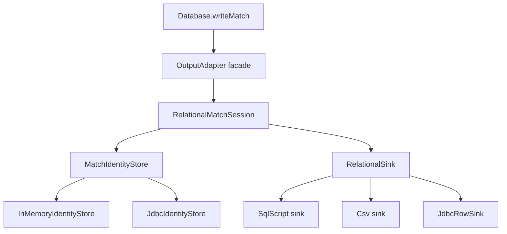

# Requirements

### Overview & Goals

Resolve the three remaining **P1 blockers** in `docs/FIXME.md` on the relational write/adapters surface so the next review can approve. Prior ADR 0042 work stays closed; this plan does **not** re-open those items or take on the P2 list.

**Agreed decisions**
- Scope: **P1 only** (P1.1, P1.2, P1.3)
- P1.1: **one write brain** — `RelationalMatchSession` owns domain decisions; JDBC is identity store + row sink, not a parallel `OutputAdapter` brain
- P1.3: **durable aliases** — `team_name_aliases` is operator-owned config and must survive SQL-script schema bootstrap
- Canonical fork semantics: **JDBC live-DB semantics** (public-id backfill, innings `declared` update on reuse, single source-CA reconcile/register path)

### Scope

#### In Scope
- Shared **adapter parity suite** locking durable outcomes across JDBC and session+sink paths (P1.2)
- **Alias lifecycle** alignment in schema generation, docs/ADR, and tests (P1.3)
- **Collapse JDBC** onto `RelationalMatchSession` via a `MatchIdentityStore` port + `RelationalSink` (P1.1)
- ADR + architecture + `docs/FIXME.md` updates so remaining text matches reality (P1 hygiene only)

#### Out of Scope
- All **P2** items (tx coordinator collapse, `SourceCaIdAllocator` API trim, CSV wipe `--force`, `DataSourceManager` pool lifecycle, project_memory split, god-interface shrink, etc.) unless a P1 change forces a tiny local edit
- Parse-side CA linking (`JdbcMatchLinker`, policies) — already good; do not undo

### User Stories

- As a reviewer, I want one domain write implementation so identity/source-CA/innings changes cannot fork silently across adapters.
- As an operator, I want `team_name_aliases` to survive SQL-script apply so parser re-runs do not wipe manual mappings.
- As a maintainer, I want a parity suite that fails when JDBC and file adapters diverge on the listed behaviors.

### Functional Requirements

1. **Single write brain**: `Database` / `OutputAdapter` consumers keep the same facade; SQL script, CSV, and JDBC all route domain writes through `RelationalMatchSession`.
2. **Parity**: Same match operations yield the same observable durable outcomes for:
   - first insert + idempotent re-import
   - late `sourceCaId` reconcile
   - conflicting `sourceCaId`
   - innings `declared` on reuse
   - public id backfill / collision
   - delivery fielder + `match_people` duplicate suppression
   - rollback leaves no partial match
3. **Durable aliases**: SQL script bootstrap must **not** `DROP`/`recreate` alias data; create-if-absent (and unique index) only; docs/ADR state this explicitly; tests lock preserve-on-apply.
4. **Canonical semantics on reuse**: backfill null `public_match_id`; update `innings.declared`; **one** source-CA decide/apply path (no double reconcile on insert).

### Non-Functional Requirements

- Kotlin / feature-slice style already used in `bbb-update-database`; Arrow/`Either` only where the module already uses it on this surface
- Tests: JUnit + Strikt; TDD preferred for new suite and session store behavior
- `./gradlew :bbb-update-database:check` (or project `check`) green after implementation
- New architectural choice documented as an ADR (extend 0042 or add a follow-up ADR)

# Technical Design

### Current Implementation

- **File adapters** (`SqlScriptOutputAdapter`, `CsvOutputAdapter`): thin `OutputAdapter` facades over `RelationalMatchSession` + `RelationalSink` (`emit(RelationalRow)`).
- **JDBC** (`JdbcOutputAdapter` ~500 lines + dialect subclasses): full parallel `OutputAdapter` — own match write decision, public-id backfill, SourceCaId DB probing, entity writes, duplicate clauses, autoCommit lifecycle. Shares helpers (`RelationalWriteSupport`, `SourceCaIdAllocator`) but **not** the session.
- **Known semantic forks** (FIXME table): innings `declared` update; `ensurePublicMatchId` backfill vs validate-only; `insertMatch` double source-CA reconcile on JDBC.
- **Aliases**: ADR 0006 = operator-owned durable integration data; `RelationalSchemaSql` still `DROP TABLE IF EXISTS team_name_aliases` then `CREATE` on every script bootstrap; migrations `1__` also drop/create aliases; `2__` adds UNIQUE.

### Key Decisions

| Decision | Choice | Rationale |
|---|---|---|
| Write architecture | One brain + **MatchIdentityStore** port | Session owns decisions; store supplies lookup/keys/backfill; sink only persists rows |
| Canonical semantics | Live-DB (backfill, declared update, single CA path) | Matches production JDBC needs; file sinks emit UPDATEs when session decides them |
| Alias lifecycle | Durable / create-if-absent | Aligns ADR 0006 intent with JDBC ops reality |
| Parity first | Shared fixture suite before/during collapse | Makes forks fail red and prevents silent re-divergence |



### Proposed Changes

#### P1.2 — Parity suite

- Add a shared fixture under `bbb-update-database/src/test/...` that drives the **same** match operation sequences through:
  - JDBC: SQLite in-memory via existing `sqlite.SqlOutputAdapter` (and, after collapse, the new session-backed JDBC adapter)
  - Session path: `RelationalMatchSession` + recording sink and/or SQL script + CSV adapters as practical for observable outcomes
- Assert identical outcomes for the seven behaviors listed in Requirements.
- Start with the suite encoding **canonical live-DB semantics** so current forks fail red until the session/JDBC collapse lands.

#### P1.3 — Durable aliases

- `RelationalSchemaSql`: remove `team_name_aliases` from the destructive `DROP` list; emit `CREATE TABLE IF NOT EXISTS` (+ unique index if-not-exists / dialect-safe equivalent). Other tables remain destructive rebuild as today.
- Migrations: keep greenfield `CREATE` of aliases; do **not** treat alias wipe as required script semantics. Document that `1__` historically includes the table (immutable-going-forward) and `2__` uniqueness stays. Avoid new in-place rewrites of `1__` beyond what durability strictly needs (prefer script + docs; only touch `1__` DROP of aliases if tests/tools re-apply `1__` as a wipe path that must preserve aliases — prefer not re-running destructive `1__` against DBs with operator data).
- Tests: seed alias row → apply script schema SQL → assert row still present; uniqueness still enforced.
- Update `docs/adr/0006-persistent-team-name-aliases.md`, `docs/architecture/database.md`, and rewrite `docs/FIXME.md` P1.3 as done / archive remaining P2-only.

#### P1.1 — MatchIdentityStore + JDBC collapse

Introduce something like:

```kotlin
internal interface MatchIdentityStore {
    fun findMatchKey(canonicalMatchId: CanonicalMatchId): Long?
    fun matchWriteDecision(...): MatchWriteDecision
    fun ensurePublicMatchId(...) // backfill null public_match_id on reuse
    fun sourceCaOwnership(sourceCaId: String): SourceCaIdOwnership
    fun findInnings(...): Long?
    fun allocateKey(...) / rememberKey(...) // in-memory counters vs JDBC generated keys + cache
    // plus person/team/ground/date/delivery lookup caches as needed
}
```

- **`InMemoryIdentityStore`**: extract current `RelationalOutputState` key maps/counters (file adapters).
- **`JdbcIdentityStore`**: move lookup/backfill/ownership/generated-key behavior out of `JdbcOutputAdapter`.
- **`RelationalMatchSession`**: depends on store + sink; implements live-DB semantics (UPDATE `declared` via sink row or store hook; public-id backfill; single CA path using store ownership + shared `SourceCaIdAllocator`).
- **`JdbcRowSink`**: `RelationalSink` that executes INSERT/UPDATE with dialect duplicate clauses; returns/feeds generated keys through the store.
- **`JdbcOutputAdapter`**: shrink to facade (session + jdbc store + jdbc sink + connection tx begin/commit/rollback), same pattern as `SqlScriptOutputAdapter`. Dialect subclasses only supply conflict SQL / connection init.
- Extend `RelationalRow` or emit path only as needed for **UPDATE** statements (declared, public_match_id, pending source_ca_id) — keep protocol explicit and minimal.
- ADR follow-up to 0042 documenting session + identity store + sinks as the single write pipeline.

### File Structure

**Likely new**
- `.../adapter/relational/MatchIdentityStore.kt` (interface + in-memory impl, or split files)
- `.../adapter/jdbc/JdbcIdentityStore.kt`, `JdbcRowSink.kt` (or under `adapter/` next to JDBC)
- `.../src/test/.../AdapterParityTest.kt` (or `parity/` package with shared fixtures)
- `docs/adr/00xx-match-identity-store.md` (or amend 0042)

**Modified**
- `RelationalMatchSession.kt`, `RelationalOutputState.kt`, `RelationalSink.kt` / row model as needed
- `JdbcOutputAdapter.kt` (collapse), dialect `SqlOutputAdapter`s if constructor changes
- `SqlScriptOutputAdapter.kt`, `csv/CsvOutputAdapter.kt` (wire `InMemoryIdentityStore`)
- `RelationalSchemaSql.kt`
- `docs/adr/0006-...`, `docs/architecture/database.md`, `docs/FIXME.md`, `docs/ARCHITECTURE.md` / applications map if write-path section exists

### Risks

- **Key allocation impedance**: file adapters invent sequential ids; JDBC uses DB identity. Mitigation: store abstracts allocate/lookup; session never branches on adapter type.
- **Parity observability**: CSV/SQL outcomes are files/statements vs JDBC rows. Mitigation: compare normalized durable facts (keys, column values, rejection errors, post-rollback queries), not raw bytes.
- **Migration/history**: do not invent a second alias table; prefer non-destructive script generation over rewriting old Flyway history unless unavoidable.
- **Scope creep into P2**: refuse tx-coordinator collapse and allocator API shrink unless required for the thin JDBC facade.

# Testing

### Validation Approach

- TDD for parity fixtures and identity-store/session behavior: red on current forks → green after collapse.
- JUnit 5 + Strikt; SQLite in-memory for JDBC leg.
- Run `./gradlew :bbb-update-database:check` (and full `check` if cross-module docs-only is fine).

### Key Scenarios

1. First insert then idempotent re-import — same match key / no duplicate core rows across JDBC and session+sink.
2. Late `sourceCaId` reconcile — pending/apply ends with same `source_ca_id`.
3. Conflicting `sourceCaId` — both paths reject consistently.
4. Innings reuse updates `declared`.
5. Null `public_match_id` backfill succeeds; collision rejects.
6. Duplicate delivery fielder / match_people suppressed (no hard failure).
7. Rollback after partial write — no leftover match (JDBC query; session state restored; file sink truncated/restored per existing tx model).
8. Alias durability — alias row survives SQL script schema bootstrap; unique constraint still holds.

### Edge Cases

- Uncanonical match holding `source_ca_id` (existing JDBC ownership probe paths)
- `sourceReferencesChanged` when provenance table missing (JDBC warn path) — do not require file-adapter parity if not representable; document exclusion if needed
- Dialect duplicate clauses for match_people still honored via JDBC sink

### Test Changes

- **Add** shared parity suite + alias preserve test
- **Update** `RelationalMatchSessionTest` for backfill/declared/single CA once store exists
- **Update** `SqliteOutputAdapterTest` / script/CSV tests only where construction or semantics shift
- **Keep** existing linker/migration tests green

# Delivery Steps

### ✓ Step 1: Add shared adapter parity suite
Parity tests exist and encode canonical live-DB semantics for the seven P1.2 behaviors (initially red on known forks).

- Add shared fixtures/builders for match operations under `bbb-update-database/src/test/...`.
- Run the same sequences against SQLite JDBC (`sqlite.SqlOutputAdapter`) and `RelationalMatchSession` + recording (and/or SQL/CSV) sinks.
- Assert observable outcomes: insert/re-import, source-CA late reconcile and conflict, innings `declared`, public-id backfill/collision, duplicate fielder/match_people suppression, rollback cleanliness.
- Wire suite so it becomes the gate for P1.1 completion (green only after JDBC collapse).

### ✓ Step 2: Make team_name_aliases durable on script bootstrap
SQL script schema bootstrap preserves operator alias rows; docs/ADR and tests lock that lifecycle.

- Change `RelationalSchemaSql` so `team_name_aliases` is not DROPped with the destructive rebuild set; use create-if-absent + unique index guards.
- Add test: insert alias → apply generated schema SQL → row still present; uniqueness still enforced.
- Align `docs/adr/0006-persistent-team-name-aliases.md` and `docs/architecture/database.md` with durable operator-owned aliases (and note `1__`/`2__` history without unnecessary migration rewrites).
- Leave match/data tables on the existing destructive script rebuild semantics.

### ✓ Step 3: Introduce MatchIdentityStore and unify session semantics
RelationalMatchSession uses a MatchIdentityStore and implements canonical live-DB reuse semantics for all sinks.

- Extract `MatchIdentityStore` + `InMemoryIdentityStore` from current `RelationalOutputState` key/maps/counter behavior.
- Teach session: public-id backfill on reuse, innings `declared` update on reuse, single source-CA reconcile/register path (no double enter).
- Extend row/sink emit path minimally for UPDATE operations the session decides.
- Re-wire `SqlScriptOutputAdapter` and `CsvOutputAdapter` to the in-memory store; keep file-adapter behavior covered by unit/parity tests.
- Expand `RelationalMatchSessionTest` for the new semantics.

### ✓ Step 4: Collapse JDBC onto session + JdbcIdentityStore + JdbcRowSink
JdbcOutputAdapter is a thin facade; one write brain serves JDBC and file adapters; parity suite is green.

- Implement `JdbcIdentityStore` (lookups, ownership probe, generated keys, backfill) and `JdbcRowSink` (INSERT/UPDATE + dialect duplicate clauses).
- Replace domain logic in `JdbcOutputAdapter` with `RelationalMatchSession(store, sink)`; keep connection transaction/autoCommit begin/commit/rollback on the facade.
- Keep dialect subclasses only for conflict SQL / connection init differences.
- Delete or hollow out duplicated JDBC write paths; ensure `Database` wiring still works.
- Make adapter parity suite green; fix any remaining forks exposed by tests.
- Add/adjust ADR (0042 follow-up) and rewrite `docs/FIXME.md` so P1s are closed and only P2 remain for later.