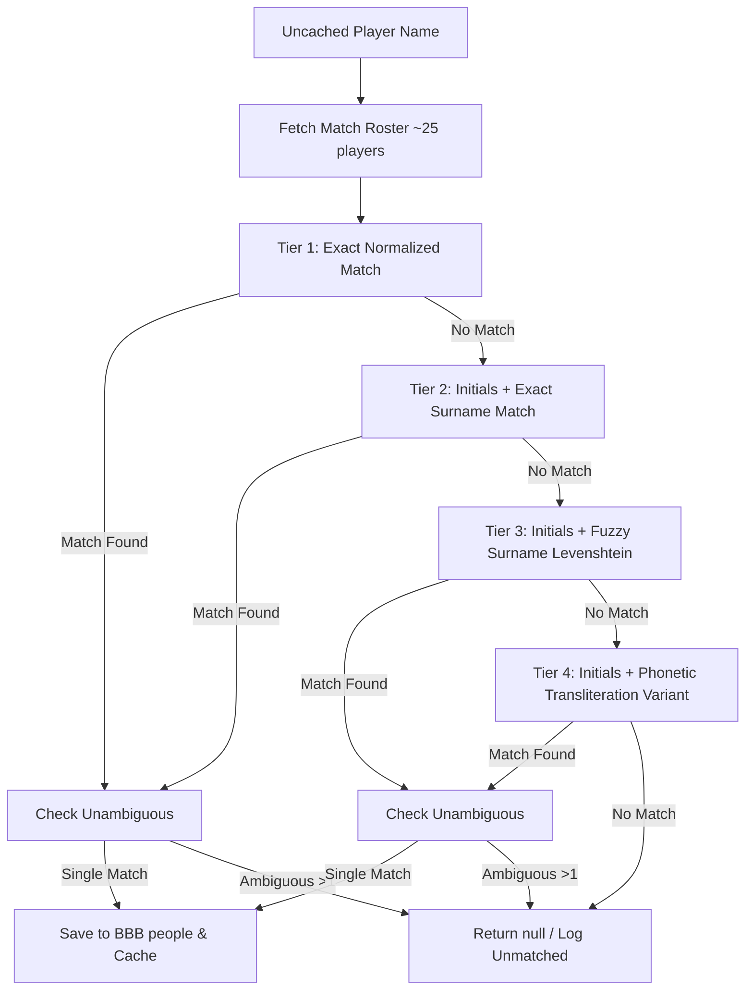

# Requirements

### Overview & Goals
Enable automated, high-precision matching of players whose names exhibit minor spelling or transliteration discrepancies (e.g., `Aaditya Varadarajan` in Cricsheet vs. `A Varadharajan` in the stats database for match `a1355828`) without requiring expensive global database searches or manual alias curation.

### Scope
- **In Scope**:
  - Pure in-memory multi-tiered fuzzy and phonetic name matching in `PlayerNameMatcher` scoped to the match roster (~22–26 players).
  - Length-proportional Levenshtein edit distance and common transliteration normalizations (such as `dh`/`d`, `th`/`t`, `w`/`v`).
  - Strict ambiguity rejection (rejecting matches if multiple roster candidates qualify).
  - Automatic write-through caching to the BBB `people` database table via existing `StatsPlayerLinker` workflows.
  - Comprehensive unit and integration test coverage.
- **Out of Scope**:
  - Full-table fuzzy scans across the entire millions-of-rows CricketArchive database.
  - Manual database alias tables requiring continuous human maintenance.

### User Stories
- **As a data ingestion pipeline**, I want to resolve player identities despite minor spelling variations between Cricsheet and CricketArchive so that match statistics link accurately to player records.
- **As a system maintainer**, I want fuzzy matching to execute in-memory against match-scoped rosters so that ingestion throughput is maximized with zero additional database query overhead.

### Functional Requirements
1. **Tier 1 (Exact Normalized Match)**: Exact match on normalized `fullName` or `knownAs`.
2. **Tier 2 (Initials & Exact Surname Match)**: Exact match on normalized surname with compatible given-name initials.
3. **Tier 3 (Match-Scoped Fuzzy Surname Match)**: Bounded Levenshtein edit distance ($\le 1$ for short surnames, $\le 2$ for longer surnames; similarity ratio $\ge 0.82$) on surname paired with compatible given-name initials.
4. **Tier 4 (Phonetic / Transliteration Variant Match)**: Transliteration-normalized surname comparison (e.g., collapsing `dh` $\leftrightarrow$ `d`, `th` $\leftrightarrow$ `t`, `ee` $\leftrightarrow$ `i`) paired with compatible given-name initials.
5. **Ambiguity Protection**: If two or more roster candidates meet the fuzzy criteria for a given source name, the match must return `null` to avoid false positives.
6. **Zero-Overhead Caching**: The first match for any player writes through to the `people` table in the BBB database and `ThreadSafePlayerCache`, making all future encounters $O(1)$ in-memory lookups.

# Technical Design

### Current Implementation
- `PlayerNameMatcher.kt` currently performs two matching stages:
  1. Exact normalized match against `fullName` or `knownAs`.
  2. Tokenized initials and exact surname matching.
- When surnames differ slightly (e.g. `Varadarajan` vs `Varadharajan`), Stage 2 fails because surname tokens must be identical.
- `StatsPlayerLinker.kt` orchestrates linking by fetching the match roster (`~22–26` players) from `StatsPlayerRepository.playersForMatch(sourceCaId)` and caching successful matches in `JdbcPlayerIdentityRepository`.

### Key Decisions
1. **Match-Scoped In-Memory Evaluation**:
   - *Rationale*: A match roster contains only ~22–26 players. Executing fuzzy string metrics (edit distance, phonetic mapping) in memory across 25 elements takes $< 0.1\text{ ms}$, eliminating the need for expensive full-table database scans or database schema changes.
2. **Length-Proportional Edit Distance**:
   - *Rationale*: Prevents false positives on short surnames (e.g. `Roy` vs `Ray`, edit distance 1 on length 3) while allowing appropriate tolerance for longer names (e.g. `Varadarajan` vs `Varadharajan`, length 12).
3. **Initials / Given-Name Compatibility Gate**:
   - *Rationale*: Fuzzy matching is only permitted when first names or initials are compatible (e.g., `Aaditya` initial `a` matches `A`), ensuring different players with similar surnames are never conflated.
4. **Strict Ambiguity Rejection**:
   - *Rationale*: If more than one candidate in the match roster qualifies during fuzzy matching, the matcher returns `null`.

### Proposed Changes
- Enhance `PlayerNameMatcher.kt`:
  - Add `levenshteinDistance(a: String, b: String): Int`.
  - Add `isSurnameFuzzyMatch(sourceSurname: String, candidateSurname: String): Boolean`.
  - Add `normalizeTransliteration(name: String): String`.
  - Update `matchPlayer(sourceName: String, roster: List<StatsRosterPlayer>): StatsRosterPlayer?` to execute Tier 3 (Fuzzy) and Tier 4 (Transliteration) if Tier 1 and Tier 2 yield no match.

### Architecture Diagram

### Risks & Mitigations
- **Risk: False positive matching on short names**:
  - *Mitigation*: Restrict edit distance dynamically based on string length (distance 0 for length $\le 3$, distance 1 for length $4..7$, distance $\le 2$ for length $\ge 8$) and enforce initial matching.
- **Risk: Ambiguity between siblings/relatives in same roster**:
  - *Mitigation*: Ambiguity check returns null if multiple candidates match within the match roster.

# Testing

### Validation Approach
Automated testing using JUnit 5 and Strikt to verify both positive resolution of spelling variants and negative/ambiguity protection.

### Key Scenarios
1. **Target Transliteration Case**:
   - `Aaditya Varadarajan` matched against match roster containing `A Varadharajan` $\rightarrow$ Successfully links with correct CA ID.
2. **Common Transliteration Variants**:
   - `Mohammed Shami` $\leftrightarrow$ `Mohammad Shami`
   - `Ravi Bishnoi` $\leftrightarrow$ `R Bishnoy`
   - `Usman Qasim` $\leftrightarrow$ `U Kasim`
   - `Anrich Nortje` $\leftrightarrow$ `A Nortje`
3. **Initials with Fuzzy Surname**:
   - `A. Varadarajan` $\leftrightarrow$ `A Varadharajan`
   - `Aaditya V.` $\leftrightarrow$ `A Varadharajan` (single token fallback)

### Edge Cases
1. **Short Surname Guard**:
   - `A Roy` vs roster containing `A Ray` $\rightarrow$ Rejected (edit distance 1 on 3-letter name is disallowed).
2. **Initials Mismatch Guard**:
   - `K Varadarajan` vs roster containing `A Varadharajan` $\rightarrow$ Rejected (initials `k` and `a` do not match).
3. **Multiple Roster Candidates (Ambiguity)**:
   - `A Varadarajan` vs roster containing both `A Varadharajan` and `A Varadarajen` $\rightarrow$ Rejected (ambiguous).
4. **End-to-End Linker & Cache Verification**:
   - Verify that upon resolving `Aaditya Varadarajan`, the result is written to the database `people` table and cached, so subsequent encounters resolve immediately without re-evaluation.

# Delivery Steps

### ✓ Step 1: Implement fuzzy string distance and phonetic similarity utilities in PlayerNameMatcher
Add pure Kotlin string distance calculations, transliteration normalization, and surname similarity metrics to `PlayerNameMatcher`.

- Implement bounded Levenshtein edit-distance calculation optimized for short string comparisons.
- Implement length-proportional distance thresholding (max distance 1 for surnames $\le 4$ chars, max distance 2 for surnames $\ge 5$ chars; or similarity ratio $\ge 0.82$).
- Implement common cricket name transliteration normalization (collapsing phonetic equivalents such as `dh`/`d`, `th`/`t`, `ph`/`p`, `ee`/`i`, `oo`/`u`, `w`/`v`, and double consonants).
- Implement initial/given-name compatibility validation alongside fuzzy surname matching.

### ✓ Step 2: Integrate multi-tier fuzzy resolution into PlayerNameMatcher
Extend `PlayerNameMatcher.matchPlayer` with match-scoped fuzzy and phonetic matching stages and strict ambiguity rejection.

- Add Tier 3 fuzzy surname matching when Tier 1 (exact) and Tier 2 (initials + exact surname) produce no match.
- Add Tier 4 transliteration-normalized matching as a secondary fallback.
- Enforce strict uniqueness: if more than one candidate in the match roster matches with high similarity, reject the match (return `null`) to eliminate false positives.
- Ensure resolved matches continue to flow transparently through `StatsPlayerLinker` for caching and persistence in the `people` table.

### ✓ Step 3: Add comprehensive unit and integration test coverage
Validate matching accuracy, false positive prevention, and caching behavior across unit and integration test suites.

- Add test cases in `PlayerNameMatcherTest` verifying `Aaditya Varadarajan` resolves to `A Varadharajan`.
- Add test cases for common transliteration discrepancies (e.g. `Mohammed`/`Muhammad`, `Choudhary`/`Chowdhury`, `Qasim`/`Kasim`).
- Add negative and ambiguity test cases ensuring distinct players (such as `Ray` vs `Roy` with differing initials) and ambiguous roster candidates are not erroneously matched.
- Add integration test in `StatsPlayerLinkerTest` ensuring fuzzy match results are persisted to `PlayerIdentityRepository` and cached in `ThreadSafePlayerCache`.
- Execute `./gradlew clean check` across all modules to verify 100% test pass rate and Kover coverage compliance.

### ✓ Step 4: Diagnose and resolve remaining lookup failures
Use the reported `lookup_errors.log` cases to establish regression coverage, identify whether each remaining failure is caused by an incomplete stats roster, unavailable roster, or matcher limitation, and implement the smallest safe resolution improvements.

### ✓ Step 5: Diagnose and classify the latest lookup failures
Reassess the current `lookup_errors.log` entries against their parsed source JSON and match-scoped CricketArchive rosters. Add regression coverage and the smallest safe matcher or logging improvement for verified limitations; log a clear reason when no corresponding roster identity exists.

### ✓ Step 6: Diagnose the remaining reported lookup problems
Reproduce a current unresolved lookup from `lookup_errors.log`, compare the parsed source identity with its match-scoped CricketArchive roster, and add a regression fix or a precise classification message only when supported by the data.

### ✓ Step 7: Resolve current missing-player reports with roster-backed disambiguation
Reproduce the current `lookup_errors.log` failures, compare each source identity to its source JSON and CricketArchive match roster, and add the smallest evidence-backed rule or classification necessary to resolve safe matches, including `T Dilshan`.