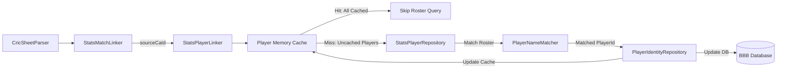

# Requirements

### Overview & Goals
The goal of this task is to link player identities from Cricsheet ball-by-ball (BBB) data to their corresponding player records (`ca_id`) in the CricketArchive (stats) database within `bbb-parse-cricsheet`. Once a match is linked to a CricketArchive match (`sourceCaId`), the players listed in the match can be matched against the CricketArchive match roster. To maximize performance across thousands of match files and millions of delivery lookups, player mappings will be cached in-memory and persisted to the BBB database so that each player is resolved against the stats database at most once.

### Scope
- **In Scope**:
  - Querying match player rosters from the CricketArchive database for matches with a linked `sourceCaId`.
  - Matching Cricsheet player names (`info.players` / `registry.people`) against CricketArchive match rosters using normalized name and initials/surname matching.
  - Preloading known player mappings from the BBB database `people` table into an in-memory thread-safe cache at application startup.
  - Updating the in-memory cache and persisting newly resolved player `ca_id` records to the BBB database immediately.
  - Integrating player linking into the `bbb-parse-cricsheet` pipeline (`CricSheetParser` and `Application.kt`).
  - Unit, integration, and performance tests for player matching and caching.
- **Out of Scope**:
  - Manual web scraping or external API lookups for unlisted players.
  - Modifying delivery-level payload structures beyond existing player references.

### User Stories
- **As a data engineer**, I want player identities in BBB match files to be automatically linked to CricketArchive player IDs (`ca_id`) using match rosters, so that player statistics can be joined seamlessly across datasets.
- **As a system operator**, I want player lookups to be cached in-memory and persisted in the BBB database, so that subsequent matches and batch runs avoid redundant stats database queries and run at maximum speed.

### Functional Requirements
- **Match Roster Retrieval**: When a match is successfully linked to a `sourceCaId`, retrieve the list of players for that match from the CricketArchive database.
- **Cache-First Check**: For each player in the Cricsheet match, check if their `source_person_id` already exists in the in-memory player cache with a valid `ca_id > 0`. If all players in the match are cached, bypass the stats database query completely.
- **Roster Name Matching**: For uncached players, match the player name against the CricketArchive match roster using:
  1. Exact case-insensitive match on full name.
  2. Normalized name match (removing diacritics, periods, and extra whitespace).
  3. Initials and surname matching within the team's roster (e.g., `V Kohli` matching `Virat Kohli`).
- **Immediate Cache & Persistence Update**: When an uncached player is successfully matched to a CricketArchive `ca_id`:
  - Store the mapping in the in-memory cache immediately.
  - Persist/update the player record in the BBB database (`people` table).
- **Graceful Unmatched Handling**: If a player cannot be matched with certainty (or the match has no `sourceCaId`), log a warning and continue processing without failing the match conversion.

### Non-Functional Requirements
- **Performance**: In-memory cache lookups must be O(1) using `ConcurrentHashMap`. Zero database roundtrips for matches where all players are already cached.
- **Thread Safety**: The cache and repository interactions must be safe for concurrent or sequential match processing.
- **Observability**: Provide informative logging for cache hits, newly matched players, and ambiguous/unmatched players.

# Technical Design

### Current Implementation
- `bbb-parse-cricsheet` currently performs match-level linking via `StatsMatchLinker`, writing the resolved `Matches.CaId` to `info.sourceCaId`.
- Cricsheet files contain `info.players` (mapping team names to arrays of player names) and `info.registry.people` (mapping player names to Cricsheet unique IDs `source_person_id`).
- In `bbb-update-database`, `people` are stored in the database with `(id, source_person_id, full_name, ca_id)` where `ca_id` is currently defaulted to 0 if not pre-populated.

### Key Decisions
- **Inline Cache-First Pipeline**: Preload all existing `(source_person_id -> ca_id)` mappings from the BBB database `people` table into an in-memory cache on startup. When parsing a match, check the cache first; only query the CricketArchive match roster if there are uncached players.
- **Roster-Scoped Matching**: Perform player name matching strictly against the roster of players who participated in the specific match (`sourceCaId`), preventing false-positive name collisions across the entire player database.
- **Immediate Write-Through Persistence**: As soon as an uncached player is linked, write the resolved `ca_id` to both the in-memory cache and the BBB database so that all subsequent matches in the same run benefit immediately.

### Proposed Changes
- **`StatsPlayerRepository`**: Interface and JDBC implementation (`JdbcStatsPlayerRepository`) to query match players from CricketArchive using `sourceCaId`.
- **`PlayerIdentityRepository`**: Interface and JDBC implementation (`JdbcPlayerIdentityRepository`) to read and update `(source_person_id, full_name, ca_id)` in the BBB database.
- **`PlayerNameMatcher`**: Pure functional engine for matching Cricsheet player names against CricketArchive roster players.
- **`StatsPlayerLinker`**: Orchestrator that manages cache queries, roster fetching, matching, and write-through persistence.
- **`CricSheetParser` & `Application`**: Connect `StatsPlayerLinker` into the parsing workflow after match linking.

### Data Models / Contracts

```kotlin
@JvmInline
value class StatsPlayerId(val value: Int)

data class StatsRosterPlayer(
    val playerId: StatsPlayerId,
    val fullName: String,
    val knownAs: String? = null,
    val surname: String? = null
)

data class PlayerMatchResult(
    val sourcePersonId: String,
    val sourceName: String,
    val statsPlayerId: StatsPlayerId?
)

interface StatsPlayerRepository {
    fun playersForMatch(matchCaId: SourceCaId): List<StatsRosterPlayer>
}

interface PlayerIdentityRepository {
    fun loadAllPlayerMappings(): Map<String, StatsPlayerId>
    fun savePlayerMapping(sourcePersonId: String, fullName: String, statsPlayerId: StatsPlayerId)
}

interface PlayerLinker {
    fun linkPlayers(
        sourceCaId: SourceCaId,
        matchPlayers: Map<String, String> // name -> sourcePersonId
    ): List<PlayerMatchResult>
}
```

### File Structure
- Added / Modified Files in `bbb-parse-cricsheet`:
  - `src/main/kotlin/com/knowledgespike/ballbyball/parsecricsheet/StatsPlayerRepository.kt` (New)
  - `src/main/kotlin/com/knowledgespike/ballbyball/parsecricsheet/PlayerIdentityRepository.kt` (New)
  - `src/main/kotlin/com/knowledgespike/ballbyball/parsecricsheet/PlayerNameMatcher.kt` (New)
  - `src/main/kotlin/com/knowledgespike/ballbyball/parsecricsheet/StatsPlayerLinker.kt` (New)
  - `src/main/kotlin/com/knowledgespike/ballbyball/parsecricsheet/CricSheetParser.kt` (Modified - invoke player linker)
  - `src/main/kotlin/com/knowledgespike/ballbyball/parsecricsheet/Application.kt` (Modified - wire player linker)
  - `src/test/kotlin/com/knowledgespike/ballbyball/parsecricsheet/PlayerNameMatcherTest.kt` (New)
  - `src/test/kotlin/com/knowledgespike/ballbyball/parsecricsheet/StatsPlayerLinkerTest.kt` (New)
  - `src/test/kotlin/com/knowledgespike/ballbyball/parsecricsheet/JdbcStatsPlayerRepositoryTest.kt` (New)

### Architecture Diagram



### Risks
- **Name Discrepancies**: Subtle spelling differences or nicknames between Cricsheet and CricketArchive rosters. *Mitigation*: Multi-stage matching (exact -> normalized -> initials + surname) scoped strictly to the 22-player match roster.
- **Multiple Matches in Roster (Ambiguity)**: Two players with identical initials and surnames in the same match. *Mitigation*: Require distinct full name or return unmatched with a warning rather than guessing incorrectly.

# Testing

### Validation Approach
- Validate name matching algorithms using comprehensive unit tests with real-world international and domestic cricket player names.
- Validate repository queries using in-memory / testcontainer databases with sample CricketArchive match scorecards.
- Verify that caching avoids redundant database queries across multiple match files.

### Key Scenarios
- **All Players Cached**: When parsing a match where all players already exist in the in-memory cache, verify zero database queries are made to `StatsPlayerRepository`.
- **Uncached Players in Linked Match**: When parsing a match with uncached players and a valid `sourceCaId`, verify that `StatsPlayerRepository.playersForMatch` is called, unmatched players are matched against the roster, and the new mappings are saved to both cache and DB.
- **Unlinked Match**: When `sourceCaId` is null, verify player matching is safely skipped.
- **Name Variations**: Verify that name formats such as `V Kohli` match `Virat Kohli`, `SPD Smith` matches `Steven Peter Devereux Smith`, and accented characters match smoothly.

### Edge Cases
- Matches with substitute fielders / concussion replacements who may not appear in the starting 11.
- Players with single names or non-standard naming conventions.
- Ambiguous name matches where multiple players match the same initials in a team.

### Test Changes
- `PlayerNameMatcherTest`: Unit tests for matching algorithms across varied name formats.
- `StatsPlayerLinkerTest`: Unit tests verifying cache hit/miss behavior, DB persistence, and logging.
- `JdbcStatsPlayerRepositoryTest`: Query tests verifying SQL roster extraction for given match IDs.
- `CricSheetParserTest`: Integration tests ensuring end-to-end player linking and JSON envelope production.

# Delivery Steps

### ✓ Step 1: Implement player data models and name matching engine
Core data models, tiny types, and name normalization algorithms are defined with unit tests for roster matching.

- Define domain models and tiny types for player identifiers: `SourcePersonId`, `StatsPlayerId`, `StatsPlayerCandidate`, and `PlayerMatchResult`.
- Implement `PlayerNameMatcher` supporting exact normalized full-name matching, initials-plus-surname matching, and diacritic/punctuation stripping.
- Add unit tests in `PlayerNameMatcherTest` covering various cricket name variations (e.g., "V Kohli" vs "Virat Kohli", "RG Sharma" vs "Rohit Sharma", hyphenated names).

### ✓ Step 2: Implement stats player repository and caching persistence
Database repositories for querying CricketArchive match rosters and persisting BBB player mappings with fast cache preloading are implemented.

- Implement `StatsPlayerRepository` / `JdbcStatsPlayerRepository` to query match player rosters from the CricketArchive database given a match `sourceCaId`.
- Implement `PlayerIdentityRepository` / `JdbcPlayerIdentityRepository` in the BBB database layer to preload existing player mappings `(source_person_id -> ca_id)` and persist new mappings.
- Implement `ThreadSafePlayerCache` backed by a `ConcurrentHashMap` initialized on startup from `PlayerIdentityRepository`.
- Add integration tests for repository queries and database persistence.

### ✓ Step 3: Integrate player linking into the Cricsheet parse pipeline
The player linking pipeline is connected to CricSheetParser and Application entry points.

- Implement `StatsPlayerLinker` coordinating the player cache, stats match roster lookup, and `PlayerNameMatcher`.
- Update `CricSheetParser.processFile` to invoke `StatsPlayerLinker` for matches with a resolved `sourceCaId`, skipping stats queries when all match players are already cached.
- Update `Application.kt` in `bbb-parse-cricsheet` to wire `StatsPlayerLinker` using the stats and BBB database connections.
- Add structured logging to record cache hits, newly linked players, and unmatched roster players.

### ✓ Step 4: Validate player linking and verify caching performance
End-to-end integration and benchmark tests verify correct player linking and high lookup throughput.

- Add unit and integration tests in `StatsPlayerLinkerTest` verifying that cached players avoid stats DB calls and newly matched players are stored.
- Update `CricSheetParserTest` and `ApplicationTest` in `bbb-parse-cricsheet` to verify end-to-end player linking during match parsing.
- Validate that duplicate player lookups across multiple match files execute with zero redundant database queries.