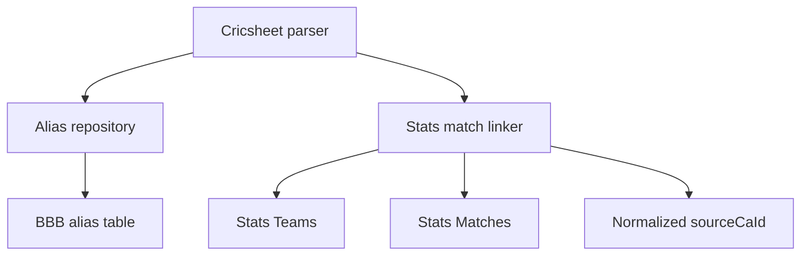

# Requirements

### Overview & Goals

Add a persistent, general-purpose mapping for team names that differ between Cricsheet and the CricketArchive stats database. The ball-by-ball database owns the integration aliases, while the stats database remains the source of truth for canonical team and match identities.

### Scope

#### In scope

- Persist reusable Cricsheet-to-stats team-name aliases in the ball-by-ball database.
- Store the stable stats `Teams.TeamId` as the alias target.
- Allow parsing to read aliases through a second ball-by-ball JDBC connection while retaining the existing stats connection.
- Preserve exact team-name matching and use aliases when exact matching cannot resolve the match, including a single-name alias alongside an exact name.
- Continue failing fast and logging when the match is missing or an alias target cannot be resolved; accept duplicate rows only when they identify one distinct result and reject ambiguity.
- Provide migrations and generated schema support for MySQL, PostgreSQL, and SQLite.
- Document the manual alias insertion and retry workflow.

#### Out of scope

- Automatic fuzzy matching or automatic alias creation.
- Match-specific aliases; mappings apply to a source team name across all matches.
- Changes to ownership or schema of the CricketArchive stats database.
- Changes to the existing `source_ca_id` output contract.

### Functional Requirements

- A source team name can have multiple mappings per source system and can be reused across future parses; every mapping is considered during lookup.
- Alias targets resolve to exactly one stats team identity; invalid or ambiguous targets stop the affected parse. Duplicate matching stats rows are accepted with a warning only when they identify one distinct result; multiple distinct IDs are ambiguous failures.
- Existing exact matching remains available and continues to match on teams, `MatchStartDate`, and `HowMuch`, excluding victory type.
- Alias-assisted matching remains date- and margin-constrained and treats team order as interchangeable.
- The parser accepts separate ball-by-ball alias-database and stats-database connection settings without logging credentials.
- A missing match logs the lookup criteria and exits with a failure, allowing an operator to add an alias and rerun parsing. Marginless lookups reject multiple distinct matches rather than selecting arbitrarily.

# Technical Design

### Current Implementation

`bbb-parse-cricsheet` currently constructs `JdbcMatchLinker` in `Application.kt` using the stats `DatabaseConnection`. `StatsMatchLinker.kt` builds `MatchLookupCriteria` from `Info`, applies the existing women’s-team naming rule, and queries stats `Matches` by team names, `MatchStartDate`, and `HowMuch`.

`CricSheetParser.kt` already accepts the `MatchLinker` strategy and writes its resolved value to `Info.sourceCaId`. `bbb-update-database` already carries that value through `MatchRecord.sourceCaId` and the relational `source_ca_id` column, so the alias feature should reuse that path rather than introduce another match-link contract.

The stats schema has `Matches.HomeTeamId` and `Matches.AwayTeamId` foreign keys to `Teams.Id`, while `Teams.TeamId` is the external team identifier and `Teams.Name` is not safe as a unique identity because duplicate display names exist.

### Key Decisions

- **Alias ownership:** add `team_name_aliases` to the ball-by-ball database because the mapping describes the integration between the ball-by-ball source and the stats source; do not modify the stats source schema.
- **Alias target:** store `Teams.TeamId`, the stable stats-side team identifier selected by the user. Resolve it through stats `Teams` at lookup time and require one matching row, rather than persisting the stats database’s local `Teams.Id`.
- **Connection boundary:** retain linking during parsing and inject a second read-only JDBC connection for the ball-by-ball alias database. Moving linking to `bbb-update-database` would delay `sourceCaId` until after normalization and change the established workflow.
- **Resolution policy:** keep exact matching as the first path; when it cannot resolve the match, apply any configured aliases and retry with stats team identities. Never auto-create or fuzzy-match aliases.
- **Failure policy:** preserve the current fail-fast behavior for no match and invalid alias targets; duplicate stats matches are logged as warnings when they identify one distinct result, while multiple distinct IDs remain ambiguous failures.

### Proposed Changes

Add a small alias repository/resolver behind the existing `MatchLinker` composition. It will read source names from the ball-by-ball alias table, resolve configured targets against stats `Teams`, and let the linker build a parameterized match query using a stable team ID for aliased names and an exact name for names without an alias. This supports the common case where only one of the two source names differs.

The parser CLI will add ball-by-ball alias-database options alongside the existing stats options. `Application.kt` will open both connections with `DatabaseConnection`, construct the linker with both dependencies, and close both connections after parsing. Existing normalized output and relational writers remain unchanged.

The schema will be additive: create a new versioned alias-table migration rather than editing the existing initial migrations, and add the same table to `RelationalSchemaSql.kt` so generated databases and checked-in migrations agree.

### Data Models / Contracts

The alias table will use a shape equivalent to:

```sql
team_name_aliases(
    source_system VARCHAR(...) NOT NULL,
    source_team_name VARCHAR(...) NOT NULL,
    stats_team_id INTEGER NOT NULL,
)
```

Add an index on `stats_team_id`. The table does not use a cross-database foreign key; the linker validates `stats_team_id` against the stats `Teams` table before using it.

The Kotlin boundary should remain small and injectable, following the existing `MatchLinker` strategy. The JDBC implementation will expose the same `sourceCaId(Info): String` behavior while composing an alias repository and the stats match lookup. Alias-target failures should have a distinct logged failure from no-match failures, while duplicate match rows produce a warning and use the first result.

Parser options should add ball-by-ball equivalents of the existing stats options, for example `--bbb-connection-string`, `--bbb-user-name`, and `--bbb-password-environment-variable`, represented in `ParseCricsheetInput` and parsed by `ParseCricsheetArguments`. Password arguments must contain environment-variable names, not secret values.

### File Structure

- `bbb-parse-cricsheet/src/main/kotlin/.../StatsMatchLinker.kt` — add alias resolution and ID-based stats lookup composition.
- `bbb-parse-cricsheet/src/main/kotlin/.../ParseCricsheetInput.kt` — add alias-database connection settings.
- `bbb-parse-cricsheet/src/main/kotlin/.../Application.kt` — open and close the second database connection and wire the linker.
- `bbb-update-database/migrations/{mysql,postgres,sqlite}/1__initial_tables.sql` — include the alias table in each dialect's consolidated schema.
- `bbb-update-database/src/main/kotlin/.../RelationalSchemaSql.kt` — include the alias table in generated relational schemas.
- `bbb-parse-cricsheet/src/test/kotlin/.../StatsMatchLinkerTest.kt` — cover exact, aliased, partial, invalid, missing, and duplicate lookup behavior.
- `bbb-parse-cricsheet/src/test/kotlin/.../ParseCricsheetArgumentsTest.kt` — cover the new CLI settings.
- `docs/adr/0006-persistent-team-name-aliases.md` — record ownership, target identity, and parser-boundary decisions.
- `README-DEV.md`, `docs/architecture/applications.md`, and `docs/project_memory.md` — document configuration, manual alias insertion, runtime flow, and the completed change.

### Architecture Diagram



### Risks

- `Teams.TeamId` is indexed but should be validated as uniquely resolving before an alias is accepted; duplicate target rows must produce a clear failure rather than a guessed team.
- The parser now has two database credentials and failure modes; connection setup and cleanup must be explicit and credentials must remain environment-provided.
- Exact and alias-assisted paths must use the same date, margin, and home/away semantics to avoid inconsistent linking.
- The alias table is integration data, not a stats-domain table; it must not be silently populated by parsing.

# Testing

### Validation Approach

Use JUnit 5, Strikt, and SQLite-backed integration-style tests through public linker and CLI interfaces. Keep the existing parser envelope test to verify that a resolved alias path still writes `Info.sourceCaId` and reaches normalized output.

### Key Scenarios

- Existing exact team-name matching still resolves one stats `CaId`.
- A persisted alias for one source team plus an exact second team resolves the correct match.
- Persisted aliases for both source teams resolve regardless of home/away ordering.
- Multiple stats matches with the same criteria log a warning and return the first `CaId`.
- No exact or alias-assisted match still produces `StatsMatchNotFoundException` and retains fail-fast behavior.
- An alias whose `Teams.TeamId` is absent or non-unique fails explicitly.
- CLI parsing captures both stats and ball-by-ball connection settings, while required output/input behavior remains unchanged.
- Generated relational schema and all three migration dialects contain the alias table with duplicate source names permitted and an indexed target.

### Test Changes

Extend `StatsMatchLinkerTest` fixtures with `team_name_aliases`, `Teams`, and `Matches` rows so tests exercise the real JDBC query paths rather than mocked internals. Add argument assertions in `ParseCricsheetArgumentsTest`, retain the existing `CricSheetParserTest` strategy-injection coverage, and run `./gradlew clean check --no-daemon` plus `git diff --check` after implementation.

# Delivery Steps

### ✓ Step 1: Add persistent alias schema and architecture record
Ball-by-ball databases can persist reusable source-team aliases targeting stable stats team IDs.

- Add or update versioned `team_name_aliases` migrations for MySQL, PostgreSQL, and SQLite so duplicate source names are supported, including compatibility migrations for existing databases.
- Add the alias table and indexes to `RelationalSchemaSql.kt`.
- Permit duplicate `(source_system, source_team_name)` rows and retain an indexed `stats_team_id` target.
- Add `docs/adr/0006-persistent-team-name-aliases.md` documenting why mappings live in the ball-by-ball database and why stable stats IDs are used.
- Add SQLite/schema coverage for the table shape and target index.

### ✓ Step 2: Implement alias-aware stats linking
`JdbcMatchLinker` resolves exact and persistent alias-assisted matches while preserving fail-fast behavior.

- Add an injectable alias repository/resolver in `StatsMatchLinker.kt` using the ball-by-ball JDBC connection.
- Resolve aliases to exactly one stats `Teams.TeamId` and query `Matches` through `HomeTeamId`/`AwayTeamId` team joins.
- Preserve existing exact name lookup, date and `HowMuch` criteria, reverse team ordering, duplicate-row warning and first-result selection, and `sourceCaId` output.
- Support one aliased team alongside one exact team and fail clearly for invalid alias targets.
- Extend `StatsMatchLinkerTest` with exact, alias, partial-alias, missing, duplicate, and invalid-target scenarios.

### ✓ Step 3: Wire CLI connections and document the manual workflow
The parser CLI can read the ball-by-ball alias database and operators can add aliases safely before retrying a failed parse.

- Extend `ParseCricsheetInput` and `ParseCricsheetArguments` with ball-by-ball JDBC URL, username, and password options.
- Update `Application.kt` to open both database connections, inject them into the linker, and close them safely.
- Extend `ParseCricsheetArgumentsTest` and parser integration coverage for the new wiring while keeping `CricSheetParser` test injection intact.
- Update `README-DEV.md` and `docs/architecture/applications.md` with environment variables, command examples, alias insertion guidance, and the two-database flow.
- Update `docs/project_memory.md` with shipped behavior, decisions, gotchas, and test coverage, then run `./gradlew clean check --no-daemon` and `git diff --check`.

### ✓ Step 4: Retry failed match lookups without margin
When a date-and-margin lookup finds no match, retry the same criteria without the victory margin and record lookup failures in a dedicated rotating log.

- Retry only `StatsMatchNotFoundException` results from the margin-constrained lookup, preserving exact and alias-assisted team resolution.
- Log the failed margin-constrained lookup and any final lookup failure through a dedicated logger that writes to the console and `lookup_failures.log` with the existing rotation policy.
- Keep per-file failure handling and raw-file preservation unchanged.
- Add focused linker and logging/configuration tests, update documentation and project memory, then run `./gradlew clean check --no-daemon` and `git diff --check`.

### ✓ Step 5: Preserve Rachael Heyhoe Flint Trophy team names
Female Rachael Heyhoe Flint Trophy matches must not receive the standard ` Women` team-name suffix during stats linking.

- Add `Rachael Heyhoe Flint Trophy` to the existing female competition exception set.
- Add focused linker regression coverage.
- Update the relevant developer documentation and project memory, then run the required checks.

### ✓ Step 6: Handle duplicate stats match rows
Duplicate stats rows with one distinct `CaId` log a warning; multiple distinct IDs remain ambiguous failures.

- Select the single distinct `CaId` for duplicate exact or alias-assisted match results and log the lookup criteria and duplicate rows at warning level.
- Keep missing matches and invalid or ambiguous alias targets as failures.
- Retain ambiguity regressions for multiple distinct IDs, update documentation and project memory, then run `./gradlew clean check --no-daemon` and `git diff --check`.

### ✓ Step 7: Try individual and combined team aliases
Alias-assisted lookups must try each configured alias independently and both aliases together before reporting a missing match.

- Preserve the exact-name lookup as the first attempt.
- When both source teams have aliases, try alias-first/exact-second, exact-first/alias-second, and both aliases together.
- Add regression coverage for a match resolved by one alias while both aliases are configured, then run the required checks.

### ✓ Step 8: Bypass stats lookup for ICC World Cricket League Europe Region Division Two Twenty20
Matches in this event have no stats representation and should still be parsed successfully with an empty `sourceCaId`.

- Detect the exact event name before invoking stats linking.
- Preserve the normal parsed output flow so these files are written under `parsed` rather than `not-parsed`.
- Add focused parser coverage and update the relevant documentation and project memory.
- Run `./gradlew clean check --no-daemon` and `git diff --check`.

### ✓ Step 9: Bypass stats lookup for Kenya T20 Quadrangular Series
Matches in this event have no stats representation and should still be parsed successfully with an empty `sourceCaId`.

- Detect the exact event name before invoking stats linking.
- Preserve the normal parsed output flow so these files are written under `parsed` rather than `not-parsed`.
- Add focused parser coverage and update the relevant documentation and project memory.
- Run `./gradlew clean check --no-daemon` and `git diff --check`.

### ✓ Step 10: Bypass stats lookup for East Asia Cup 2016/17
Matches in this event and season have no stats representation and should still be parsed successfully with an empty `sourceCaId`.

- Detect the exact event name and `2016/17` season before invoking stats linking.
- Preserve the normal parsed output flow so these files are written under `parsed` rather than `not-parsed`.
- Add focused parser coverage and update the relevant documentation and project memory.
- Run `./gradlew clean check --no-daemon` and `git diff --check`.

### ✓ Step 11: Bypass stats lookup for ICC World Twenty20 Asia Region Qualifier A
Matches in this event have no stats representation and should still be parsed successfully with an empty `sourceCaId`.

- Detect the exact event name before invoking stats linking.
- Preserve the normal parsed output flow so these files are written under `parsed` rather than `not-parsed`.
- Add focused parser coverage and update the relevant documentation and project memory.
- Run `./gradlew clean check --no-daemon` and `git diff --check`.

### ✓ Step 12: Bypass stats lookup for ICC World Twenty20 Africa Region Qualifier A
Matches in this event have no stats representation and should still be parsed successfully with an empty `sourceCaId`.

- Detect the exact event name before invoking stats linking.
- Preserve the normal parsed output flow so these files are written under `parsed` rather than `not-parsed`.
- Add focused parser coverage and update the relevant documentation and project memory.
- Run `./gradlew clean check --no-daemon` and `git diff --check`.

### ✓ Step 13: Bypass stats lookup for ICC World Twenty20 Africa Region Qualifier B
Matches in this event have no stats representation and should still be parsed successfully with an empty `sourceCaId`.

- Detect the exact event name before invoking stats linking.
- Preserve the normal parsed output flow so these files are written under `parsed` rather than `not-parsed`.
- Add focused parser coverage and update the relevant documentation and project memory.
- Run `./gradlew clean check --no-daemon` and `git diff --check`.

### ✓ Step 14: Bypass stats lookup for ICC World Twenty20 East Asia-Pacific Region Qualifiers
Matches in these events have no stats representation and should still be parsed successfully with an empty `sourceCaId`.

- Detect the exact event names before invoking stats linking.
- Preserve the normal parsed output flow so these files are written under `parsed` rather than `not-parsed`.
- Add focused parser coverage and update the relevant documentation and project memory.
- Run `./gradlew clean check --no-daemon` and `git diff --check`.

### ✓ Step 15: Bypass stats lookup for ICC World Twenty20 Europe Region Qualifiers
Matches in these events have no stats representation and should still be parsed successfully with an empty `sourceCaId`.

- Detect the exact event names before invoking stats linking.
- Preserve the normal parsed output flow so these files are written under `parsed` rather than `not-parsed`.
- Add focused parser coverage and update the relevant documentation and project memory.
- Run `./gradlew clean check --no-daemon` and `git diff --check`.

### ✓ Step 16: Bypass stats lookup for Asian Games Men's Cricket Competition in 2014/15
Matches in this event and season have no stats representation and should still be parsed successfully with an empty `sourceCaId`.

- Detect the exact event name and `2014/15` season before invoking stats linking.
- Preserve the normal parsed output flow so these files are written under `parsed` rather than `not-parsed`.
- Add focused parser coverage and update the relevant documentation and project memory.
- Run `./gradlew clean check --no-daemon` and `git diff --check`.

### ✓ Step 17: Bypass stats lookup for additional regional qualifiers
Matches in these events have no stats representation and should still be parsed successfully with an empty `sourceCaId`.

- Detect the exact event names `ICC World Twenty20 Europe Region Qualifier C`, `ICC World Twenty20 Americas Sub Regional Qualifier A`, and `ICC World Twenty20 Asia Region Qualifier B` before invoking stats linking.
- Preserve the normal parsed output flow so these files are written under `parsed` rather than `not-parsed`.
- Add focused parser coverage and update the relevant documentation and project memory.
- Run `./gradlew clean check --no-daemon` and `git diff --check`.

### ✓ Step 18: Bypass stats lookup for additional competitions
Matches in these events and seasons have no stats representation and should still be parsed successfully with an empty `sourceCaId`.

- Detect `East Asia Cup` in `2018`, `ICC World Twenty20 Africa Region Qualifier C` in `2018/19`, `ICC World Cricket League Americas Region Division One Twenty20` in `2010`, and `ACC Twenty20 Cup` in `2014/15` before invoking stats linking; bypass `Stan Nagaiah Trophy` for all seasons.
- Preserve the normal parsed output flow so these files are written under `parsed` rather than `not-parsed`.
- Add focused parser coverage and update the relevant documentation and project memory.
- Run `./gradlew clean check --no-daemon` and `git diff --check`.

### ✓ Step 19: Bypass stats lookup for Continental Cup
`Continental Cup` matches have no stats representation and should still be parsed successfully with an empty `sourceCaId`.

- Detect the exact event name before invoking stats linking; bypass all seasons.
- Preserve the normal parsed output flow so these files are written under `parsed` rather than `not-parsed`.
- Add focused parser coverage and update the relevant documentation and project memory.
- Run `./gradlew clean check --no-daemon` and `git diff --check`.

### ✓ Step 20: Bypass stats lookup for Major League Cricket
`Major League Cricket` matches in season `2023` have no stats representation and should still be parsed successfully with an empty `sourceCaId`.

- Detect the exact event name and `2023` season before invoking stats linking.
- Preserve the normal parsed output flow so these files are written under `parsed` rather than `not-parsed`.
- Add focused parser coverage and update the relevant documentation and project memory.
- Run `./gradlew clean check --no-daemon` and `git diff --check`.

### ✓ Step 21: Bypass stats lookup for Nepal Premier League
All `Nepal Premier League` matches have no stats representation and should still be parsed successfully with an empty `sourceCaId`.

- Detect the exact event name before invoking stats linking; bypass all seasons.
- Preserve the normal parsed output flow so these files are written under `parsed` rather than `not-parsed`.
- Add focused parser coverage and update the relevant documentation and project memory.
- Run `./gradlew clean check --no-daemon` and `git diff --check`.

### ✓ Step 22: Preserve The Blaze team name for female matches
Female matches involving `The Blaze` must not receive the standard ` Women` team-name suffix during stats linking.

- Add `The Blaze` to the team-specific female naming exceptions.
- Add focused linker regression coverage.
- Update the relevant developer documentation and project memory, then run the required checks.

### ✓ Step 23: Preserve opponent suffix for The Blaze matches
Female matches involving `The Blaze` must leave only `The Blaze` unsuffixed while applying the standard ` Women` suffix to the opponent when required.

- Make the `The Blaze` exception apply to the individual team name rather than the whole match.
- Add regression coverage proving the opponent still receives the suffix.
- Update the relevant developer documentation and project memory, then run the required checks.

### ✓ Step 24: Try all duplicate team-name aliases
Aliases with the same source team name must all be considered so a source name can map to different stats teams in different match contexts.

- Allow duplicate `(source_system, source_team_name)` rows in migrations and generated schemas while retaining the target index.
- Return every matching alias target and try all individual and combined alias candidate pairs deterministically.
- Add regression coverage for duplicate source names and update documentation, project memory, and validation checks.

### ✓ Step 25: Preserve Women's T20 Challenge Match team names
Female `Women's T20 Challenge Match` matches must not receive the standard ` Women` suffix during stats linking.

- Add `Women's T20 Challenge Match` to the female competition naming exceptions.
- Add focused linker regression coverage.
- Update the relevant developer documentation and project memory, then run the required checks.

### ✓ Step 26: Close remaining quality-review gaps
The implementation is safe for repeatable upgrades and fully exercises source-ID reconciliation and migration paths.

- Make the source-ID uniqueness migrations idempotent for MySQL and PostgreSQL, while preserving the SQLite behavior.
- Make source-ID reconciliation mandatory for every output adapter and preserve existing adapter behavior.
- Add JDBC reconciliation coverage for backfill, conflicts, duplicate ownership, and rollback behavior.
- Refactor repetitive parser exclusion tests into parameterized rule data without weakening coverage.
- Extend SQLite migration tests to apply the complete migration sequence to an existing schema, including duplicate aliases and source-ID uniqueness.
- Run `./gradlew clean check --no-daemon` and `git diff --check`.

### ✓ Step 27: Close final adapter and migration quality gaps
Direct JDBC writes, CSV reconciliation failures, and repeated SQLite alias migrations must preserve the same invariants safely.

- Enforce source-ID reconciliation in every direct JDBC match insert path.
- Make CSV reconciliation update the in-memory state only after a successful atomic file replacement, with failure coverage.
- Make the SQLite duplicate-alias migration safely repeatable or resumable, with interrupted-upgrade coverage.
- Run `./gradlew clean check --no-daemon` and `git diff --check`.

### ✓ Step 28: Resolve remaining quality-review blockers
Parser boundaries, linker composition, adapter transactions, and migration history must be safe and testable across supported databases.

- Reject overlapping parser input and output paths, and validate required database settings at argument parsing time.
- Split the stats linker’s policy and JDBC data-access responsibilities into focused components without changing lookup behavior.
- Make CSV and SQL-script reconciliation transactional across commit and rollback.
- Align alias migration history with the actual predecessor schema and add supported-dialect migration execution coverage.
- Run `./gradlew clean check --no-daemon` and `git diff --check`.

### ✓ Step 29: Resolve final database quality blockers
Database output transactions, CSV publication recovery, and dialect migration verification must satisfy the final quality review.

- Make transaction lifecycle methods mandatory on every output adapter implementation.
- Replace the crash-vulnerable CSV directory swap with durable generation publication and recovery.
- Make MySQL and PostgreSQL migration verification an explicit required validation path rather than silently skipping it.
- Run focused database tests, the full `./gradlew clean check --no-daemon`, `git diff --check`, and a follow-up quality review to confirm no P1 findings remain.

### ✓ Step 30: Enforce parser input and output boundaries
Direct `CricSheetParser` callers must receive the same protection against overlapping input and output trees as the CLI.

- Validate normalized input, parsed-output, and not-parsed paths at the parser boundary.
- Reject equal or nested input/output paths and overlapping output trees before walking files.
- Add direct parser regression coverage for equal and nested path configurations, then run the required checks.

### ✓ Step 31: Type stats team lookups
Stats repository lookup values must not cross the repository boundary as `Any`.

- Couple each typed team lookup variant with its SQL predicate and JDBC binding behavior.
- Preserve exact-name and stable-team-ID lookup behavior and existing candidate ordering.
- Run the focused parser tests, the full `./gradlew clean check --no-daemon`, and `git diff --check`.

### ✓ Step 32: Extract the CSV bundle publisher
`CsvOutputAdapter` should coordinate relational state and transactions without owning CSV bundle publication and recovery internals.

- Extract bundle creation, CSV serialization, atomic publication journaling, recovery, and output preparation into `CsvBundlePublisher`.
- Keep transaction commit/rollback state in `CsvOutputAdapter` and pass immutable pending data to the publisher.
- Preserve publication failure, rollback, and interrupted-publication coverage at the extracted component boundary.
- Run the focused CSV tests, `./gradlew clean check --no-daemon`, and `git diff --check`.

### ✓ Step 33: Add parser application lifecycle seams
The parser application must be testable at its startup, dependency-wiring, and resource-cleanup boundary.

- Inject database-connection and parser factories into `Application.execute` while preserving the production entry point.
- Add boundary tests for missing arguments, successful dual-connection wiring, read-only alias configuration, and parser failure cleanup.
- Update project memory with the lifecycle test coverage and run `./gradlew clean check --no-daemon` and `git diff --check`.

### ✓ Step 34: Clean up failed CSV bundle creation
Temporary CSV bundle directories must be removed when copying or serializing a bundle fails.

- Move bundle creation inside the publisher cleanup scope so every created temporary bundle is deleted.
- Add failure-injection coverage for copy and table-serialization failures.
- Run the focused CSV tests, `./gradlew clean check --no-daemon`, and `git diff --check`.

### ✓ Step 35: Separate stats linking policy from JDBC composition
`JdbcMatchLinker` should coordinate injected data-access seams without owning the ordered lookup policy and alias validation implementation.

- Extract pure deterministic candidate planning for exact, individual-alias, and combined-alias lookups.
- Inject stats and alias resolution interfaces into the linker while retaining the production JDBC constructor.
- Add policy-level coverage for candidate ordering and preserve the existing JDBC integration coverage.
- Run focused parser tests, `./gradlew clean check --no-daemon`, and `git diff --check`.

### ✓ Step 36: Preserve exact-first stats lookup
An exact stats team-name match must succeed before stale or invalid aliases are resolved.

- Query the exact two-name candidate before resolving either team’s aliases.
- Add regression coverage for an exact match alongside an invalid alias target and assert the exact `CaId` is returned.
- Run focused parser tests, the full `./gradlew clean check --no-daemon`, and `git diff --check`.