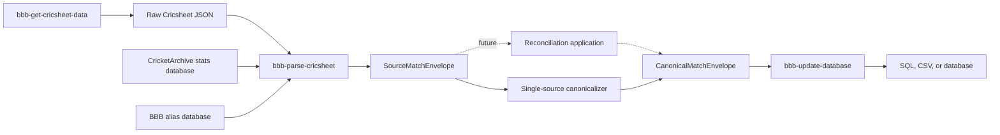

# Ball by Ball applications

## Scope

The repository contains command-line applications and shared libraries for retrieving,
normalizing, storing, and loading cricket ball-by-ball data:

| Module                  | Responsibility                                                                  |
|-------------------------|---------------------------------------------------------------------------------|
| `bbb-get-cricsheet-data`| Command-line entry point for retrieving raw Cricsheet data and player registers |
| `bbb-parse-cricsheet`   | Convert raw Cricsheet JSON into canonical-envelope JSON                         |
| `bbb-shared`            | Shared match schema, tiny types, utilities, and deterministic identity contracts|
| `bbb-update-database`   | Load canonical match envelopes into relational output (SQL, CSV, or JDBC)       |
| `bbb-bulkupdate`        | Bulk-load exported CSV files into supported databases (MariaDB, Postgres, etc.) |

The CLI parser and updater use `bbb-shared` for the source-neutral match
schema and identity models. Gradle module registration is kept in `settings.gradle.kts`,
and all versions are declared in `gradle/libs.versions.toml`.

### Normalized match-data workflow

The CLI data path is split into source retrieval, source adaptation, and relational loading:

`bbb-parse-cricsheet` owns the annotated Cricsheet input model and maps source
format/gender values to relational match types. `ParseCricsheetInput` carries a
single validated `ParseDirectoryLayout`, which `CricSheetParser` consumes. The
parser reads the CricketArchive stats database and ball-by-ball alias database
through separate JDBC connections created by `StatsMatchLinker.fromConnections`.
The linker returns sealed `StatsLinkResult` values: `Linked`, `NotFound`,
`Ambiguous`, `InvalidAlias`, or `Skipped`. The parser maps expected outcomes at
the per-file boundary; infrastructure failures are recorded as per-file
failures.

Match linking first queries policy-adjusted stats names and date. On an exact
miss, aliases are resolved using raw Cricsheet source names and the
provider-namespace UUID `f3c879d8-6d5c-5f33-9c7f-4f6c2dcff18b` as
`team_name_aliases.source_system`. This alias key is distinct from
`ProviderId` `"cricsheet"`, which identifies the provider in
`match_source_reference`. Validated target IDs are resolved through the
preloaded team index and combined with stats-name IDs into an alias candidate,
preserving home/away interchangeability. A margin-constrained `NotFound` is
then evaluated without the margin. If all exact-primary-date attempts return
`NotFound`, the linker tries exact dates one day before, one day after, two days
before, then two days after the primary Cricsheet date, trying the original
margin before a plain lookup on each alternate date. The first `Linked`,
`Ambiguous`, or `InvalidAlias` result stops the cascade; SQL matches exact
`MatchStartDate` values in the batch rather than applying fuzzy date matching,
and policy-skipped matches do not enter lookup.

The JDBC stats repository loads `Teams` once when it is created and resolves
team names and stats IDs to internal `Teams.Id` values in memory. It fetches
candidate matches for the primary date and ordered ±1/±2 fallbacks in one
set-based query for the exact teams, and at most one additional query for alias
candidates; margin, date priority, and exact-before-alias ranking are applied
in memory. Positive alias lookups are cached for the repository lifetime, but
empty results are not cached so newly added aliases remain visible. The
CricketArchive stats schema has no index on `Matches.MatchStartDate`; operators
can consider adding `Matches(MatchStartDate, HomeTeamId, AwayTeamId)` to support
the batched date/team lookup. This repository does not modify the external
stats database schema. `sourceCaId` is optional CricketArchive enrichment in
the otherwise source-neutral payload and remains null for skipped or unlinked
matches. Final expected link failures fail that file but still write its
normalized envelope with a null `sourceCaId`.

`TeamNamePolicy` owns female stats-name shaping and reads
`policies/female-competition-exceptions.txt` and
`policies/female-team-exceptions.txt`. Link exclusions are owned by
`StatsMatchLinkPolicy`; `policies/stats-all-season-exclusions.txt` and
`policies/stats-season-exclusions.txt` are the authoritative sources. Keep
exclusion values in those resources rather than duplicating them in this guide.
`bbb-shared` contains the
normalized payload with Kotlin-compatible camelCase property names and the
versioned source/canonical envelopes. The adapter hashes exact raw bytes,
derives a provider-scoped UUIDv5 from the safe basename stem (including keys
such as `wi_201706`), and omits Cricsheet-only `meta`. The current explicit
single-source canonicalizer adds a stable canonical UUID and merge evidence; a
future reconciliation application will replace this promotion step when
multiple providers are available. The updater consumes canonical envelopes
only.

The parser requires an absolute `--base-directory` plus safe relative
`--input` and `--output` directories, a stats JDBC URL, and a ball-by-ball JDBC
URL. It recursively mirrors JSON files and atomically replaces managed parsed
outputs, preserving unrelated files. Every successfully converted file is
written under `--output`, even when lookup fails; the unlinked envelope has a
null `sourceCaId`, while the lookup failure is still logged and makes the run
non-zero. Conversion and output failures are logged, stale output for that
source is removed when possible, and later files continue. Operators add
aliases manually to `team_name_aliases(source_system, source_team_name,
stats_team_id)` and rerun the parser after a logged failure; parsing never
creates aliases.

Each dialect's `1__initial_tables.sql` migration creates the alias table with
a unique key across `(source_system, source_team_name, stats_team_id)`. The
application does not maintain dialect-specific alias migration files; operators
seed their aliases directly in the database. When rebuilding a MariaDB or
PostgreSQL database with generated SQL, the script seeds the 48 baseline
Cricsheet team aliases using `INSERT IGNORE` or `ON CONFLICT DO NOTHING`,
keeping operator-added aliases intact. SQLite scripts do not embed seed aliases;
the shared `1__initial_tables.sql` migration provides them.

`bbb-get-cricsheet-data` downloads either all Cricsheet data or nightly update
archives. Both modes download and validate the register CSV files, validate
the downloaded artifacts, and extract match JSON into local directories. It
uses the JDK HTTP client with an injectable transport seam for deterministic tests.

## Relational loader architecture

`bbb-update-database` parses canonical match envelopes and writes normalized
rows to SQL scripts, CSV files, or JDBC database connections:

- `RelationalMatchSession` coordinates domain entity operations with transactional
  staging.
- `MatchTransaction` manages atomic per-match boundaries. In SQL, prepared
  statements are written to the script stream. In CSV, lines are appended to
  buffer sinks. In JDBC, batch inserts run within a connection transaction.
- `CsvBundlePublisher` provides atomic directory replacement for CSV output.
- `JdbcIdentityStore` tracks and resolves surrogate keys during live relational
  loading.

SQL script output selected with `-o`/`--outputFile` or `-sf`/`--sqlFile` is
resolved relative to the configured base directory. Nested paths are allowed,
while absolute paths and paths that escape the base directory are rejected.
CSV output selected with `-cd`/`--csvDir` follows the same base-directory
relative path contract. A non-empty output directory is refused unless the
operator supplies `--force`; explicit force replaces existing contents.

`Database` retains the `OutputAdapter` port. JDBC, SQL-script, and CSV adapters
inherit common domain forwarding from `SessionBackedOutputAdapter` and compose
one `MatchTransaction` from relational identity and sink snapshot hooks.
`JdbcOutputAdapter` supplies a live `JdbcIdentityStore` and `JdbcRowSink`; JDBC
owns `Connection.commit()` at the adapter boundary. Closing an active match
transaction rolls it back; CSV only publishes pending output on explicit commit.
After a successful SQL-script import, the application calls `complete()`,
which appends `COMMIT;` and publishes the completed script. SQL-script `close()`
does not publish: it rolls back an active match if needed and abandons staged
output, deleting the staged file when no publication journal is pending.

Generated SQL scripts support `mariadb`, `postgres`, and `sqlite`. The CLI
rejects `mysql` for generated scripts because MariaDB DDL is not guaranteed to
work on MySQL 8. This is separate from the Flyway files under
`bbb-update-database/migrations/mysql/` and direct `jdbc:mysql:` connections.

## Tiny types and identity contracts

The application enforces strong typing using Kotlin inline value classes (`@JvmInline value class`):
- `PublicMatchId`: Ten-digit numeric identifier derived deterministically from the canonical match UUID.
- `CanonicalMatchId`: Stable UUID identifying the real-world match.
- `SourceRecordId`: Provider-scoped UUID identifying the source provider's record.
- `Sha256Digest`: Exact lowercase 64-character SHA-256 digest of source bytes.
- `SourceCaId`: Optional CricketArchive identifier from stats match linking.
- `ProviderId`: Identifier for the data provider (e.g. `cricsheet`).

Boundary validation uses Arrow's `Raise` and `Either` DSL. All value classes declare
private constructors and companion factory methods (`invoke` with `Raise`, `of`
returning `Either`, and `from` for validated internal mapping).
